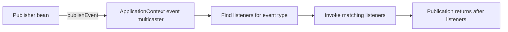

An application often needs to react to something that has already happened, reuse an expensive read result, or perform work at a later time. Spring provides lightweight application events, a cache abstraction, and scheduled-task support. These features simplify wiring, but they do not automatically provide durable messaging, correct cache invalidation, or cluster-wide job coordination.

This lesson uses Spring Framework 7.0.10 documentation and Java 21 examples. The repository does not include Spring dependencies or a cache provider; code is instructional rather than locally compiled or run.

## Application events

`ApplicationEventPublisher` lets one Spring bean publish an event without directly depending on every listener. With typed events, the event is an ordinary application object:

```java
public record OrderCreatedEvent(long orderId, Instant createdAt) {
}

@Service
class OrderService {
    private final ApplicationEventPublisher events;
    private final OrderRepository orders;

    OrderService(ApplicationEventPublisher events, OrderRepository orders) {
        this.events = events;
        this.orders = orders;
    }

    @Transactional
    Order create(CreateOrder command) {
        Order saved = orders.save(Order.from(command));
        events.publishEvent(
                new OrderCreatedEvent(saved.id(), Instant.now()));
        return saved;
    }
}
```

Listeners can subscribe by event type:

```java
@Component
class OrderMetricsListener {
    @EventListener
    void recordCreation(OrderCreatedEvent event) {
        // Record an in-process metric using the event's safe fields.
    }
}
```

By default, the standard application event multicaster invokes listeners synchronously on the publishing thread. A slow listener therefore increases the publishing operation's latency, and an uncaught listener failure can affect event publication. Configuring asynchronous listeners or a task executor changes threading and failure/ordering behavior; it does not make the event durable.

The basic sequence is:



The diagram represents the default synchronous path, where matching listeners run on the publisher's thread. If asynchronous execution is configured, listeners may complete later, and the publisher cannot assume they have finished when `publishEvent` returns.

### Events and transaction outcomes

If a listener should run only after a database transaction commits, use `@TransactionalEventListener`:

```java
@Component
class OrderReceiptListener {
    @TransactionalEventListener(phase = TransactionPhase.AFTER_COMMIT)
    void sendReceipt(OrderCreatedEvent event) {
        // Trigger receipt work after a successful transaction commit.
    }
}
```

`AFTER_COMMIT` is the default phase; other phases include `BEFORE_COMMIT`, `AFTER_ROLLBACK`, and `AFTER_COMPLETION`. Without an active transaction, a transactional listener is not invoked unless `fallbackExecution` is enabled. A transaction-bound in-process event is still not a durable queue: the process can fail after commit but before the listener finishes. For work that must survive process failure, use durable messaging or an outbox pattern and make downstream handling idempotent.

## Method-result caching

Spring's cache abstraction separates cache declarations from the provider that stores entries. Enable annotation-driven caching and choose a `CacheManager`/provider appropriate to the deployment:

```java
@Configuration
@EnableCaching
class CacheConfiguration {
}
```

`@Cacheable` returns a cached result when the same cache key is present; otherwise, the method executes and its result is stored. Use a key that represents every input affecting the result:

```java
@Service
class ProductCatalog {
    private final ProductRepository products;

    ProductCatalog(ProductRepository products) {
        this.products = products;
    }

    @Cacheable(cacheNames = "products", key = "#productId")
    ProductView findById(long productId) {
        return products.findViewById(productId)
                .orElseThrow(() -> new ProductNotFoundException(productId));
    }
}
```

`@CacheEvict` removes entries and `@CachePut` updates a cache entry while still invoking the method. A common pattern is to evict the affected key after a successful update:

```java
@CacheEvict(cacheNames = "products", key = "#productId")
ProductView update(long productId, UpdateProduct command) {
    return products.update(productId, command);
}
```

These are illustrative service methods; repository and DTO types are application-defined. For operations that affect a collection of cached entries, evict the relevant entries deliberately; `allEntries = true` clears the entire named cache and may cause a broad cache miss spike.

Caching annotations are applied through Spring's caching infrastructure, commonly using proxies. Self-invocation inside the same bean does not cross the proxy and therefore may bypass cache advice. A cache entry can also become stale if its key omits a meaningful input, its mutation path fails to evict it, or multiple application instances use uncoordinated local caches.

The Spring abstraction does not define a universal expiration policy or distributed consistency guarantee. Configure TTL, maximum size, serialization, eviction, and provider-specific behavior in the chosen cache implementation. Cache only data whose correctness can tolerate the resulting staleness window, and ensure the key includes tenant, locale, authorization context, or other dimensions when they affect the returned value. Avoid placing sensitive data in a cache without appropriate access and retention controls.

## Scheduled tasks and cron expressions

Enable scheduled-task processing with `@EnableScheduling`. A scheduled method can use a fixed delay, fixed rate, or cron trigger:

```java
@Configuration
@EnableScheduling
class SchedulingConfiguration {
}

@Component
class ReconciliationJob {
    private final ReconciliationService reconciliation;

    ReconciliationJob(ReconciliationService reconciliation) {
        this.reconciliation = reconciliation;
    }

    @Scheduled(cron = "0 0 2 * * *", zone = "UTC")
    void reconcileDaily() {
        reconciliation.reconcile();
    }
}
```

Spring cron expressions have six fields: second, minute, hour, day of month, month, and day of week. The expression above runs at 02:00:00 UTC each day. Specify a zone when the schedule is tied to a civil time; daylight-saving transitions can otherwise change when a local-time task runs.

Use fixed delay when the wait period should begin after the previous invocation completes; use fixed rate when starts should be spaced according to a target interval. Configure a scheduler with deliberate pool capacity for concurrent scheduled work; do not assume that a scheduled method runs on a dedicated thread or that a long task cannot delay other work.

`@Scheduled` registers a trigger inside the current application process. In a horizontally scaled service, each replica normally registers the same schedule and may execute the job. If exactly one execution across replicas is required, use a distributed coordination/locking mechanism or a scheduler designed for clustering. Also design jobs to tolerate retries, restarts, partial completion, and repeated execution; a cron trigger is not an exactly-once guarantee.

## Common failure modes

- **A listener blocks a request:** The default event listener runs synchronously; move genuinely slow work to a deliberate asynchronous or durable processing mechanism.
- **A listener misses an event:** Check event type, listener bean registration, active transaction phase, and whether an event was published before rollback.
- **An after-commit action is lost on crash:** Transaction-bound events are not durable delivery; use an outbox or message broker for critical follow-up work.
- **Cached values are stale:** Audit every write path, cache key dimensions, TTL, and provider topology; explicitly evict or update affected entries.
- **Caching advice does not run:** Ensure caching is enabled, the bean is managed by Spring, and the method call crosses the caching proxy.
- **A task runs multiple times in production:** Check replica count and duplicated bean registration; coordinate work across instances where required.
- **Tasks overlap or block one another:** Review execution time, cron triggers, scheduler pool configuration, and repeatable schedule declarations.
- **A cron fires at the wrong local time:** Set the `zone` attribute intentionally and account for daylight-saving changes.

## Further reading

- Spring Framework 7.0.10, [Application Events](https://docs.spring.io/spring-framework/reference/core/beans/context-introduction.html#context-functionality-events)
- Spring Framework 7.0.10, [`SimpleApplicationEventMulticaster`](https://docs.spring.io/spring-framework/docs/7.0.10/javadoc-api/org/springframework/context/event/SimpleApplicationEventMulticaster.html)
- Spring Framework 7.0.10, [Transaction-bound Events](https://docs.spring.io/spring-framework/reference/data-access/transaction/event.html)
- Spring Framework 7.0.10, [Declarative Caching](https://docs.spring.io/spring-framework/reference/integration/cache/annotations.html)
- Spring Framework 7.0.10, [Task Execution and Scheduling](https://docs.spring.io/spring-framework/reference/integration/scheduling.html)
- [Spring Data JPA](./spring-data-jpa)
