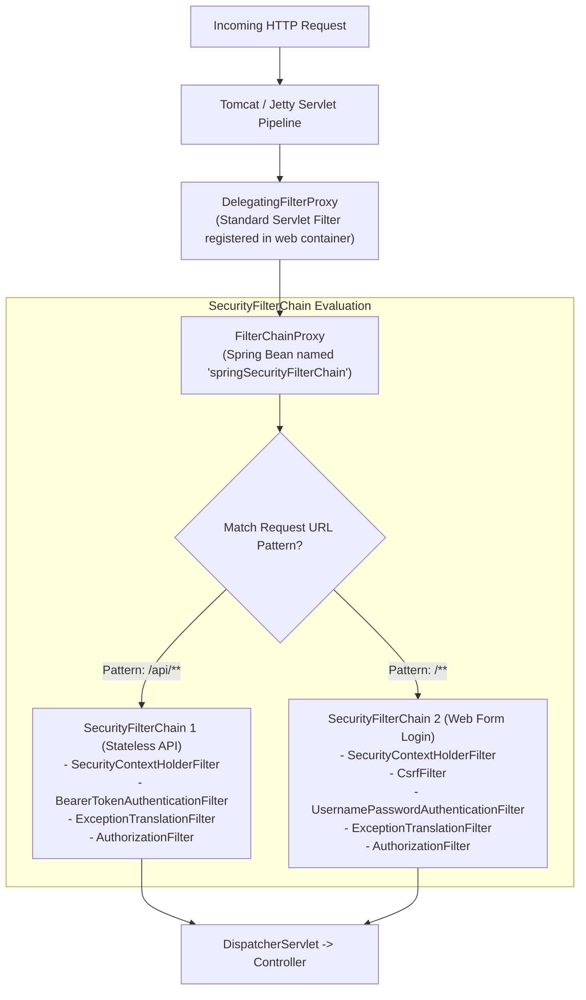
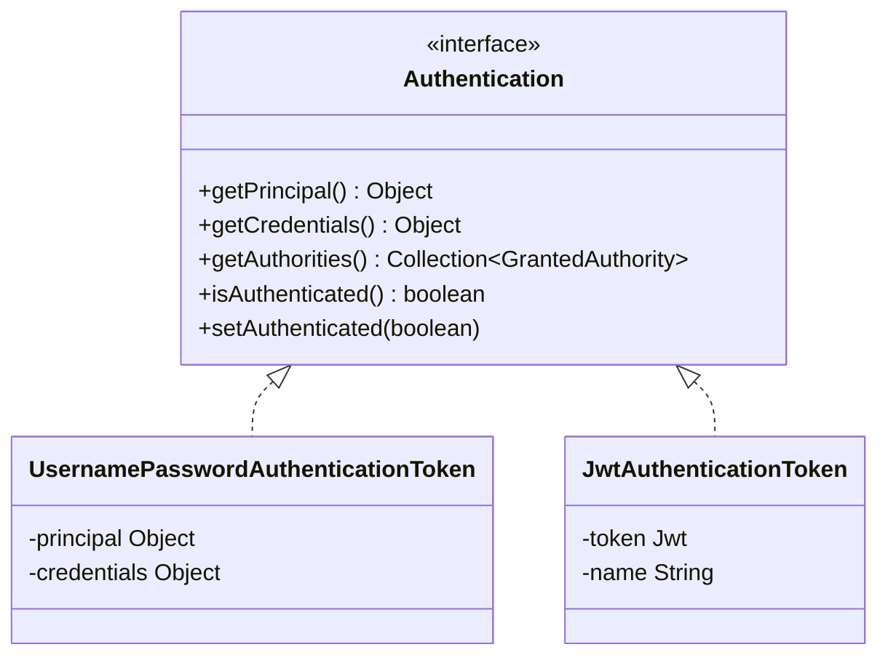
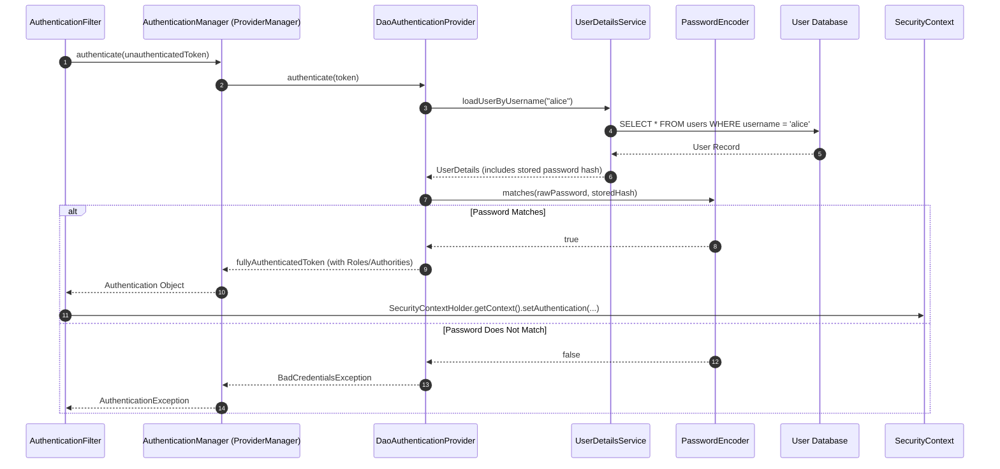
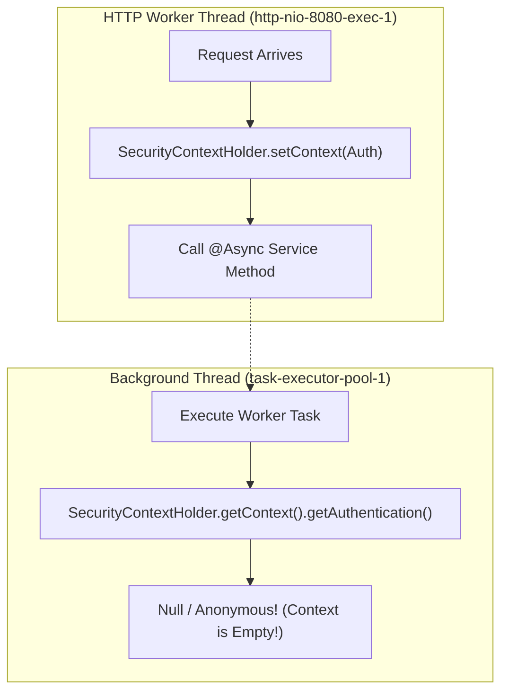
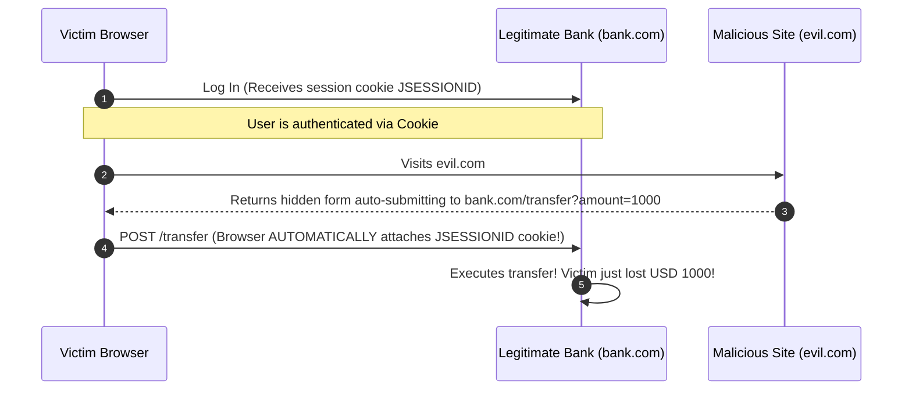

Security is often the most feared subsystem in enterprise Java. Many developers treat Spring Security as an impenetrable labyrinth of obscure filters and magic XML/DSL configurations. When something breaks, they resort to StackOverflow cargo-culting—copying `.csrf(csrf -> csrf.disable())` and `.permitAll()` until the red 403 errors stop, completely unaware that they just tore down their application's entire perimeter defense.

Spring Security is not magic. At its core, it is an exquisitely structured chain of standard Java Servlet Filters acting as an interceptor pipeline, coupled with an extensible authentication strategy and a declarative authorization engine.

In this guide, we will trace the journey of an HTTP request through Spring Security's internal filter chain, demystify the authentication provider hierarchy, conquer role-based versus permission-based access control, and implement battle-hardened defenses against the OWASP Top 10.

---

## The Filter Pipeline: From Servlet Container to Spring Context

How does a web server like Tomcat or Jetty (which knows nothing about Spring beans) delegate security decisions to Spring's `ApplicationContext`? The bridge is `DelegatingFilterProxy`.



### The Architectural Hand-Off
1. **The Servlet Container**: Tomcat receives an incoming HTTP request and invokes its standard `javax.servlet.Filter` chain.
2. **`DelegatingFilterProxy`**: A standard servlet filter that contains zero security logic. Its sole purpose is to look up a Spring bean named `springSecurityFilterChain` inside the Spring `ApplicationContext` and delegate all calls to it.
3. **`FilterChainProxy`**: The true nerve center of Spring Security. It manages a list of `SecurityFilterChain` beans. When a request arrives, it evaluates the request URI against each chain's `RequestMatcher` and selects the **first matching chain**.
4. **`SecurityFilterChain`**: An ordered list of security filters (typically 12 to 15 filters) that execute sequentially. If any filter rejects the request (e.g., bad credentials or missing CSRF token), the chain halts immediately and returns an HTTP 401 or 403 response without ever reaching `DispatcherServlet`.

---

## Authentication vs Authorization

Mixing up authentication and authorization is the root cause of many flawed security designs.

- **Authentication (AuthN)**: *"Who are you?"* The process of verifying a claimed identity using credentials (passwords, JWT tokens, API keys, certificates).
- **Authorization (AuthZ)**: *"What are you allowed to do?"* Deciding whether the already-authenticated identity has permission to perform a specific action on a specific resource.

### The Authentication Object Hierarchy
Once authenticated, Spring represents the caller with an `Authentication` instance:



- **`Principal`**: The user identity, usually an instance of `UserDetails` or a string username.
- **`Credentials`**: The secret proof of identity (password or token). In high-security systems, Spring wipes credentials from memory once authentication succeeds.
- **`Authorities`**: The granted permissions (`Collection<GrantedAuthority>`), such as `ROLE_ADMIN` or `order:read`.

---

## The Authentication Engine: `AuthenticationManager`

When a user submits credentials (e.g., via a JSON login payload or HTTP Basic auth), how does Spring verify them against a database?



### Password Storage: `DelegatingPasswordEncoder`
Never store passwords in plain text or using outdated algorithms like MD5 or SHA-256 (which can be cracked at billions of hashes per second using commodity GPUs).

Spring Security uses `DelegatingPasswordEncoder`, which prefixes stored password hashes with the algorithm identifier:
- `{bcrypt}` prefix followed by the standard BCrypt hash string
- `{argon2}` prefix followed by the standard Argon2 parameters and hash string

This allows seamless, zero-downtime upgrades of password hashing algorithms across an existing user base.

```java
package com.example.ecommerce.security;

import org.springframework.context.annotation.Bean;
import org.springframework.context.annotation.Configuration;
import org.springframework.security.crypto.factory.PasswordEncoderFactories;
import org.springframework.security.crypto.password.PasswordEncoder;

@Configuration
public class SecurityBeansConfig {

    @Bean
    public PasswordEncoder passwordEncoder() {
        // Defaults to BCrypt with adaptive cost factor
        return PasswordEncoderFactories.createDelegatingPasswordEncoder();
    }
}
```

---

## Modern `SecurityFilterChain` Configuration

In modern Spring Security 6 / Spring Boot 3+, the legacy `WebSecurityConfigurerAdapter` is completely removed. Configuration is declared via `@Bean SecurityFilterChain`:

```java
package com.example.ecommerce.security;

import org.springframework.context.annotation.Bean;
import org.springframework.context.annotation.Configuration;
import org.springframework.http.HttpMethod;
import org.springframework.security.config.Customizer;
import org.springframework.security.config.annotation.method.configuration.EnableMethodSecurity;
import org.springframework.security.config.annotation.web.builders.HttpSecurity;
import org.springframework.security.config.annotation.web.configuration.EnableWebSecurity;
import org.springframework.security.config.http.SessionCreationPolicy;
import org.springframework.security.web.SecurityFilterChain;

@Configuration
@EnableWebSecurity
@EnableMethodSecurity // Enables @PreAuthorize, @PostAuthorize
public class WebSecurityConfig {

    @Bean
    public SecurityFilterChain apiSecurityFilterChain(HttpSecurity http) throws Exception {
        return http
            // 1. Configure URL authorization rules (top-to-bottom order matters!)
            .authorizeHttpRequests(auth -> auth
                .requestMatchers("/api/v1/public/**", "/actuator/health").permitAll()
                .requestMatchers(HttpMethod.GET, "/api/v1/products/**").permitAll()
                .requestMatchers("/api/v1/admin/**").hasRole("ADMIN")
                .anyRequest().authenticated()
            )
            // 2. Stateless session management for REST APIs
            .sessionManagement(session -> session
                .sessionCreationPolicy(SessionCreationPolicy.STATELESS)
            )
            // 3. Disable CSRF for purely stateless token-based APIs
            .csrf(csrf -> csrf.disable())
            // 4. Enable HTTP Basic authentication for testing/administrative access
            .httpBasic(Customizer.withDefaults())
            .build();
    }
}
```

> [!IMPORTANT]
> **Declaration Order Matters in URL Matchers!**  
> Spring Security evaluates rules in the exact order they are defined. If you put `.anyRequest().authenticated()` before `.requestMatchers("/public/**").permitAll()`, your public endpoint will be blocked because the first matching rule wins! Always define rules from most specific to least specific.

---

## Role-Based vs Permission-Based Authorization

Spring Security makes an important distinction between **Roles** and **Authorities**:

- `hasRole('ADMIN')` automatically checks for a `GrantedAuthority` with the prefix `ROLE_` (it looks for `ROLE_ADMIN` in the security context).
- `hasAuthority('order:write')` checks for the exact raw string without prepending any prefix.

Senior engineering teams prefer **Permission-Based Access Control (PBAC)** over coarse roles. Instead of checking if someone is an `ADMIN`, check if they have permission to perform the specific business action (`invoice:delete`). This allows administrators to construct custom roles dynamically without modifying application code.

---

## Method Security and Preventing IDOR Vulnerabilities

Securing URL paths at the perimeter is essential, but URL-level security cannot prevent **Insecure Direct Object References (IDOR)**.

### The IDOR Vulnerability Explained
Consider this controller endpoint:
```java
@GetMapping("/api/v1/invoices/{id}")
public InvoiceResponse getInvoice(@PathVariable UUID id) {
    return invoiceService.getInvoice(id);
}
```
If your security rule is `.requestMatchers("/api/v1/invoices/**").hasRole("CUSTOMER")`, then *any* authenticated customer can pass any invoice UUID in the URL and read invoices belonging to competing customers!

### The Solution: `@PreAuthorize` with Custom Security Evaluators

First, activate method security by adding `@EnableMethodSecurity` to your configuration. Then, write a dedicated security bean to enforce data ownership:

```java
package com.example.ecommerce.security;

import com.example.ecommerce.repository.InvoiceRepository;
import org.springframework.security.core.Authentication;
import org.springframework.stereotype.Component;

import java.util.UUID;

@Component("invoiceSecurity")
public class InvoiceSecurityEvaluator {

    private final InvoiceRepository invoiceRepository;

    public InvoiceSecurityEvaluator(InvoiceRepository invoiceRepository) {
        this.invoiceRepository = invoiceRepository;
    }

    public boolean isOwner(Authentication authentication, UUID invoiceId) {
        if (authentication == null || !authentication.isAuthenticated()) {
            return false;
        }

        // Platform admins can view any invoice
        boolean isAdmin = authentication.getAuthorities().stream()
                .anyMatch(a -> a.getAuthority().equals("ROLE_ADMIN"));
        if (isAdmin) {
            return true;
        }

        String currentUsername = authentication.getName();
        return invoiceRepository.findOwnerUsernameById(invoiceId)
                .map(owner -> owner.equalsIgnoreCase(currentUsername))
                .orElse(false);
    }
}
```

Now attach the ownership check directly to your service or controller method:

```java
package com.example.ecommerce.service;

import com.example.ecommerce.dto.InvoiceResponse;
import org.springframework.security.access.prepost.PreAuthorize;
import org.springframework.stereotype.Service;

import java.util.UUID;

@Service
public class InvoiceService {

    @PreAuthorize("@invoiceSecurity.isOwner(authentication, #id)")
    public InvoiceResponse getInvoice(UUID id) {
        // Business logic executes ONLY if caller owns the invoice or is an admin
        return loadInvoice(id);
    }
}
```

---

## The ThreadLocal Trap: Asynchronous Security Context Loss

Spring Security stores the current user in `SecurityContextHolder`, which defaults to `ThreadLocal` storage (`MODE_THREADLOCAL`).



### Why `@Async` Loses Your Security Context
Because a new thread from the async task pool executes the background method, that thread's `ThreadLocal` is completely empty! Any attempt to read `SecurityContextHolder.getContext().getAuthentication()` inside an `@Async` method or a `CompletableFuture` returns `null`.

### The Solution: `DelegatingSecurityContextAsyncTaskExecutor`
Configure your `TaskExecutor` bean to propagate the security context to child worker threads automatically:

```java
package com.example.ecommerce.config;

import org.springframework.context.annotation.Bean;
import org.springframework.context.annotation.Configuration;
import org.springframework.core.task.TaskExecutor;
import org.springframework.scheduling.annotation.EnableAsync;
import org.springframework.scheduling.concurrent.ThreadPoolTaskExecutor;
import org.springframework.security.task.DelegatingSecurityContextAsyncTaskExecutor;

@Configuration
@EnableAsync
public class AsyncSecurityConfig {

    @Bean
    public TaskExecutor threadPoolTaskExecutor() {
        ThreadPoolTaskExecutor executor = new ThreadPoolTaskExecutor();
        executor.setCorePoolSize(10);
        executor.setMaxPoolSize(50);
        executor.setThreadNamePrefix("async-sec-");
        executor.initialize();

        // Wraps Runnable/Callable to propagate SecurityContext automatically
        return new DelegatingSecurityContextAsyncTaskExecutor(executor);
    }
}
```

---

## CSRF Protection: When to Keep It and When to Disable It

Cross-Site Request Forgery (CSRF) is an attack where a malicious website tricks a user's browser into sending an authenticated request to your web application using the user's ambient session cookie.



### When Can You Safely Disable CSRF?
You can safely disable CSRF (`csrf.disable()`) **only if** both conditions are met:
1. Your API is purely stateless (`SessionCreationPolicy.STATELESS`).
2. Authentication credentials are sent via the `Authorization: Bearer <token>` header, **not via browser cookies**.

Because browsers *never* automatically attach custom `Authorization` headers to cross-origin requests, CSRF attacks are impossible against pure Bearer-token REST APIs.

However, if your REST API stores authentication tokens inside an `HttpOnly` cookie, **you must keep CSRF protection enabled** (using Spring's `CookieCsrfTokenRepository.withHttpOnlyFalse()`).

---

## Architectural Traps and Real-World Outages

### The "Shadowed Admin Endpoint" Security Breach
A healthcare startup configured their security filter chain as follows:
```java
.authorizeHttpRequests(auth -> auth
    .requestMatchers("/**").permitAll()
    .requestMatchers("/api/admin/**").hasRole("ADMIN")
)
```
The developer assumed Spring Security evaluated all rules and applied the most restrictive one. In reality, Spring evaluates rules in top-to-bottom declaration order. Because `/**` was declared first, every single incoming request matched `permitAll()`. The `/api/admin/**` rule was completely unreachable, leaving their admin panel exposed to the public internet for three weeks until a penetration test discovered it.

### The Self-Invocation Method Security Bypass
A developer annotated a sensitive method with `@PreAuthorize`:
```java
@Service
public class UserService {

    public void updateProfile(UUID userId, ProfileDto dto) {
        // Direct internal call bypasses Spring Security's CGLIB proxy!
        this.deleteInternalRecords(userId);
    }

    @PreAuthorize("hasRole('ADMIN')")
    public void deleteInternalRecords(UUID userId) {
        // Sensitive operation
    }
}
```
When an unprivileged regular user updated their profile, `updateProfile` directly called `this.deleteInternalRecords(userId)`. Because the call was made within the same class instance, it bypassed the Spring Security method proxy interceptor, allowing regular users to execute admin-only logic!

---

## Senior Interview Questions

### Question 1: How does `SecurityContextHolder` store the `SecurityContext`, and how does this impact virtual threads in Java 21?
**Answer:**  
`SecurityContextHolder` uses a strategy pattern (`SecurityContextHolderStrategy`). The default strategy is `MODE_THREADLOCAL`, which stores the `SecurityContext` in a standard Java `ThreadLocal` bound to the operating system carrier thread.

In Java 21 with Project Loom (Virtual Threads), millions of virtual threads can be mounted and unmounted across a small pool of carrier threads. While virtual threads have their own isolated `ThreadLocal` variables (so security context data is not corrupted across virtual threads), allocating heavy objects inside `ThreadLocal` across millions of virtual threads can cause memory bloat. Furthermore, if virtual threads spawn child virtual threads (e.g., via Structured Concurrency), child threads do not inherit `ThreadLocal` data unless `MODE_INHERITABLETHREADLOCAL` or Scoped Values are used.

### Question 2: What is the exact difference between `AuthenticationEntryPoint` and `AccessDeniedHandler` in Spring Security?
**Answer:**  
- **`AuthenticationEntryPoint`**: Invoked when an unauthenticated client attempts to access a protected resource (corresponds to **HTTP 401 Unauthorized**). Its job is to trigger the authentication challenge (e.g., redirecting to a login page or sending a `WWW-Authenticate: Bearer` response header).
- **`AccessDeniedHandler`**: Invoked when a client is already fully authenticated, but lacks the necessary roles or authorities to access the resource (corresponds to **HTTP 403 Forbidden**). Its job is to render a custom forbidden error page or RFC 9457 Problem Detail.

Both are orchestrated by Spring Security's `ExceptionTranslationFilter`.

### Question 3: Why was `WebSecurityConfigurerAdapter` deprecated and subsequently removed in Spring Security 6?
**Answer:**  
`WebSecurityConfigurerAdapter` relied heavily on object inheritance and mutable state configuration through method overriding (`configure(HttpSecurity http)`). This design had several major drawbacks:
1. It made it difficult to configure multiple independent `SecurityFilterChain` instances cleanly for different URL patterns (e.g., public API vs admin portal vs OAuth2 callbacks).
2. It violated modern Spring component design principles favouring composition and declarative `@Bean` registrations.
3. Component-based configuration (`@Bean SecurityFilterChain`) allows Spring Boot to inspect, compose, and test individual filter chains in isolation without instantiating an entire monolithic security adapter.

### Question 4: How does Spring Security protect against timing attacks during password verification?
**Answer:**  
In simple string comparisons (`password.equals(storedHash)`), the comparison terminates early on the first mismatched character. An attacker measuring request response latencies with microsecond precision could infer characters of a password hash one by one.

Spring Security's `PasswordEncoder` implementations (like `BCryptPasswordEncoder`) use constant-time byte comparisons (`MessageDigest.isEqual()`). Regardless of whether the first character or the last character fails, the comparison always executes the exact same number of operations and takes identical execution time, eliminating timing side-channel vulnerabilities.
