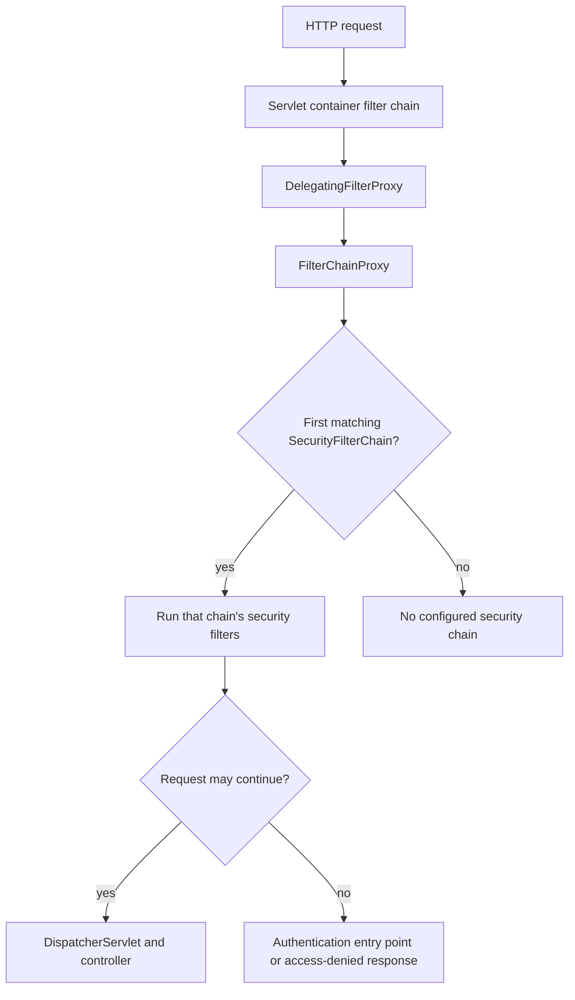

Security decisions are easiest to reason about when authentication and authorization have clear boundaries. In a Spring servlet application, requests pass through a chain of security filters before reaching MVC. Those filters can establish an authenticated principal, reject a request, or delegate to authorization rules. Knowing the components helps diagnose why a request is redirected, rejected, or allowed.

This lesson follows the Spring Security 7 reference documentation and Java 21 examples. The repository does not include Spring Security dependencies; snippets are instructional rather than compiled or run here.

## The servlet request path

Spring Security integrates with the servlet container through `DelegatingFilterProxy`, which delegates to Spring's `FilterChainProxy`. The proxy chooses a matching `SecurityFilterChain`; that chain contains filters for applicable security concerns. A request that passes the chain continues to the servlet and Spring MVC:



In a normally configured application, ensure all request paths are covered by an intended chain; an unmatched request does not automatically mean Spring Security will protect it. When multiple chains are defined, chain matchers and their order determine which configuration applies. A chain for a specialized API path must not accidentally shadow or leave uncovered the application's other paths.

Within a chain, filters commonly handle security-context loading, authentication mechanisms, CSRF, exception translation, and authorization. Filter order matters: a failure may happen before controller code runs. Use Spring Security's supported configuration DSL rather than manually registering a competing servlet filter for the same concern.

## Authentication is not authorization

**Authentication** establishes who or what is making the request. **Authorization** decides whether that authenticated identity may perform a particular action on a particular resource. A valid login does not itself grant access to every route or object.

An authenticated identity is represented by an `Authentication` object, which can carry a principal, credentials during authentication, and `GrantedAuthority` values. After authentication, Spring associates the result with a `SecurityContext`, typically accessed through `SecurityContextHolder`. In servlet applications the holder commonly uses thread-bound context; asynchronous work must not assume that security state is automatically available in another execution context.

For username/password authentication, a simplified provider flow is:

1. An authentication filter extracts submitted credentials and creates an unauthenticated authentication request.
2. The filter delegates to an `AuthenticationManager` (commonly `ProviderManager`).
3. A supporting `AuthenticationProvider`, such as `DaoAuthenticationProvider`, obtains user details from `UserDetailsService`.
4. The provider checks the submitted password using a `PasswordEncoder`.
5. On success, the authenticated result and its authorities are placed in the security context; failures are handled by the configured authentication entry point or failure handler.

Do not log submitted credentials or return detailed account-existence information in login errors. Authentication endpoints also need appropriate rate limiting and monitoring.

## User details and password encoders

`UserDetailsService` loads a user record and its authorities for username/password authentication. It is not itself a password checker or a complete authentication mechanism; `DaoAuthenticationProvider` coordinates user loading and password verification.

Passwords must not be stored in plaintext or with a fast general-purpose hash such as plain SHA-256. `PasswordEncoder` uses a one-way adaptive password hashing scheme such as bcrypt, PBKDF2, scrypt, or Argon2. Tune the work factor on deployment hardware and plan upgrades as the available cost parameters change. Spring Security's `DelegatingPasswordEncoder` supports an encoded format with an algorithm identifier, which helps applications verify older stored formats and migrate hashes over time.

A configuration can provide an encoder and an authentication source without placing credentials in code:

```java
@Configuration
class AuthenticationConfiguration {
    @Bean
    PasswordEncoder passwordEncoder() {
        return PasswordEncoderFactories.createDelegatingPasswordEncoder();
    }

    @Bean
    UserDetailsService userDetailsService(AccountRepository accounts) {
        return username -> accounts.findForAuthentication(username)
                .orElseThrow(() -> new UsernameNotFoundException("User not found"));
    }
}
```

`AccountRepository` and the account-to-`UserDetails` mapping are application-specific. Provision users through a controlled registration or administrative process; never seed a real production password in source code. Keep authentication failure responses generic even if the internal exception distinguishes an unknown user from a wrong password.

## Request authorization with a SecurityFilterChain

Modern servlet configuration declares a `SecurityFilterChain` bean rather than extending a framework adapter:

```java
@Configuration
@EnableWebSecurity
class WebSecurityConfiguration {
    @Bean
    SecurityFilterChain applicationSecurity(HttpSecurity http) throws Exception {
        return http
                .authorizeHttpRequests(authorize -> authorize
                        .requestMatchers("/health").permitAll()
                        .requestMatchers("/admin/**").hasRole("ADMIN")
                        .anyRequest().authenticated())
                .formLogin(Customizer.withDefaults())
                .build();
    }
}
```

This example intentionally retains Spring Security's CSRF protection. `hasRole("ADMIN")` is a convenience for an authority named `ROLE_ADMIN`; `hasAuthority("invoice:read")` checks the exact authority string. Match rules are evaluated in declaration order, so put specific rules before broader matchers. A public health route should expose only health information that is safe to disclose.

The login mechanism should fit the client and deployment model. Form login commonly uses a browser session; APIs may use other authentication mechanisms such as a bearer token. Do not disable CSRF solely because an endpoint returns JSON: if browsers automatically attach session cookies, cross-site requests can still be a risk. CSRF decisions depend on how credentials are transported and whether the browser sends them automatically.

## Method authorization and RBAC

Request-level rules provide a useful perimeter, but critical authorization belongs close to the operation that protects the data. Spring method security can use annotations such as `@PreAuthorize`:

```java
@Configuration
@EnableMethodSecurity
class MethodSecurityConfiguration {
}

interface InvoiceOperations {
    @PreAuthorize("hasRole('FINANCE')")
    InvoiceView findInvoice(long invoiceId);
}
```

`@EnableMethodSecurity` activates method security; `@PreAuthorize` evaluates its expression before the method invocation. The interface is an abbreviated contract; the application supplies its Spring-managed implementation. That implementation must also enforce resource-level ownership rules. Role-based access control (RBAC) grants permissions through roles such as `FINANCE`, while fine-grained authorities can express capabilities such as `invoice:read`.

A role check alone does not prevent insecure direct object reference (IDOR). If users may access only invoices belonging to their organization, the operation must also check ownership/tenant membership for the requested `invoiceId`. Put that decision in a policy/service that has the necessary resource context, and deny by default when identity or ownership cannot be established.

Method security is proxy-based. A call from one method to another method on the same object using `this` may bypass the method-security proxy. Keep security-sensitive entry points on externally invoked Spring beans or structure the operation so protected calls pass through the proxy. Do not rely only on a controller annotation if the same service operation can be reached through another route, message listener, or scheduled job.

## Sessions, CSRF, and security context

Spring Security can persist a security context across requests using a session, or use a stateless authentication design where each request carries credentials. These models have different trade-offs and must be configured intentionally. A session cookie is automatically attached by a browser to matching requests, which is why cookie-based authentication is relevant to CSRF defense.

Spring Security protects unsafe HTTP methods with CSRF tokens by default in servlet configuration. Keep that protection for browser/session flows unless a documented threat analysis and architecture support a different approach. Stateless bearer-token APIs generally have a different CSRF exposure because browsers do not automatically attach an `Authorization: Bearer` header in the same way as ambient cookies; however, token placement, browser storage, CORS, and any cookie-based refresh mechanism still affect the threat model.

The `SecurityContextHolder` is a convenient access point for the current security context, not a substitute for passing required identity or authorization decisions into domain operations explicitly. Avoid caching authorization decisions across users or tenants without including all relevant identity and policy inputs.

## Troubleshooting denied requests

- **A request is redirected to a login page:** Check which `SecurityFilterChain` matched and whether form login is configured for that client path.
- **A request receives 401 or 403:** Distinguish missing/invalid authentication from an authenticated principal lacking authority; inspect the entry point, access-denied handler, and matched authorization rule.
- **A rule unexpectedly allows access:** Verify matcher order, chain order, path normalization, and whether a broad `permitAll` rule precedes a protected route.
- **`hasRole` never matches:** Confirm the granted authority's `ROLE_` prefix; use `hasAuthority` for an exact custom authority.
- **A method annotation seems ignored:** Confirm method security is enabled, the target is a Spring bean, and the invocation crosses the proxy rather than using self-invocation.
- **Login rejects a valid user:** Check the `UserDetailsService`, stored password encoding prefix, chosen `PasswordEncoder`, enabled/locked state, and authority mapping.
- **A browser POST fails with 403:** Check whether a CSRF token is required and whether the client sends it; do not disable CSRF as a debugging shortcut.
- **One user can read another user's record:** Add resource-level ownership or tenant authorization; route-level authentication is insufficient.

## Further reading

- Spring Security 7, [Servlet Architecture](https://docs.spring.io/spring-security/reference/servlet/architecture.html)
- Spring Security 7, [Servlet Authentication Architecture](https://docs.spring.io/spring-security/reference/servlet/authentication/architecture.html)
- Spring Security 7, [`DaoAuthenticationProvider`](https://docs.spring.io/spring-security/reference/servlet/authentication/passwords/dao-authentication-provider.html)
- Spring Security 7, [Password Storage](https://docs.spring.io/spring-security/reference/features/authentication/password-storage.html)
- Spring Security 7, [Java Configuration](https://docs.spring.io/spring-security/reference/servlet/configuration/java.html)
- Spring Security 7, [Method Security](https://docs.spring.io/spring-security/reference/servlet/authorization/method-security.html)
- Spring Security 7, [Cross Site Request Forgery](https://docs.spring.io/spring-security/reference/servlet/exploits/csrf.html)
- [Spring Events, Caching, & Scheduling](./spring-events-caching-scheduling)
