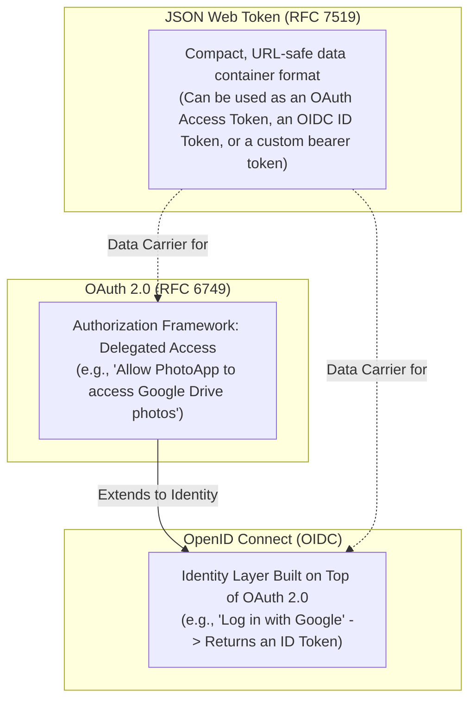
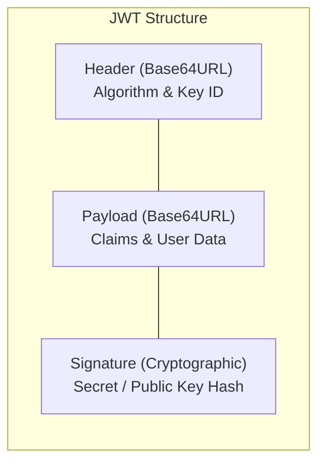
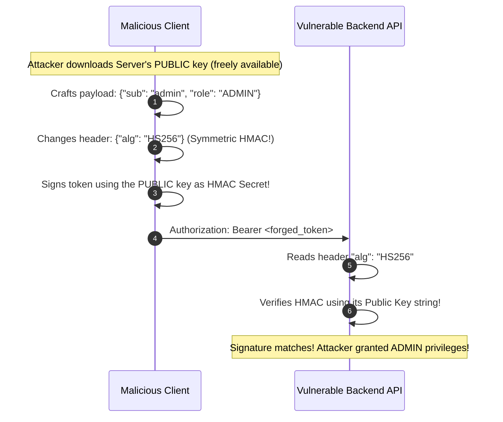
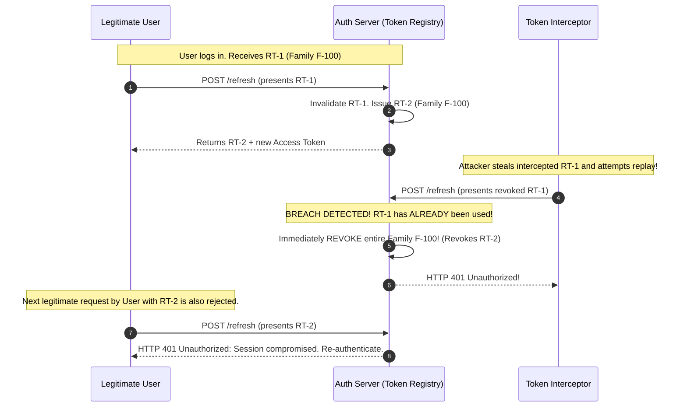

Few concepts in enterprise software development have generated as much confusion, flawed online tutorials, and catastrophic security breaches as the trifecta of **OAuth 2.0**, **OpenID Connect (OIDC)**, and **JSON Web Tokens (JWT)**.

Many developers believe that "going stateless with JWTs" means you simply slap a Base64-encoded string into `localStorage`, write a custom filter that splits strings on dots, and celebrate never needing a database session again. 

In production, naive JWT implementations introduce devastating vulnerabilities: un-revokable credentials, algorithm-confusion attacks, XSS credential harvesting, and zombie sessions where terminated employees retain access for weeks.

In this guide, we will untangle the identity standards, dissect JWT cryptographic internals, build a production-grade `OncePerRequestFilter` in Spring Security, and architect an enterprise-grade Refresh Token Rotation strategy with automatic replay detection.

---

## Untangling the Alphabet Soup: OAuth2 vs OIDC vs JWT

Before writing a single line of security code, we must establish rigorous definitions. These three terms are not interchangeable:



| Concept | Primary Purpose | Key Output | Metaphor |
|---|---|---|---|
| **OAuth 2.0** | **Authorization** (Delegated Access) | Access Token (opaque or JWT) | Hotel keycard: grants entry to Room 402, but doesn't say who you are. |
| **OpenID Connect** | **Authentication** (User Identity) | ID Token (always a JWT) | Driver's license / Passport: proves your identity and birthdate. |
| **JWT** | **Data Format** (Signed Claims) | `header.payload.signature` | The physical plastic card on which the claims are printed. |

> [!IMPORTANT]
> **ID Tokens vs Access Tokens**  
> An OIDC **ID Token** is meant *exclusively for the client application* to display user profile details ("Welcome back, Alice!"). An ID Token must **never** be sent to a backend API as an authorization credential. Backend APIs must only accept and validate **Access Tokens**.

---

## Anatomy of a JSON Web Token

A signed JSON Web Token (RFC 7519 / JWS RFC 7515) is composed of three distinct Base64URL-encoded JSON segments separated by periods:

```text
header.payload.signature
```



### The Header
Specifies the cryptographic algorithm used to sign the token and the key identifier:
```json
{
  "alg": "RS256",
  "typ": "JWT",
  "kid": "auth-key-2026-q1"
}
```

### The Payload (Claims)
Contains verifiable statements about the subject entity:
- **`iss` (Issuer)**: The authorization server that minted the token (e.g., `https://auth.company.com`).
- **`sub` (Subject)**: The unique immutable user identifier (UUID).
- **`aud` (Audience)**: The intended recipient API (e.g., `https://api.company.com/orders`).
- **`exp` (Expiration Time)**: Unix epoch timestamp after which the token is invalid.
- **`iat` (Issued At)**: When the token was created.
- **`jti` (JWT ID)**: Unique token identifier used to prevent replay attacks.
- **Custom Claims**: Application-specific attributes such as `roles: ["ROLE_ADMIN"]` or `tenantId: "TENANT-42"`.

> [!WARNING]
> **Base64URL Is NOT Encryption!**  
> Anyone who intercepts a JWT can paste it into `jwt.io` and read every single payload claim in plain text. Never place passwords, Social Security numbers, unencrypted credit cards, or internal infrastructure secrets inside a JWT payload.

### The Signature
The signature prevents tampering. It is computed by taking the Base64URL-encoded header, concatenating a dot and the Base64URL-encoded payload, and signing the resulting bytes:

```text
RSASHA256(
  base64UrlEncode(header) + "." + base64UrlEncode(payload),
  privateKey
)
```
If an attacker mutates a single character in the payload (e.g., changing `"role": "USER"` to `"role": "ADMIN"`), the signature verification fails immediately on the server.

---

## Cryptographic Traps: Algorithm Confusion Attacks

One of the most famous JWT vulnerabilities in history is the **Algorithm Confusion Attack** (CVE-2015-9235).

Suppose your backend uses asymmetric RSA signing (`RS256`). Your authorization server signs tokens using its **Private Key**, and your resource server verifies tokens using the public **RSA Public Key**.



### How to Immunize Your Application
Never allow the incoming JWT header to dictate which algorithm the server uses for verification! Always enforce a strict, server-side allowlist:

```java
// IMMUNIZATION: Explicitly lock the accepted algorithm on the verifier
ConfiguredJwtVerifier verifier = JwtDecoders.fromIssuerLocation(issuerUri);
// The decoder strictly rejects any token with an alg other than RS256
```

---

## Implementing a Custom `OncePerRequestFilter`

While production microservices leveraging OAuth2 identity providers (Keycloak, Auth0, Okta) should prefer Spring's built-in `oauth2ResourceServer().jwt()`, high-performance custom services often implement a lightweight `OncePerRequestFilter`.

### Step 1: The Token Extraction and Validation Filter

```java
package com.example.ecommerce.security.jwt;

import jakarta.servlet.FilterChain;
import jakarta.servlet.ServletException;
import jakarta.servlet.http.HttpServletRequest;
import jakarta.servlet.http.HttpServletResponse;
import org.springframework.http.HttpHeaders;
import org.springframework.security.authentication.UsernamePasswordAuthenticationToken;
import org.springframework.security.core.authority.SimpleGrantedAuthority;
import org.springframework.security.core.context.SecurityContextHolder;
import org.springframework.security.web.authentication.WebAuthenticationDetailsSource;
import org.springframework.stereotype.Component;
import org.springframework.util.StringUtils;
import org.springframework.web.filter.OncePerRequestFilter;

import java.io.IOException;
import java.util.List;

@Component
public class JwtAuthenticationFilter extends OncePerRequestFilter {

    private final JwtTokenService tokenService;

    public JwtAuthenticationFilter(JwtTokenService tokenService) {
        this.tokenService = tokenService;
    }

    @Override
    protected void doFilterInternal(
            HttpServletRequest request,
            HttpServletResponse response,
            FilterChain filterChain
    ) throws ServletException, IOException {

        // 1. Extract Bearer token from Authorization header
        String authHeader = request.getHeader(HttpHeaders.AUTHORIZATION);
        if (!StringUtils.hasText(authHeader) || !authHeader.startsWith("Bearer ")) {
            filterChain.doFilter(request, response);
            return;
        }

        String jwt = authHeader.substring(7).trim();

        // 2. Validate token signature, expiration, and issuer
        if (tokenService.validateToken(jwt)) {
            String username = tokenService.extractUsername(jwt);
            List<String> roles = tokenService.extractRoles(jwt);

            List<SimpleGrantedAuthority> authorities = roles.stream()
                    .map(SimpleGrantedAuthority::new)
                    .toList();

            // 3. Create fully authenticated Authentication token
            UsernamePasswordAuthenticationToken authentication =
                    new UsernamePasswordAuthenticationToken(username, null, authorities);

            authentication.setDetails(new WebAuthenticationDetailsSource().buildDetails(request));

            // 4. Populate SecurityContext for downstream filters and controllers
            SecurityContextHolder.getContext().setAuthentication(authentication);
        }

        filterChain.doFilter(request, response);
    }
}
```

### Step 2: Registering the Filter in `SecurityFilterChain`
The custom filter must be placed **before** `UsernamePasswordAuthenticationFilter`:

```java
package com.example.ecommerce.security;

import com.example.ecommerce.security.jwt.JwtAuthenticationFilter;
import org.springframework.context.annotation.Bean;
import org.springframework.context.annotation.Configuration;
import org.springframework.security.config.annotation.web.builders.HttpSecurity;
import org.springframework.security.config.annotation.web.configuration.EnableWebSecurity;
import org.springframework.security.config.http.SessionCreationPolicy;
import org.springframework.security.web.SecurityFilterChain;
import org.springframework.security.web.authentication.UsernamePasswordAuthenticationFilter;

@Configuration
@EnableWebSecurity
public class SecurityConfig {

    private final JwtAuthenticationFilter jwtFilter;

    public SecurityConfig(JwtAuthenticationFilter jwtFilter) {
        this.jwtFilter = jwtFilter;
    }

    @Bean
    public SecurityFilterChain filterChain(HttpSecurity http) throws Exception {
        return http
            .csrf(csrf -> csrf.disable())
            .sessionManagement(sm -> sm.sessionCreationPolicy(SessionCreationPolicy.STATELESS))
            .authorizeHttpRequests(auth -> auth
                .requestMatchers("/api/v1/auth/**", "/public/**").permitAll()
                .anyRequest().authenticated()
            )
            // Register custom JWT filter in the proper pipeline slot
            .addFilterBefore(jwtFilter, UsernamePasswordAuthenticationFilter.class)
            .build();
    }
}
```

---

## Token Storage: `localStorage` vs `HttpOnly` Cookies

Where should a single-page frontend (React, Vue, Next.js) store authentication tokens?

| Storage Mechanism | Cross-Site Scripting (XSS) Vulnerability | Cross-Site Request Forgery (CSRF) Vulnerability | Senior Architect Recommendation |
|---|---|---|---|
| **`localStorage` / `sessionStorage`** | **CRITICAL**: Any injected script can read `localStorage.getItem('token')` and exfiltrate credentials. | None (Browser never attaches `localStorage` automatically). | Acceptable only for low-risk, internal tools with strict CSP headers. |
| **`HttpOnly; Secure; SameSite=Strict` Cookie** | **IMMUNE**: JavaScript cannot read `document.cookie` when `HttpOnly` is enabled. | **Requires CSRF Defense**: Browser sends cookies automatically on cross-site requests. | **Standard for Production Web Apps**: Use with anti-CSRF token defense. |
| **In-Memory (JS Closure) + Refresh Cookie** | **HIGHLY SECURE**: Access token lives only in React state memory; refreshed silently via HttpOnly cookie. | Immune for access token; CSRF protected on refresh cookie endpoint. | **The Industry Gold Standard** for modern SPAs. |

---

## Refresh Token Rotation and Replay Detection

Access tokens must be **short-lived** (typically 5 to 15 minutes). If an access token is stolen, the attacker's window of opportunity closes quickly. 

To prevent forcing the user to re-enter their password every 15 minutes, the authorization server issues a long-lived **Refresh Token** (7 to 30 days).

However, if a refresh token is stolen, the attacker could theoretically generate new access tokens forever! The industry-standard defense is **Refresh Token Rotation with Token Family Invalidation** (RFC 6749 Section 10.4):



### Implementing Token Family Tracking
Store refresh tokens in PostgreSQL or Redis with their family identifier and consumed status:

```java
package com.example.ecommerce.security.jwt;

import java.time.Instant;
import java.util.UUID;

public record RefreshTokenRecord(
    UUID id,
    String tokenHash,
    UUID userId,
    UUID familyId,
    boolean isRevoked,
    boolean isUsed,
    Instant expiresAt
) {}
```

When an endpoint receives a refresh request:
1. Lookup the token by hash.
2. If the token is already marked `isUsed = true`, **an attacker is replaying an old token!**
3. Immediately set `isRevoked = true` for **all** tokens sharing that `familyId`.
4. Return `401 Unauthorized`, forcing both the user and the attacker to re-authenticate from scratch.

---

## Architectural Traps and Real-World Outages

### The "Infinite JWT / Zombie Employee" Security Breach
A major enterprise fintech platform migrated from server-side sessions to JWTs. They configured access tokens with a 30-day expiration time (`exp = currentTime + 30 days`) to avoid implementing refresh token logic. 

A senior engineer was terminated for code theft, and IT immediately disabled their Google Workspace and Slack accounts. However, because their backend microservices only verified the RSA cryptographic signature and expiry date without consulting a token blacklist, the terminated engineer's laptop continued making authenticated API calls for 28 days, successfully downloading sensitive financial datasets.

**Lesson Learned:** Stateless tokens cannot be revoked individually without maintaining server-side revocation state (e.g., Redis bloom filter or user password-change timestamp check). Keep access tokens under 15 minutes!

### The Base64 Parsing Memory Leak
A development team wrote a custom JWT parser using `String.split("\\.")` on every incoming HTTP request. Under a peak load of 30,000 requests/second, the millions of intermediate String objects and regex allocations caused massive Young Generation garbage collection pressure, triggering 2-second GC pauses and cascading load balancer timeouts. 

Always use optimized token decoders (such as Nimbus JOSE or Spring Security's compiled parser) that scan byte offsets rather than allocating throwaway string arrays.

---

## Senior Interview Questions

### Question 1: How can an application instantly revoke a stateless JWT before its expiration timestamp if the server maintains no session state?
**Answer:**  
In a purely stateless architecture, an individual JWT cannot be revoked without introducing state. However, three enterprise patterns solve this:
1. **Short Lifetimes (5-15 mins)**: Rely on natural expiration for the access token, while keeping the long-lived refresh token strictly stateful in Redis/database where it can be revoked instantly.
2. **User-Level Invalidation Timestamp**: Store a `last_token_revocation_timestamp` on the User entity. When a user logs out, resets their password, or is terminated, update this timestamp. In the JWT filter, reject any token whose `iat` (Issued At) claim is older than the user's revocation timestamp (using a cached timestamp in Redis to avoid database hits).
3. **Distributed Token Blacklist / Bloom Filter**: Maintain a shared Redis cache (or a memory-efficient Bloom Filter) containing the `jti` (JWT ID) of revoked tokens with a TTL matching the token's remaining lifespan.

### Question 2: Why should an API validate the `aud` (Audience) claim of a JWT, and what vulnerability occurs if audience validation is omitted?
**Answer:**  
In a microservices ecosystem sharing a central Identity Provider (e.g., Keycloak), multiple distinct client applications and resource servers exist (e.g., Billing API, Internal Admin API, Public Store API).

If the Billing API only verifies the cryptographic signature and issuer (`iss`), a malicious client who legitimately obtained a token intended for the low-privilege Public Store API can replay that same token against the sensitive Billing API! Because the token was signed by the trusted IdP, the signature check succeeds. Validating `aud == "https://api.store.com/billing"` ensures that the token was explicitly minted for that specific downstream service.

### Question 3: What is the purpose of the `kid` (Key ID) header in a JWT, and what security flaw must be avoided when processing it?
**Answer:**  
`kid` identifies which cryptographic key from an authorization server's JWKS (JSON Web Key Set) was used to sign the token, enabling zero-downtime key rotation.

The critical security flaw to prevent is **Directory Traversal / SQL Injection via `kid`**. If the server uses `kid` as a parameter to fetch a local file or run a database query (e.g., `SELECT key FROM keys WHERE id = ?`), an attacker can supply `"kid": "../../../dev/null"` or SQL injection strings. In older libraries, this tricked the server into verifying the token against an empty string or predictable file. `kid` must strictly be treated as an opaque string matched against a memory-cached set of trusted public keys.

### Question 4: Why is it recommended to use asymmetric encryption (RS256/ES256) rather than symmetric keys (HS256) in a distributed microservices architecture?
**Answer:**  
- **Symmetric (`HS256`)**: The exact same shared secret is used for both signing and verifying tokens. Every single microservice that needs to validate an incoming token must possess the secret key. If a developer misconfigures or leaks the secret in any one downstream service, an attacker can now forge valid tokens for the *entire platform*.
- **Asymmetric (`RS256` / `ES256`)**: Only the central Authorization Server holds the **Private Key** (used for signing). All downstream microservices only need the **Public Key** (used strictly for verification). Even if a downstream microservice is completely compromised, the attacker cannot forge tokens because the private key was never distributed.
