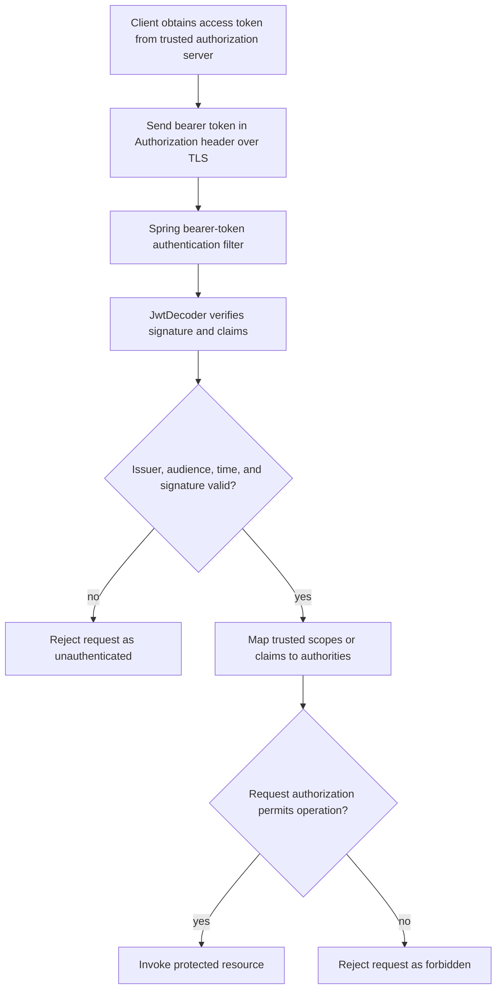

Signed tokens let a resource server verify a credential's authenticity and claims without loading a server-side session for every request. That can simplify distributed request handling, but it does not make token security automatic: a JSON Web Token (JWT) is a credential, and anyone who steals a bearer token can present it until it expires or is otherwise rejected.

This lesson uses Spring Security 7 documentation, Spring Boot 4.1.2 configuration, Java 21 examples, and IETF token-security guidance. The repository does not include Spring Security dependencies or an identity provider, so examples are instructional and not locally compiled or run.

## OAuth 2.0, OpenID Connect, and JWT are different things

| Term | What it is | What it is not |
|---|---|---|
| OAuth 2.0 | An authorization framework for obtaining delegated access to protected resources. | A token format or an end-user sign-in protocol by itself. |
| OpenID Connect (OIDC) | An identity layer on top of OAuth 2.0 that lets a client verify an end-user's identity. | A replacement name for OAuth 2.0. |
| JWT | A token format for carrying claims in a signed and/or encrypted structure. | Necessarily an access token, necessarily encrypted, or necessarily part of OAuth. |

An OAuth access token can be opaque or a JWT. An OIDC ID token is issued for the client to learn about an authenticated end user; it is not interchangeable with an access token intended for an API. A resource server should accept the token type and audience intended for that resource, not simply any token that happens to have a valid signature.

## JWT structure and what a signature means

A common signed JWT uses JWS compact serialization with three Base64URL-encoded components:

```text
header.payload.signature
```

The header describes the signing algorithm and key identifier; the payload contains claims such as issuer, subject, audience, and expiration; the signature protects integrity and proves that a trusted key signed the signed bytes. Base64URL encoding is not encryption: anyone holding a typical signed token can decode its header and claims. Do not put passwords, secrets, or unnecessary personal data in a token.

JWT can also be represented as an encrypted JWE, which uses a different compact structure. Do not confuse signing with confidentiality or assume all JWTs have exactly three segments.

Common registered claims include:

- `iss` — issuer that created the token.
- `sub` — subject represented by the token.
- `aud` — intended recipient or recipients.
- `exp` — time after which the token must not be accepted.
- `nbf` — time before which the token must not be accepted.
- `iat` — time at which the token was issued.
- `jti` — token identifier that can support replay or revocation controls when the application maintains corresponding state.

Claims are assertions only after the token's cryptographic operations and required claim checks succeed. A decoder that merely parses JSON has not authenticated the token.

## Issuance, validation, and authorization flow

An authorization server issues a token for a particular audience and purpose. A resource server validates it before building the authenticated principal and checking the requested permission:



Authentication answers whether the credential is valid for this resource. Authorization separately decides whether the authenticated identity has permission for this operation and resource. A valid token with `orders.read` does not automatically authorize access to every tenant's order.

## Prefer Spring Security Resource Server support

For a Spring servlet API, use Spring Security's OAuth 2.0 Resource Server support instead of writing a JWT parser and verifier by hand. With the resource-server and JOSE modules available, the framework's bearer filter delegates authentication to `JwtAuthenticationProvider` and `JwtDecoder`; the provider validates the token and maps scopes to `SCOPE_` authorities.

Configure the trusted issuer and the intended API audience:

```yaml
spring:
  security:
    oauth2:
      resourceserver:
        jwt:
          issuer-uri: https://identity.example.com/issuer
          audiences: https://orders-api.example.com
```

Both URLs are placeholders. In a real deployment, configure them from trusted environment-specific configuration, not from an untrusted request. `issuer-uri` identifies the expected `iss` value and lets Spring discover the issuer's public keys; `audiences` tells Spring which `aud` value the resource server accepts. An issuer check alone does not ensure the token was intended for this API.

The request-security chain can require a scope for a route:

```java
@Configuration
class ApiSecurityConfiguration {
    @Bean
    SecurityFilterChain apiSecurity(HttpSecurity http) throws Exception {
        return http
                .sessionManagement(session -> session
                        .sessionCreationPolicy(SessionCreationPolicy.STATELESS))
                .authorizeHttpRequests(authorize -> authorize
                        .requestMatchers(HttpMethod.GET, "/orders/**")
                        .hasAuthority("SCOPE_orders.read")
                        .anyRequest().authenticated())
                .oauth2ResourceServer(resourceServer -> resourceServer
                        .jwt(Customizer.withDefaults()))
                .build();
    }
}
```

Imports are omitted. `STATELESS` configures Spring Security not to create or use an HTTP session to obtain the `SecurityContext` for requests; it does not guarantee that the application has no server-side state anywhere. This chain does not disable CSRF. Make CSRF decisions separately based on credential transport: a browser automatically attaches cookies, while a bearer token deliberately placed in an `Authorization` header has different CSRF properties. If the application also uses cookies for authentication or refresh, keep the relevant CSRF defenses.

By default, the resource-server JWT support validates signature, `exp`, `nbf`, and issuer, and maps scopes to `SCOPE_` authorities. Configure audience validation explicitly as shown. If custom validators, claim mapping, or a `JwtDecoder` are needed, compose them with the framework's validation rather than replacing it with a parser that checks only a signature.

## What a custom JWT authentication filter would be responsible for

The roadmap mentions implementing a custom JWT authentication filter. In production, the built-in resource-server support is usually the safer choice. A custom filter creates a second authentication implementation that must remain correct as token formats, keys, claims, and framework behavior change.

At an architectural level, a bearer authentication filter must:

1. Extract a bearer credential only from the documented `Authorization` header format; do not accept tokens from URLs, where they can leak through history, logs, or referrer data.
2. Delegate authentication to a configured provider/decoder that verifies an allowlisted algorithm, trusted key, issuer, audience, time claims, and any required token type.
3. Set the `SecurityContext` only after successful validation and authority conversion.
4. On invalid credentials, use the standard authentication failure path and never continue as if the request were authenticated.
5. Continue the servlet filter chain exactly once for an accepted request, and clear or manage context according to Spring Security's established lifecycle.

If a genuinely custom authentication mechanism is required, integrate through Spring Security's authentication abstractions and filters rather than writing ad hoc Base64 decoding or accepting a client-selected algorithm. Test malformed tokens, missing signatures, unsupported algorithms, wrong issuer/audience, expired and not-yet-valid tokens, key rotation, absent credentials, and insufficient scope.

## Essential validation and key-management rules

Treat every incoming token as untrusted until fully verified:

- Pin the acceptable signing algorithms in trusted configuration; never let the token header choose an arbitrary verification algorithm or key source.
- Obtain verification keys from the trusted issuer/JWKS configuration. Treat `kid` only as a selector among trusted published keys, not as a URL or filesystem path.
- Validate signature, expected issuer, API audience, `exp`, and `nbf`; use a small deliberate clock-skew allowance if needed.
- Validate the intended token purpose/type so that an ID token, a token for another API, or another JWT class cannot be substituted.
- Use TLS, short-lived access tokens, and key rotation with an overlap period that supports legitimate tokens signed by old keys until they expire.
- Keep signing private keys and client secrets out of source control, logs, and client applications. A resource server that only validates tokens should usually hold public verification keys, not the issuer's private signing key.
- Log authentication failures without logging the token itself.

JWT signature validation does not prevent replay of a stolen bearer token. Short lifetimes reduce the exposure window but do not revoke a token immediately. If immediate revocation is required, use a design that checks revocation state, introspects opaque tokens, or changes the relevant signing key with understood blast radius.

## Refresh tokens and rotation

Access tokens and refresh tokens serve different purposes. An access token is presented to an API and should usually be short-lived. A refresh token is presented to the authorization server to obtain a replacement access token; it should not be sent to ordinary resource APIs. Refresh tokens are often opaque, because they do not need to be independently validated by every resource server.

For public clients that cannot safely keep a client secret, OAuth 2.0 Security Best Current Practice calls for refresh-token replay protection, such as sender-constrained refresh tokens or refresh-token rotation. With rotation:

1. The client presents the current refresh token to the authorization server.
2. The server validates it, invalidates it, and issues a new refresh token.
3. The server records the relationship between old and new tokens (a token family).
4. Reuse of an already-invalidated token indicates possible theft; revoke the active family or session and require reauthentication.

Rotation requires server-side state, atomic replacement, replay detection, and a plan for concurrent refresh requests. A race in which two requests use the same token can look like replay; clients should serialize refresh operations and servers should define safe family-revocation behavior. Store refresh tokens securely (for example, retain only a verifier/hash where the design allows), protect them in transit, and revoke them on logout, credential reset, or detected compromise.

For browser clients, avoid storing bearer or refresh credentials in JavaScript-accessible local storage. HttpOnly, Secure cookies reduce direct script access but are automatically attached by browsers and therefore require CSRF protections and a careful same-site/origin design. Token storage must be chosen for the client type and threat model.

## Common misconceptions and failure modes

- **“JWT payloads are encrypted.”** A signed JWS payload is readable after Base64URL decoding; signing protects integrity, not confidentiality.
- **“Decoding means validating.”** Parsing a token does not verify signature, issuer, audience, or time claims.
- **“Any valid token can call this API.”** Validate `aud` and token purpose, then authorize the required scope/authority and resource ownership.
- **“Stateless means there is no server state.”** Refresh rotation, revocation, key management, and authorization data often remain stateful.
- **“A JWT can be revoked by deleting it from the client.”** A copied token can still be replayed until expiry unless the server checks revocation or another invalidation mechanism.
- **“An ID token is an API access token.”** They have different intended audiences and semantics; APIs should accept their configured access-token type.
- **“A custom filter is just three Base64 splits.”** The difficult work is secure algorithm/key selection, claim validation, context lifecycle, failure behavior, and keeping up with protocol guidance.
- **“CSRF is irrelevant to APIs.”** Whether it matters depends on whether browsers automatically attach the authentication credential, especially cookies.

## Further reading

- Spring Security 7, [OAuth 2.0 Resource Server JWT](https://docs.spring.io/spring-security/reference/servlet/oauth2/resource-server/jwt.html)
- Spring Security 7, [Servlet Authentication Architecture](https://docs.spring.io/spring-security/reference/servlet/authentication/architecture.html)
- IETF, [RFC 7519: JSON Web Token](https://www.rfc-editor.org/rfc/rfc7519)
- IETF, [RFC 8725: JSON Web Token Best Current Practices](https://www.rfc-editor.org/rfc/rfc8725)
- IETF, [RFC 9700: Best Current Practice for OAuth 2.0](https://www.rfc-editor.org/rfc/rfc9700#section-4.14)
- OpenID Foundation, [OpenID Connect Core 1.0](https://openid.net/specs/openid-connect-core-1_0.html)
- [Spring Security Architecture](./spring-security-architecture)
