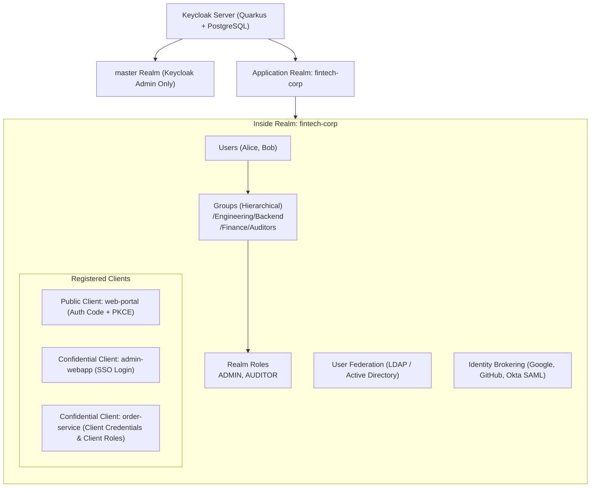
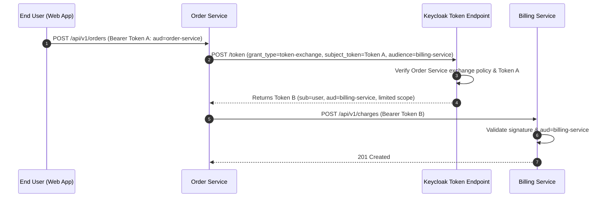
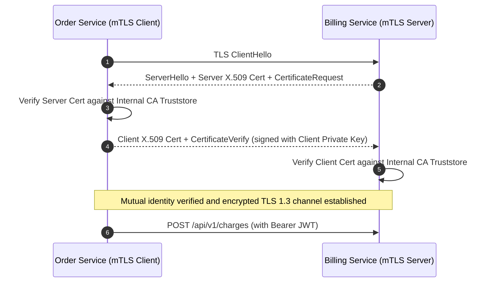

When a team builds its first microservice, adding a `users` table, a BCrypt encoder, and a `/login` endpoint feels fast. By the time the system grows to a dozen services, a web portal, a mobile app, and enterprise B2B customers asking for SAML SSO, MFA, and Active Directory sync, maintaining custom identity code becomes a constant drag and a security risk.

**Keycloak** is the most widely used open-source Identity and Access Management (IAM) server in the Java ecosystem. Built on Quarkus, it implements OpenID Connect (OIDC), OAuth 2.0, and SAML 2.0 out of the box, letting your Spring Boot services stay focused on business logic while delegating authentication, SSO, federation, and token issuance to a central server.

## Keycloak Architecture: Realms, Clients, Roles, and Groups

Keycloak organizes identity metadata into a clear hierarchy. Getting these boundaries right early prevents messy migrations later.



### Realms

A **Realm** is a fully isolated security domain with its own users, credentials, roles, groups, clients, themes, and signing keys.
- The built-in `master` realm is reserved strictly for administering Keycloak itself. Never create application users or register business apps in `master`.
- Create a dedicated realm for your application (for example `fintech-corp`), or separate realms per isolated B2B tenant if your SaaS product needs hard tenant separation (note that Keycloak works well with dozens to a few hundred realms; if you have tens of thousands of tenants, model tenants inside a single realm using Keycloak Organizations or attributes rather than creating 10,000 realms).

### Clients

A **Client** represents an application or service that requests tokens or relies on Keycloak to authenticate users:
- **Public Clients** (React/Angular SPAs, mobile apps): Client authentication is disabled because no secret can be kept safe on an end-user device. Always require **Authorization Code Flow with PKCE**.
- **Confidential Clients** (Spring Boot web apps, BFFs, backend microservices): Client authentication is enabled using a client secret, signed JWT (`private_key_jwt`), or X.509 certificate. Enabling **Service accounts roles** lets the client obtain tokens via the Client Credentials grant for machine-to-machine calls.
- **Client Scopes**: Reusable bundles of protocol mappers and role mappings (such as `email`, `profile`, or a custom `tenant-context` scope) that can be attached to multiple clients.

### Roles (Realm, Client, and Composite)

Keycloak supports three role types:
- **Realm Roles**: Global roles shared across the entire realm (for example `PLATFORM_ADMIN` or `AUDITOR`). They appear in the JWT under `realm_access.roles`.
- **Client Roles**: Roles scoped to a specific client/service (for example `invoice:approve` on `billing-service`). They appear under `resource_access.<client-id>.roles`. Client roles scale better in microservices because teams can define permissions for their own API without polluting a global namespace.
- **Composite Roles**: A role that bundles several other realm or client roles together (for example, granting `FINANCE_MANAGER` automatically grants `billing-service/invoice:read` and `billing-service/invoice:approve`).

### Groups

**Groups** organize users into a hierarchy (such as `/Finance/NorthAmerica` or `/Engineering/SRE`). Instead of assigning ten roles manually to every new employee, attach roles and shared attributes (like `cost_center` or `department`) to a Group, and add users to the Group. Users inherit the roles and attributes of their group and all parent groups automatically.

### Production Deployment Basics

In production, run Keycloak against PostgreSQL (never the default embedded H2 database), pre-build the image with `kc.sh build`, and configure proxy headers when sitting behind Kubernetes Ingress, Nginx, or an AWS ALB:

```yaml
services:
  keycloak-db:
    image: postgres:16-alpine
    environment:
      POSTGRES_DB: keycloak
      POSTGRES_USER: keycloak_user
      POSTGRES_PASSWORD: ${KC_DB_PASSWORD}
    volumes:
      - postgres_data:/var/lib/postgresql/data

  keycloak:
    image: quay.io/keycloak/keycloak:26.0
    command: start --optimized
    environment:
      KC_DB: postgres
      KC_DB_URL_HOST: keycloak-db
      KC_DB_URL_DATABASE: keycloak
      KC_DB_USERNAME: keycloak_user
      KC_DB_PASSWORD: ${KC_DB_PASSWORD}
      KC_HOSTNAME: https://auth.company.com
      KC_PROXY_HEADERS: xforwarded
      KC_HTTP_ENABLED: "true"
      KC_BOOTSTRAP_ADMIN_USERNAME: admin
      KC_BOOTSTRAP_ADMIN_PASSWORD: ${KC_ADMIN_PASSWORD}
    ports:
      - "8080:8080"
    depends_on:
      - keycloak-db

volumes:
  postgres_data:
```

In a multi-pod Kubernetes deployment, Keycloak uses embedded **Infinispan** (typically with `DNS_PING` or `JDBC_PING`) to replicate user sessions, offline sessions, and brute-force counters across nodes so losing a pod does not log users out.

## Single Sign-On (SSO) Integration with Spring Boot

Years ago, developers integrated Keycloak using Red Hat's proprietary `keycloak-spring-boot-starter`. That adapter was officially deprecated and archived. Today, the standard approach is to use Spring Security's native OAuth2/OIDC starters:
- `spring-boot-starter-oauth2-client` for server-side web apps and BFFs that orchestrate browser SSO login and logout.
- `spring-boot-starter-oauth2-resource-server` for stateless REST APIs that validate incoming bearer tokens.

Because both rely strictly on standard OIDC discovery, your Java code has zero vendor lock-in to Keycloak.

### Configuring Spring Boot 3 for Keycloak SSO and Single Logout

Add `spring-boot-starter-oauth2-client` and configure your Keycloak client in `application.yml`:

```yaml
spring:
  security:
    oauth2:
      client:
        registration:
          keycloak:
            client-id: admin-webapp
            client-secret: ${KEYCLOAK_WEBAPP_SECRET}
            scope: openid,profile,email
            authorization-grant-type: authorization_code
        provider:
          keycloak:
            issuer-uri: https://auth.company.com/realms/fintech-corp
            user-name-attribute: preferred_username
```

Then enable `.oauth2Login(...)` and wire `OidcClientInitiatedLogoutSuccessHandler`. That logout handler is an easy detail to miss: without it, clicking "Log out" destroys the local Spring session cookie (`JSESSIONID`) while leaving the user's Keycloak SSO session alive, so the next page visit silently logs them straight back in!

```java
package com.javahub.sso.config;

import org.springframework.context.annotation.Bean;
import org.springframework.context.annotation.Configuration;
import org.springframework.security.config.Customizer;
import org.springframework.security.config.annotation.web.builders.HttpSecurity;
import org.springframework.security.oauth2.client.oidc.web.logout.OidcClientInitiatedLogoutSuccessHandler;
import org.springframework.security.oauth2.client.registration.ClientRegistrationRepository;
import org.springframework.security.web.SecurityFilterChain;
import org.springframework.security.web.authentication.logout.LogoutSuccessHandler;

@Configuration
public class SsoSecurityConfig {

    @Bean
    public SecurityFilterChain ssoFilterChain(
            HttpSecurity http,
            ClientRegistrationRepository clientRegistrationRepository
    ) throws Exception {
        return http
            .authorizeHttpRequests(auth -> auth
                .requestMatchers("/actuator/health", "/public/**").permitAll()
                .anyRequest().authenticated()
            )
            .oauth2Login(Customizer.withDefaults())
            .logout(logout -> logout
                .logoutSuccessHandler(oidcLogoutSuccessHandler(clientRegistrationRepository))
            )
            .build();
    }

    private LogoutSuccessHandler oidcLogoutSuccessHandler(ClientRegistrationRepository repo) {
        // Redirects the browser to Keycloak's end_session_endpoint to terminate the central SSO session
        OidcClientInitiatedLogoutSuccessHandler handler =
                new OidcClientInitiatedLogoutSuccessHandler(repo);
        handler.setPostLogoutRedirectUri("{baseUrl}/public/signed-out");
        return handler;
    }
}
```

### Automating User Provisioning with `keycloak-admin-client`

For SaaS onboarding workflows where your backend creates users or assigns roles programmatically, create a confidential client with **Service accounts roles** enabled, grant it only the `manage-users` role from `realm-management`, and authenticate via Client Credentials:

```java
package com.javahub.keycloak.config;

import org.keycloak.OAuth2Constants;
import org.keycloak.admin.client.Keycloak;
import org.keycloak.admin.client.KeycloakBuilder;
import org.springframework.beans.factory.annotation.Value;
import org.springframework.context.annotation.Bean;
import org.springframework.context.annotation.Configuration;

@Configuration
public class KeycloakAdminConfig {

    @Bean(destroyMethod = "close")
    public Keycloak keycloakAdminClient(
            @Value("${keycloak.server-url}") String serverUrl,
            @Value("${keycloak.realm}") String realm,
            @Value("${keycloak.client-id}") String clientId,
            @Value("${keycloak.client-secret}") String clientSecret
    ) {
        return KeycloakBuilder.builder()
                .serverUrl(serverUrl)
                .realm(realm)
                .grantType(OAuth2Constants.CLIENT_CREDENTIALS)
                .clientId(clientId)
                .clientSecret(clientSecret)
                .build();
    }
}
```

## Token Exchange and Custom Protocol Mappers

### Custom Protocol Mappers

By default, Keycloak includes standard OIDC claims (`sub`, `preferred_username`, `email`, `realm_access`). Most enterprise APIs also need domain claims such as `tenant_id`, `department`, group memberships, or a specific `aud` value so downstream services do not have to query a user database on every request.

You add these in Keycloak using **Protocol Mappers** attached to a Client or Client Scope:
- **User Attribute Mapper**: Reads a user or group attribute (e.g., `tenantId`) and writes it to `tenant_id` in the Access Token and/or ID Token.
- **Group Membership Mapper**: Emits the user's group paths into a `groups` claim (for example `["/Finance/NorthAmerica"]`).
- **Audience Mapper**: Adds a target resource server's client ID (such as `billing-service`) into the token's `aud` array so that the downstream service's audience check succeeds.

In your Spring Boot resource server, read mapped claims straight off the verified `Jwt`:

```java
@GetMapping("/api/v1/tenant-dashboard")
public ResponseEntity<DashboardData> getDashboard(@AuthenticationPrincipal Jwt jwt) {
    String tenantId = jwt.getClaimAsString("tenant_id");
    List<String> groups = jwt.getClaimAsStringList("groups");
    return ResponseEntity.ok(dashboardService.loadForTenant(tenantId, groups));
}
```

Keep custom claims lean. Dumping dozens of nested attributes or hundreds of group names into every JWT bloats HTTP headers and can break reverse proxies with 8 KB header limits.

### OAuth 2.0 Token Exchange (RFC 8693)

Consider a realistic call chain: a user calls `Order Service` with an access token whose audience is `order-service`. To finalize checkout, `Order Service` needs to call `Billing Service` on behalf of that same user.

Blindly forwarding the original access token to `Billing Service` has two serious drawbacks:
1. If `Billing Service` enforces strict `aud` validation (as it should), it rejects a token minted for `order-service`.
2. If you loosen `aud` so every token works everywhere, any single compromised service can replay a user's token across your entire backend (the classic confused deputy problem).

**OAuth 2.0 Token Exchange (RFC 8693)** solves this cleanly. `Order Service` authenticates to Keycloak with its own client credentials, presents the incoming user token as `subject_token`, and requests a new, down-scoped, short-lived access token whose `aud` is specifically `billing-service`. The new token preserves the original user's `sub` (and optionally records the acting service) without giving `Order Service` a blanket pass to unrelated APIs.



Here is how `Order Service` performs that exchange with Spring Boot's `RestClient`:

```java
package com.javahub.orders.security;

import org.springframework.beans.factory.annotation.Value;
import org.springframework.http.MediaType;
import org.springframework.stereotype.Service;
import org.springframework.util.LinkedMultiValueMap;
import org.springframework.util.MultiValueMap;
import org.springframework.web.client.RestClient;

import java.util.Map;

@Service
public class KeycloakTokenExchangeClient {

    private static final String TOKEN_EXCHANGE_GRANT = "urn:ietf:params:oauth:grant-type:token-exchange";
    private static final String ACCESS_TOKEN_TYPE = "urn:ietf:params:oauth:token-type:access_token";

    private final RestClient restClient;
    private final String tokenUri;
    private final String clientId;
    private final String clientSecret;

    public KeycloakTokenExchangeClient(
            RestClient.Builder restClientBuilder,
            @Value("${keycloak.token-uri}") String tokenUri,
            @Value("${keycloak.client-id}") String clientId,
            @Value("${keycloak.client-secret}") String clientSecret
    ) {
        this.restClient = restClientBuilder.build();
        this.tokenUri = tokenUri;
        this.clientId = clientId;
        this.clientSecret = clientSecret;
    }

    public String exchangeForAudience(String incomingUserToken, String targetAudience, String scope) {
        MultiValueMap<String, String> form = new LinkedMultiValueMap<>();
        form.add("grant_type", TOKEN_EXCHANGE_GRANT);
        form.add("client_id", clientId);
        form.add("client_secret", clientSecret);
        form.add("subject_token", incomingUserToken);
        form.add("subject_token_type", ACCESS_TOKEN_TYPE);
        form.add("requested_token_type", ACCESS_TOKEN_TYPE);
        form.add("audience", targetAudience);
        form.add("scope", scope);

        Map<?, ?> response = restClient.post()
                .uri(tokenUri)
                .contentType(MediaType.APPLICATION_FORM_URLENCODED)
                .body(form)
                .retrieve()
                .body(Map.class);

        if (response == null || response.get("access_token") == null) {
            throw new IllegalStateException("Keycloak token exchange returned no access_token");
        }
        return response.get("access_token").toString();
    }
}
```

> [!NOTE]
> Keycloak supports Standard Token Exchange (v2, stabilized in Keycloak 26.2+) as well as its earlier preview token-exchange feature. Check your Keycloak version's documentation for the exact feature flag and client permission toggle required to enable standard token exchange on your realm.

## mTLS Zero-Trust Internal Service Communication

In a zero-trust architecture, running inside a private VPC or Kubernetes cluster does not make a network trustworthy. If an attacker gains code execution on one compromised pod, plain HTTP internal traffic lets them sniff payloads or replay stolen bearer tokens from another workload.

**Mutual TLS (mTLS)** establishes strong cryptographic identity for **both** sides of a connection at the transport layer. In standard one-way TLS (like regular HTTPS), only the server presents an X.509 certificate so the client knows who it is talking to. In mTLS, the server also requires the client to present an X.509 certificate signed by a trusted internal Certificate Authority (CA) and prove possession of the matching private key during the TLS handshake.



If a rogue pod without a valid certificate signed by your internal CA tries to connect, the TLS handshake fails before a single HTTP byte reaches Spring Security or your controller.

### Configuring Application-Level mTLS with Spring Boot 3.1+ SSL Bundles

Spring Boot 3.1 introduced **SSL Bundles** (`spring.ssl.bundle`), which unify PEM and JKS keystore/truststore configuration across embedded servers (Tomcat/Netty) and HTTP clients (`RestClient`, `WebClient`), including hot-reloading certificates from disk when Kubernetes cert-manager or Vault rotates them.

On the **server side** (`Billing Service`), configure a PEM bundle and set `server.ssl.client-auth=need` so Tomcat rejects any client that fails to present a valid certificate:

```yaml
server:
  port: 8443
  ssl:
    bundle: internal-mtls
    client-auth: need

spring:
  ssl:
    bundle:
      pem:
        internal-mtls:
          reload-on-update: true
          keystore:
            certificate: file:/etc/certs/billing-service.crt
            private-key: file:/etc/certs/billing-service.key
          truststore:
            certificate: file:/etc/certs/internal-ca.crt
```

On the **client side** (`Order Service`), configure its own `internal-mtls` bundle (with `order-service.crt` and `order-service.key`) and attach it directly to `RestClient` using `RestClientSsl` (available in Spring Boot 3.2+):

```java
package com.javahub.orders.config;

import org.springframework.boot.autoconfigure.web.client.RestClientSsl;
import org.springframework.context.annotation.Bean;
import org.springframework.context.annotation.Configuration;
import org.springframework.web.client.RestClient;

@Configuration
public class MtlsClientConfig {

    @Bean
    public RestClient billingRestClient(RestClient.Builder builder, RestClientSsl ssl) {
        return builder
                .baseUrl("https://billing-service.internal:8443")
                .apply(ssl.fromBundle("internal-mtls"))
                .build();
    }
}
```

With `reload-on-update: true`, Spring watches the mounted certificate files and reloads the SSL context automatically when short-lived certificates rotate, avoiding pod restarts.

### Sender-Constrained Tokens with Keycloak mTLS (RFC 8705)

Even with mTLS between services, a plain bearer JWT can still be stolen from logs or memory and replayed over a different TLS connection. Keycloak implements **OAuth 2.0 Mutual-TLS Client Authentication and Certificate-Bound Access Tokens (RFC 8705)** to bind the JWT directly to the client's TLS certificate:

1. The client authenticates to Keycloak's token endpoint over mTLS using its X.509 certificate.
2. Keycloak computes the SHA-256 thumbprint of that client certificate and embeds it inside the issued JWT's `cnf` (confirmation) claim:
   ```json
   {
     "sub": "service-account-order-service",
     "aud": "billing-service",
     "cnf": {
       "x5t#S256": "bwcK0esc3ACC3DB2Y5_lESsXE8o9ltc05O89jdN-dg2"
     }
   }
   ```
3. When `Billing Service` receives the request over mTLS, a custom `OAuth2TokenValidator<Jwt>` (or filter) extracts the `X509Certificate` from `request.getAttribute("jakarta.servlet.request.X509Certificate")`, computes its Base64URL SHA-256 thumbprint, and verifies it matches `cnf.x5t#S256` in the JWT.

An attacker who steals the JWT string cannot reuse it because they do not possess the private key for the bound client certificate.

### Application-Level mTLS vs Service Mesh mTLS

In real deployments, you have two ways to roll out mTLS:

| Approach | How It Works | Best Fit |
|---|---|---|
| **Application-level mTLS (Spring SSL Bundles)** | Spring Boot terminates mTLS directly using certs mounted via cert-manager, Vault Agent, or SPIRE. | Small-to-medium service fleets, environments without Kubernetes/mesh, or when you need RFC 8705 certificate-bound JWT verification inside Java. |
| **Service Mesh mTLS (Istio / Linkerd / Cilium)** | Sidecar proxies (or node agents) intercept pod traffic, issue short-lived SPIFFE identities automatically, and enforce mTLS transparently outside the JVM. | Large Kubernetes clusters where managing keystores across polyglot services (Java, Go, Python) inside app code creates too much operational overhead. |

Even when a service mesh handles transport encryption and workload-to-workload mTLS transparently, you still use Keycloak OAuth2 tokens at Layer 7 to carry end-user identity, scopes, and business roles.

## Interview Questions

### Why did Red Hat archive `keycloak-spring-boot-starter`, and what should Spring Boot 3 apps use instead?

The legacy Keycloak starter tightly coupled Keycloak's release cycle to Spring Security internals, so every major Spring Boot upgrade caused compatibility lag. Because Keycloak follows standard OIDC and OAuth 2.0 specifications, Spring Boot 3 applications should use `spring-boot-starter-oauth2-client` (for browser SSO) and `spring-boot-starter-oauth2-resource-server` (for REST APIs). Pointing them at Keycloak's `issuer-uri` keeps your codebase portable across any OIDC-compliant IdP.

### Why is OAuth 2.0 Token Exchange safer than forwarding the caller's original JWT to every downstream service?

Forwarding the original token forces downstream APIs to accept tokens minted for another audience, breaking least privilege. If any middle-tier service is compromised, an attacker can reuse user tokens against unrelated internal services. Token Exchange (RFC 8693) asks Keycloak to mint a new, tightly scoped token targeted solely at the specific downstream audience while still preserving the user's identity for auditing and authorization.

### What is the difference between standard TLS, mTLS, and RFC 8705 certificate-bound tokens?

Standard TLS only proves the server's identity to the client and encrypts traffic. Mutual TLS (mTLS) adds client certificate verification so both services cryptographically prove their workload identity during the TLS handshake. RFC 8705 goes one step further by embedding the client certificate's SHA-256 thumbprint (`cnf.x5t#S256`) inside the OAuth2 JWT, ensuring the token itself cannot be replayed over a different TLS session if leaked.

### How do Keycloak realms, groups, and client roles work together in a multi-service enterprise setup?

A realm isolates the entire security tenant. Groups reflect organizational structure (such as teams or departments) so administrators manage membership in one place instead of editing individual users. Client roles define service-specific permissions scoped to each microservice (avoiding global naming collisions), and those client roles are assigned to groups or composite roles so users inherit the exact permissions their job function requires.
