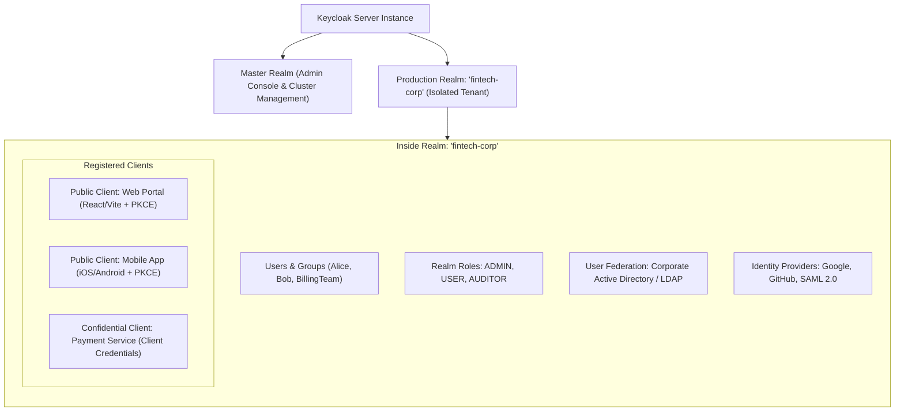
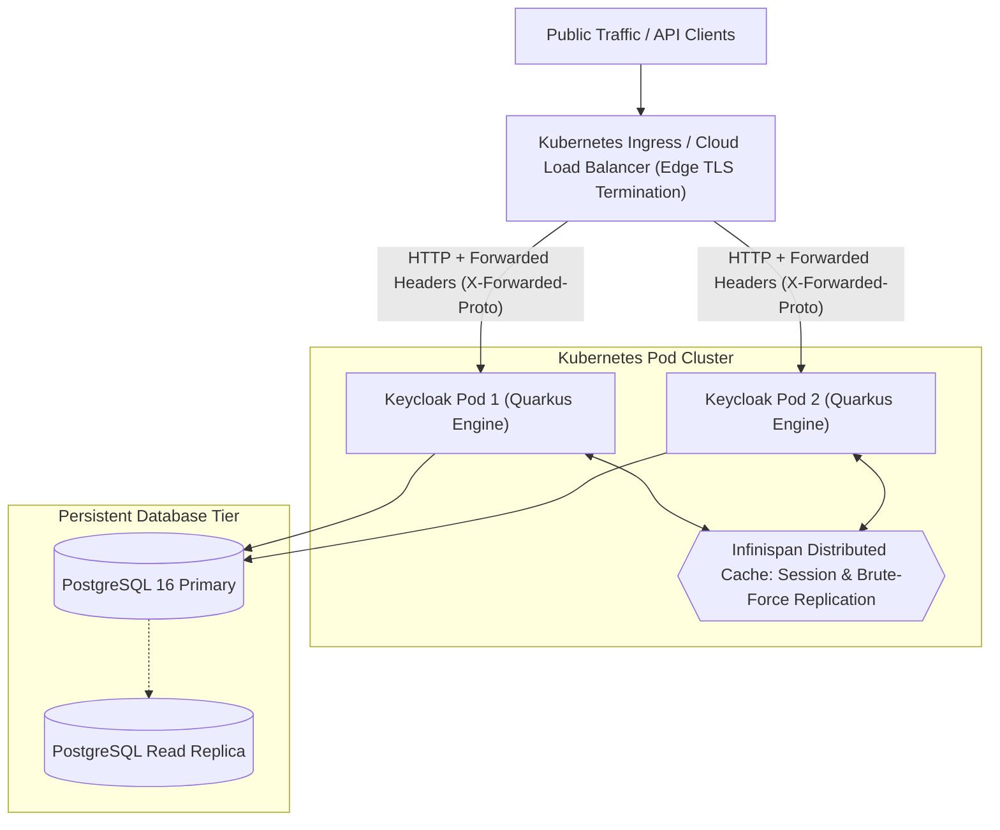
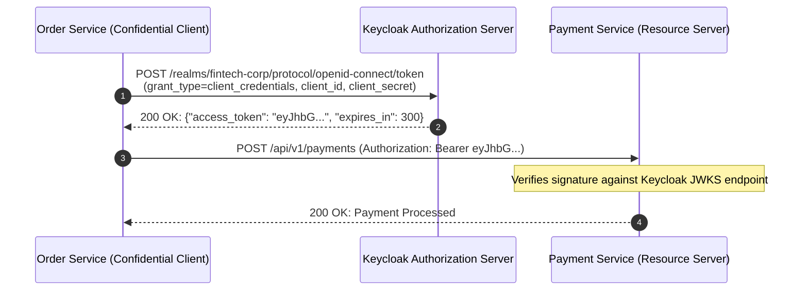

# Centralized Identity with Keycloak

In early microservice projects, developers often build custom user management: an `users` table, BCrypt password hashing, custom password reset endpoints, and email verification scripts.

As an organization grows from two services to twenty, this DIY approach becomes a security liability:
- Every microservice duplicates authentication logic and password storage.
- Implementing Single Sign-On (SSO) across web applications, mobile apps, and third-party portals becomes an expensive, fragile engineering effort.
- Adding enterprise requirements—Multi-Factor Authentication (MFA), WebAuthn/Passkeys, Corporate LDAP/Active Directory synchronization, and SOC2/HIPAA compliance audits—can consume quarters of development time.

The industry-standard solution is **Centralized Identity and Access Management (IAM)**. In the open-source and Java ecosystem, the undisputed leader is **Keycloak**. Maintained by Red Hat and widely deployed across Fortune 500 enterprises, Keycloak provides turnkey SSO, social login, identity brokering, user federation, and comprehensive OpenID Connect (OIDC) / SAML 2.0 support.

In this guide, we will explore Keycloak's core domain architecture, production deployment considerations, and modern integration with Spring Boot 3 using standard OIDC protocols and the Keycloak Admin Client.

---

## The Keycloak Domain Architecture

Before writing code, you must understand Keycloak's organizational hierarchy:



### Core Concepts

- **Realms:** A realm is an isolated tenant. It contains its own users, roles, credentials, and client applications. The `master` realm is reserved strictly for Keycloak system administrators. You should always create a custom realm (e.g., `enterprise` or `saas-tenant-a`) for your application workload.
- **Clients:** A client is an application or service requesting identity tokens from Keycloak:
  - **Public Clients:** Applications that run on untrusted end-user devices where client secrets cannot be securely stored (e.g., React Single Page Applications, mobile applications). These must authenticate using the **Authorization Code Flow with PKCE**.
  - **Confidential Clients:** Backend applications running on private servers that can securely hold a client secret (e.g., Spring Boot microservices calling other microservices via the **Client Credentials Grant**).
- **Client Scopes:** Common sets of claims (e.g., `email`, `profile`, `roles`) that clients can request to be included in issued ID and Access tokens.
- **User Federation:** Instead of migrating your company's 50,000 employees into Keycloak's database, Keycloak can proxy and authenticate users directly against an existing corporate **LDAP** or **Microsoft Active Directory** server.
- **Identity Brokering:** Allows users to log in using external social providers (Google, GitHub) or enterprise SAML/OIDC federations (Okta, Azure AD).

---

## Production Deployment Topology

Keycloak is built on **Quarkus** and uses **Infinispan** for high-performance distributed caching and cluster session replication:



### Key Production Configuration Directives

When deploying Keycloak in Docker or Kubernetes behind an Nginx, Envoy, or AWS ALB reverse proxy:

1. **Proxy Headers (`KC_PROXY_HEADERS=xforwarded`):** Keycloak must know it is operating behind a TLS-terminating reverse proxy. Without this, Keycloak will generate internal redirect URIs starting with `http://` instead of `https://`, triggering browser mixed-content and redirect errors.
2. **Database Persistence (`KC_DB=postgres`):** Never run Keycloak in production with an in-memory or embedded H2 database. Connect it to a managed, highly available PostgreSQL or MySQL cluster.
3. **Optimized Build (`KC_RUN_MODE=production`):** Pre-build the container using `kc.sh build` to freeze extensions, database drivers, and features for sub-second startup times.

### Docker Compose Reference Architecture

```yaml
version: '3.8'

services:
  keycloak-db:
    image: postgres:16-alpine
    container_name: keycloak-postgres
    environment:
      POSTGRES_DB: keycloak
      POSTGRES_USER: keycloak_user
      POSTGRES_PASSWORD: SecretDatabasePassword123!
    volumes:
      - postgres_data:/var/lib/postgresql/data
    healthcheck:
      test: ["CMD-SHELL", "pg_isready -U keycloak_user -d keycloak"]
      interval: 5s
      timeout: 5s
      retries: 5

  keycloak:
    image: quay.io/keycloak/keycloak:24.0.5
    container_name: keycloak-server
    command: start --optimized
    environment:
      KC_DB: postgres
      KC_DB_URL_HOST: keycloak-db
      KC_DB_URL_DATABASE: keycloak
      KC_DB_USERNAME: keycloak_user
      KC_DB_PASSWORD: SecretDatabasePassword123!
      KC_HOSTNAME: auth.company.com
      KC_PROXY_HEADERS: xforwarded
      KC_HTTP_ENABLED: "true"
      KEYCLOAK_ADMIN: admin
      KEYCLOAK_ADMIN_PASSWORD: ProductionAdminPassword999!
    ports:
      - "8080:8080"
    depends_on:
      keycloak-db:
        condition: service_healthy

volumes:
  postgres_data:
```

---

## Spring Boot 3 Integration: The Modern Standard

### Why the Legacy `keycloak-spring-boot-starter` is Dead

Years ago, Red Hat provided a proprietary library named `keycloak-spring-boot-starter`. 

**Red Hat officially deprecated and archived this starter.** 

Maintaining a custom security adapter that duplicated Spring Security's rapid evolution proved redundant. Today, the official and recommended architectural pattern is to use **standard, framework-native Spring Security OAuth2 modules**:
- `spring-boot-starter-oauth2-resource-server` (for REST APIs verifying bearer tokens).
- `spring-boot-starter-oauth2-client` (for web applications orchestrating the authorization code redirect flow).

By sticking to standard OIDC specifications, your application remains completely decoupled from Keycloak. If your organization migrates to Okta or Entra ID in five years, you won't need to rewrite a single line of security code.

---

## Managing Keycloak Programmatically: The Admin Client

While administrators configure Keycloak via the web console, enterprise Java backends often need to automate identity operations:
- Creating user accounts programmatically upon SaaS tenant registration.
- Assigning business roles dynamically based on corporate tier.
- Triggering password reset or email verification flows via API.

This is accomplished using the official **`keycloak-admin-client`**.

### Maven Dependency

```xml
<dependency>
    <groupId>org.keycloak</groupId>
    <artifactId>keycloak-admin-client</artifactId>
    <version>24.0.5</version>
</dependency>
```

### Step 1: Secure Service Account Configuration

In Keycloak, create a confidential client (e.g., `admin-service-client`) in the target realm and enable **Service Accounts Roles**. Grant this client the `manage-users` role.

In `application.yml`:

```yaml
keycloak:
  server-url: https://auth.company.com
  realm: fintech-corp
  client-id: admin-service-client
  client-secret: ${KEYCLOAK_ADMIN_CLIENT_SECRET}
```

### Step 2: The Keycloak Client Spring Bean

```java
package com.javahub.keycloak.config;

import org.keycloak.OAuth2Constants;
import org.keycloak.admin.client.Keycloak;
import org.keycloak.admin.client.KeycloakBuilder;
import org.springframework.beans.factory.annotation.Value;
import org.springframework.context.annotation.Bean;
import org.springframework.context.annotation.Configuration;

@Configuration
public class KeycloakAdminConfig {

    @Value("${keycloak.server-url}")
    private String serverUrl;

    @Value("${keycloak.realm}")
    private String realm;

    @Value("${keycloak.client-id}")
    private String clientId;

    @Value("${keycloak.client-secret}")
    private String clientSecret;

    @Bean
    public Keycloak keycloakAdminClient() {
        return KeycloakBuilder.builder()
                .serverUrl(serverUrl)
                .realm(realm)
                .grantType(OAuth2Constants.CLIENT_CREDENTIALS)
                .clientId(clientId)
                .clientSecret(clientSecret)
                .build();
    }
}
```

### Step 3: Enterprise User Provisioning Service

Here is a complete, production-ready service demonstrating atomic user registration, credential provisioning, and role assignment:

```java
package com.javahub.keycloak.service;

import jakarta.ws.rs.core.Response;
import org.keycloak.admin.client.CreatedResponseUtil;
import org.keycloak.admin.client.Keycloak;
import org.keycloak.admin.client.resource.RealmResource;
import org.keycloak.admin.client.resource.UserResource;
import org.keycloak.admin.client.resource.UsersResource;
import org.keycloak.representations.idm.CredentialRepresentation;
import org.keycloak.representations.idm.RoleRepresentation;
import org.keycloak.representations.idm.UserRepresentation;
import org.slf4j.Logger;
import org.slf4j.LoggerFactory;
import org.springframework.beans.factory.annotation.Value;
import org.springframework.stereotype.Service;

import java.util.Collections;
import java.util.List;

@Service
public class KeycloakUserProvisioningService {

    private static final Logger log = LoggerFactory.getLogger(KeycloakUserProvisioningService.class);

    private final Keycloak keycloak;
    private final String targetRealm;

    public KeycloakUserProvisioningService(Keycloak keycloak,
                                           @Value("${keycloak.realm}") String targetRealm) {
        this.keycloak = keycloak;
        this.targetRealm = targetRealm;
    }

    public String provisionNewEnterpriseUser(String username, String email, String temporaryPassword, String roleName) {
        RealmResource realmResource = keycloak.realm(targetRealm);
        UsersResource usersResource = realmResource.users();

        // 1. Construct User Representation
        UserRepresentation user = new UserRepresentation();
        user.setUsername(username);
        user.setEmail(email);
        user.setEnabled(true);
        user.setEmailVerified(false);
        // Force user to change their temporary password on first login
        user.setRequiredActions(List.of("UPDATE_PASSWORD", "VERIFY_EMAIL"));

        // 2. Execute User Creation API Call
        try (Response response = usersResource.create(user)) {
            if (response.getStatus() == Response.Status.CONFLICT.getStatusCode()) {
                throw new IllegalStateException("User already exists with username: " + username);
            }
            if (response.getStatus() != Response.Status.CREATED.getStatusCode()) {
                throw new RuntimeException("Failed to create user in Keycloak. HTTP Status: " + response.getStatus());
            }

            // Extract the Keycloak internal UUID generated for the user
            String userId = CreatedResponseUtil.getCreatedId(response);
            log.info("Successfully registered user in Keycloak with ID: {}", userId);

            UserResource userResource = usersResource.get(userId);

            // 3. Set Temporary Password
            CredentialRepresentation passwordCred = new CredentialRepresentation();
            passwordCred.setType(CredentialRepresentation.PASSWORD);
            passwordCred.setValue(temporaryPassword);
            passwordCred.setTemporary(true);
            userResource.resetPassword(passwordCred);

            // 4. Assign Target Realm Role
            RoleRepresentation realmRole = realmResource.roles().get(roleName).toRepresentation();
            userResource.roles().realmLevel().add(Collections.singletonList(realmRole));
            log.info("Assigned role '{}' to user ID: {}", roleName, userId);

            return userId;
        }
    }

    public void triggerPasswordResetEmail(String userId) {
        RealmResource realmResource = keycloak.realm(targetRealm);
        realmResource.users().get(userId).executeActionsEmail(List.of("UPDATE_PASSWORD"));
        log.info("Dispatched password reset email for user ID: {}", userId);
    }
}
```

---

## Securing Machine-to-Machine (M2M) Calls with Client Credentials

When Service A (Order Service) needs to call Service B (Payment Service) in a Kubernetes cluster without a human user in the loop, how do they authenticate?

They use the **OAuth 2.0 Client Credentials Grant**:



In Spring Boot 3, configure an `OAuth2AuthorizedClientManager` to automatically fetch, cache, and refresh the M2M access token before invoking downstream REST APIs via `RestClient` or `WebClient`.

---

## Customizing Tokens with Keycloak Protocol Mappers

By default, Keycloak issues JWTs containing standard claims (`sub`, `iss`, `exp`, `preferred_username`). However, enterprise microservices frequently require business-specific metadata in the token to enforce authorization without querying a database:
- `tenant_id`
- `cost_center`
- `department`
- `tier` (FREE vs ENTERPRISE)

### Adding Claims via the Admin Console

1. In Keycloak Admin, navigate to **Client Scopes** or your specific **Client**.
2. Select **Mappers** -> **Add Mapper** -> **By Configuration**.
3. Choose **User Attribute** mapper.
4. Set:
   - **Name:** `Tenant ID Mapper`
   - **User Attribute:** `tenantId`
   - **Token Claim Name:** `tenant_id`
   - **Claim JSON Type:** `String`
   - **Add to ID token:** `true`
   - **Add to access token:** `true`
   - **Add to userinfo:** `true`

Now, whenever a user authenticates, their issued JWT automatically contains:

```json
{
  "sub": "usr-12345",
  "preferred_username": "rshankar",
  "tenant_id": "tenant-enterprise-omega",
  "department": "InfrastructureEngineering"
}
```

Your Spring Boot Resource Server can read this claim directly from the `Jwt` object in zero milliseconds:

```java
@GetMapping("/tenant-dashboard")
public ResponseEntity<DashboardData> getDashboard(@AuthenticationPrincipal Jwt jwt) {
    String tenantId = jwt.getClaimAsString("tenant_id");
    return ResponseEntity.ok(dashboardService.getForTenant(tenantId));
}
```

---

## Senior Engineer Interview Crucible

### Why did Red Hat deprecate the proprietary `keycloak-spring-boot-starter`, and what is the recommended architecture for Spring Boot 3 applications today?

Red Hat deprecated the proprietary Keycloak Spring Boot starter because maintaining a vendor-specific adapter that tightly coupled Keycloak's release cycle with Spring Boot's internal security architecture was inefficient and brittle. As the Spring team released major breaking changes across Spring Security 5 and 6, the Keycloak starter constantly lagged behind.

The modern standard is to use **framework-native, specification-compliant Spring Security**:
- `spring-boot-starter-oauth2-resource-server` for REST APIs.
- `spring-boot-starter-oauth2-client` for interactive web applications.

Because Keycloak strictly adheres to OpenID Connect (OIDC) and OAuth 2.1 specifications, Spring Security can auto-configure its entire token verification pipeline simply by setting the `issuer-uri` property. This decouples the application from Keycloak, allowing seamless migration to any OIDC-compliant Identity Provider (such as Okta, Auth0, or Ping Identity) without changing application code.

---

### Explain the purpose of PKCE (Proof Key for Code Exchange) in Authorization Code flows. Why is it essential for Public Clients like Single Page Apps?

In the standard OAuth 2.0 Authorization Code flow, the client exchanges an authorization code for an access token by sending the code along with a confidential `client_secret`. 

However, **Public Clients** (Single Page Applications like React, or native mobile apps) run on end-user hardware where code and network traffic can be inspected. Storing a `client_secret` in frontend JavaScript or a mobile APK is fundamentally insecure because any user or attacker can extract it.

Without a secret, an attacker who intercepts the authorization code (via custom URI schemes or browser history sniffing) could exchange it directly for an access token. **PKCE (RFC 7636)** eliminates this vulnerability:
1. The client generates a random secret cryptographic string called the **Code Verifier** and computes its SHA-256 hash, called the **Code Challenge**.
2. The client sends the Code Challenge with the initial login request. Keycloak remembers this challenge.
3. When the user logs in and the authorization code is returned, the client exchanges the code by sending the original unhashed Code Verifier.
4. Keycloak hashes the verifier and ensures it matches the challenge recorded in step 2.

Because an eavesdropper intercepting the authorization code does not possess the unique Code Verifier held in the client's volatile memory, they cannot exchange the code for a token.

---

### How do you handle high availability and session replication across a multi-node Keycloak cluster in Kubernetes?

Keycloak achieves high availability and session replication by embedding **Apache Infinispan** as its distributed in-memory data grid.

In a Kubernetes deployment:
1. When multiple Keycloak pods spin up, Infinispan automatically discovers neighboring pods using the **DNS_PING** or **KUBE_PING** discovery protocol by querying the Kubernetes headless service.
2. Infinispan forms a distributed cluster and partitions active user sessions, client sessions, and brute-force detection counters across the nodes using consistent hashing with a configurable replication factor (typically 2).
3. If Keycloak Pod 1 crashes or is killed by Kubernetes during a node drain, Keycloak Pod 2 already holds the replicated session data in memory. The user's active session is uninterrupted, avoiding forced re-authentications.
4. Read-heavy, static metadata (realms, clients, roles) is cached aggressively in Infinispan to shield the underlying PostgreSQL database from load.

---

### Walk through using the `keycloak-admin-client` in a Java service. How do you securely authenticate as a service account without exposing human credentials?

To interact with the Keycloak Admin REST API securely from a background Java service, you must use the **OAuth 2.0 Client Credentials Grant** rather than passing administrative username/password credentials.

1. Within the target Keycloak realm, register a **Confidential Client** (e.g., `user-management-service`).
2. Under the client settings, enable **Service Accounts Roles**. This creates a dedicated non-human service account identity tied directly to that client.
3. In the client's **Service Account Roles** tab, assign the minimum required administrative permissions (e.g., `manage-users` or `view-users` scoped to the realm).
4. In the Java application, construct the `Keycloak` client using `KeycloakBuilder.builder()`, supplying the `grantType(OAuth2Constants.CLIENT_CREDENTIALS)`, `clientId`, and `clientSecret`.
5. Under the hood, the admin client requests an M2M bearer token using the client credentials grant, automatically handles token refresh when the access token nears expiration, and attaches the bearer token to all outgoing Keycloak administrative REST calls.
