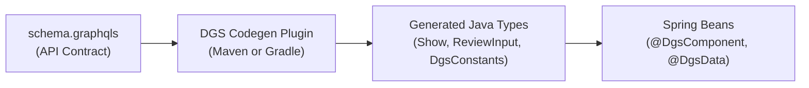
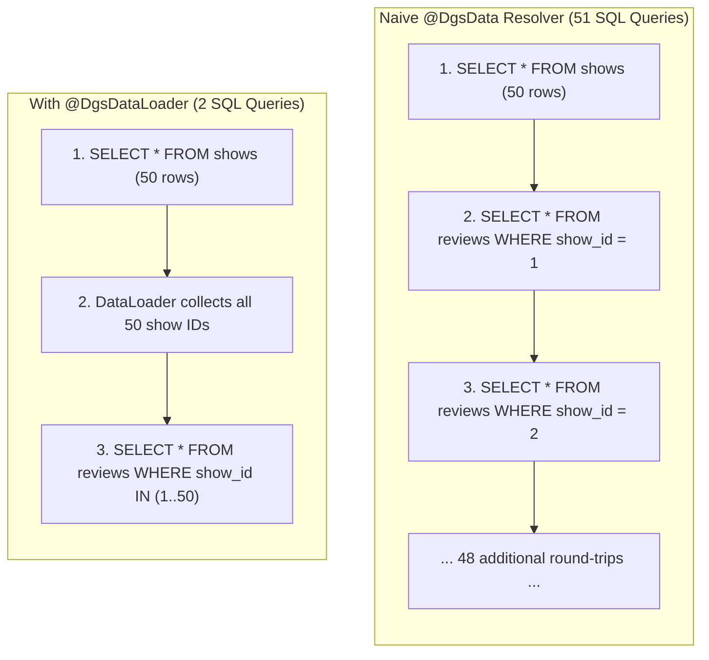
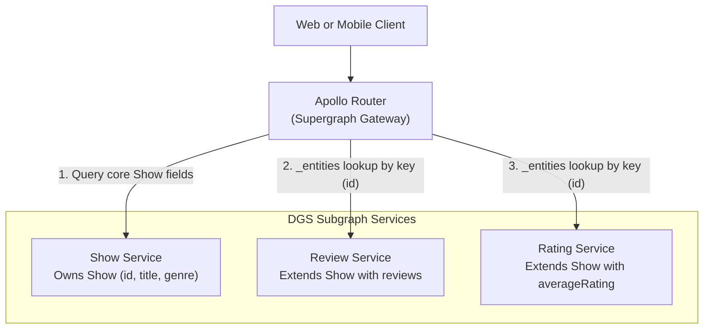

When an API serves a web dashboard, a mobile app, and a smart TV client at the same time, fixed REST payloads start pulling in opposite directions. A single `GET /api/v1/shows/42` endpoint either returns dozens of fields that a mobile list screen throws away (over-fetching), or stays minimal and forces the client to chain follow-up calls for cast members, reviews, and availability (under-fetching). As screens multiply, teams either add custom query flags to every endpoint or maintain separate Backend-for-Frontend services that duplicate orchestration logic.

GraphQL shifts payload selection to the caller. The server publishes a strongly typed schema describing what data exists and how types connect, and each client asks for the exact fields it needs in a single request.

Netflix built the **Domain Graph Service (DGS)** framework to run GraphQL across Spring Boot microservices at scale. Built on `graphql-java` (and integrated with Spring for GraphQL starting in DGS 9.x), DGS centers on schema-first development, build-time Java code generation, per-request `DataLoader` batching, and Apollo Federation support.

---

## Schema-First Design and Code Generation

Java GraphQL libraries fall into two camps: code-first (where annotations on Java classes produce the schema at startup) and schema-first (where `.graphqls` files are written first and serve as the contract). Netflix DGS is opinionated toward **schema-first**.



Putting the schema in version-controlled `.graphqls` files gives frontend and backend engineers a neutral contract to review in pull requests before writing resolver logic. During the build, the DGS code generator reads those files and produces Java classes for your types, input objects, enums, and field name constants (`DgsConstants`). If someone renames a field in the schema, the Java build breaks at compile time instead of failing silently at runtime with a null field.

### Writing the Schema

Place schema files under `src/main/resources/schema/`. DGS automatically discovers and merges all `.graphqls` files in that directory.

```graphql
type Query {
    shows(titleFilter: String): [Show!]!
    show(id: ID!): Show
}

type Mutation {
    addReview(showId: ID!, review: ReviewInput!): Review!
}

type Subscription {
    reviewAdded(showId: ID!): Review!
}

type Show {
    id: ID!
    title: String!
    releaseYear: Int!
    genre: Genre!
    licensingCost: Float
    # Resolved on demand only when requested by the client
    reviews: [Review!]!
    cast: [Actor!]!
}

type Review {
    id: ID!
    starRating: Int!
    comment: String
    authorName: String!
}

type Actor {
    id: ID!
    name: String!
}

input ReviewInput {
    starRating: Int!
    comment: String
    authorName: String!
}

enum Genre {
    SCI_FI
    DRAMA
    COMEDY
    ACTION
}
```

Notice the distinction between `type` (returned by the server) and `input` (accepted as arguments). GraphQL keeps output types and input types separate because output types can contain cyclic references and computed fields with arguments, while input types must be plain tree-shaped data.

### Maven Setup for Spring Boot 3

In modern Spring Boot 3.3+ applications, Netflix recommends importing the DGS platform BOM (`graphql-dgs-platform-dependencies`) and using `graphql-dgs-spring-graphql-starter`, which runs DGS on top of Spring for GraphQL's transport layer (HTTP, WebSockets, SSE, and Micrometer observability). Older DGS 8.x projects use `graphql-dgs-spring-boot-starter`.

```xml
<dependencyManagement>
    <dependencies>
        <dependency>
            <groupId>com.netflix.graphql.dgs</groupId>
            <artifactId>graphql-dgs-platform-dependencies</artifactId>
            <version>9.1.2</version>
            <type>pom</type>
            <scope>import</scope>
        </dependency>
    </dependencies>
</dependencyManagement>

<dependencies>
    <dependency>
        <groupId>com.netflix.graphql.dgs</groupId>
        <artifactId>graphql-dgs-spring-graphql-starter</artifactId>
    </dependency>
    <dependency>
        <groupId>org.springframework.boot</groupId>
        <artifactId>spring-boot-starter-web</artifactId>
    </dependency>
    <!-- Required if serving GraphQL Subscriptions over WebSockets -->
    <dependency>
        <groupId>org.springframework.boot</groupId>
        <artifactId>spring-boot-starter-websocket</artifactId>
    </dependency>
</dependencies>

<build>
    <plugins>
        <plugin>
            <groupId>io.github.deweyjose</groupId>
            <artifactId>graphqlcodegen-maven-plugin</artifactId>
            <version>1.60.2</version>
            <executions>
                <execution>
                    <goals>
                        <goal>generate</goal>
                    </goals>
                </execution>
            </executions>
            <configuration>
                <schemaPaths>
                    <param>src/main/resources/schema</param>
                </schemaPaths>
                <packageName>com.javahub.generated</packageName>
                <generateBoxedTypes>true</generateBoxedTypes>
                <generateDataTypes>true</generateDataTypes>
            </configuration>
        </plugin>
    </plugins>
</build>
```

> [!NOTE]
> Netflix maintains the official Gradle plugin (`com.netflix.dgs.codegen`). For Maven users, the community-maintained `io.github.deweyjose:graphqlcodegen-maven-plugin` wraps Netflix's core codegen library directly and tracks current DGS releases.

Running `mvn compile` generates `Show`, `Review`, `Actor`, `ReviewInput`, `Genre`, and `DgsConstants` under `target/generated-sources`.

---

## Implementing Queries, Mutations, and Subscriptions

In `graphql-java`, every field in a schema is resolved by a `DataFetcher`. If a field is a simple property on the returned Java object (like `Show.getTitle()`), GraphQL resolves it automatically via property lookup. You only write explicit resolvers for root operations (`Query`, `Mutation`, `Subscription`) and for nested fields that require a database call, a downstream service call, or custom logic.

DGS registers resolver classes with `@DgsComponent` (a stereotype over Spring's `@Component`).

- `@DgsQuery` is shorthand for `@DgsData(parentType = "Query")`.
- `@DgsMutation` is shorthand for `@DgsData(parentType = "Mutation")`.
- `@DgsSubscription` is shorthand for `@DgsData(parentType = "Subscription")` and returns a Reactive Streams `Publisher<T>` (such as Project Reactor's `Flux<T>`).
- `@DgsData(parentType = "...", field = "...")` attaches a resolver to any nested field on any GraphQL type.

```java
package com.javahub.datafetchers;

import com.javahub.generated.types.Review;
import com.javahub.generated.types.ReviewInput;
import com.javahub.generated.types.Show;
import com.javahub.service.ShowService;
import com.netflix.graphql.dgs.DgsComponent;
import com.netflix.graphql.dgs.DgsMutation;
import com.netflix.graphql.dgs.DgsQuery;
import com.netflix.graphql.dgs.DgsSubscription;
import com.netflix.graphql.dgs.InputArgument;
import org.reactivestreams.Publisher;
import reactor.core.publisher.Sinks;

import java.util.List;

@DgsComponent
public class ShowDataFetcher {

    private final ShowService showService;
    private final Sinks.Many<ReviewEvent> reviewSink =
            Sinks.many().multicast().directBestEffort();

    public ShowDataFetcher(ShowService showService) {
        this.showService = showService;
    }

    @DgsQuery
    public List<Show> shows(@InputArgument String titleFilter) {
        if (titleFilter == null || titleFilter.isBlank()) {
            return showService.findAllShows();
        }
        return showService.findByTitleContaining(titleFilter);
    }

    @DgsQuery
    public Show show(@InputArgument String id) {
        return showService.findById(id);
    }

    @DgsMutation
    public Review addReview(@InputArgument String showId, @InputArgument ReviewInput review) {
        Review saved = showService.addReview(showId, review);
        reviewSink.tryEmitNext(new ReviewEvent(showId, saved));
        return saved;
    }

    @DgsSubscription
    public Publisher<Review> reviewAdded(@InputArgument String showId) {
        return reviewSink.asFlux()
                .filter(event -> event.showId().equals(showId))
                .map(ReviewEvent::review);
    }

    private record ReviewEvent(String showId, Review review) {}
}
```

### How Subscriptions Run Over the Wire

Unlike queries and mutations, which execute over standard HTTP `POST /graphql`, subscriptions keep a long-lived stream open to push events to clients:

1. **WebSocket (`graphql-transport-ws`):** Enabled in Spring for GraphQL by setting `spring.graphql.websocket.path=/graphql` (with `spring-boot-starter-websocket` on the classpath). Clients send a `subscribe` frame and receive `next` frames as the `Publisher` emits items.
2. **Server-Sent Events (SSE):** Supported over standard HTTP (`Accept: text/event-stream`) with no WebSocket upgrade required, which simplifies routing through strict corporate proxies.

Keep in mind that the in-memory `Sinks.Many` shown above only broadcasts to clients connected to the same application instance. Across multiple Kubernetes pods, back the `Publisher` with a shared pub/sub broker such as Redis Pub/Sub, Kafka, or RabbitMQ so every pod receives newly created reviews.

---

## Solving the N+1 Query Problem with DataLoader

Child field resolvers are clean to write, which makes it very easy to introduce severe database load by accident. Consider this client query:

```graphql
query {
    shows {
        title
        reviews {
            starRating
            comment
        }
    }
}
```

If you write a straightforward `@DgsData` resolver for `Show.reviews`:

```java
// Bad: executes one SQL query per Show returned by Query.shows
@DgsData(parentType = "Show", field = "reviews")
public List<Review> reviews(DgsDataFetchingEnvironment dfe) {
    Show show = dfe.getSource();
    return reviewRepository.findByShowId(show.getId());
}
```

If `shows` returns 50 rows, `graphql-java` invokes `reviews(...)` 50 separate times. The database runs 1 query for the shows plus 50 queries for the reviews (51 total). Ask for 500 shows, and a single HTTP request fires 501 queries, tying up connection pool threads and slowing down every other caller.



### BatchLoader vs. MappedBatchLoader

`java-dataloader` solves this by deferring I/O until GraphQL has finished walking all sibling fields at the current level of the query tree. DGS supports two primary interfaces:

- **`MappedBatchLoader<K, V>`:** Receives a `Set<K>` of keys and returns `CompletionStage<Map<K, V>>`. This is usually the safer choice for database and microservice lookups because missing keys do not break positional alignment; if show `"42"` has no reviews, you can simply return an empty list or omit it (handling null/empty cleanly).
- **`BatchLoader<K, V>`:** Receives a `List<K>` of keys and must return a `CompletionStage<List<V>>` with the **exact same size and order** as the input list. If a key is not found, you must place `null` at that exact index, or `DataLoader` will fail with a mismatch error. It works well for dense 1-to-1 lookups where you map results back in key order.

Both interfaces also have `*WithContext` variants (`MappedBatchLoaderWithContext` and `BatchLoaderWithContext`) when you need to pass authentication headers, tenant IDs, or query arguments into the batch call via `BatchLoaderEnvironment`.

### Implementing a MappedBatchLoader

Because `DataLoader` runs asynchronously, avoid dumping blocking JDBC calls onto `ForkJoinPool.commonPool()` in high-throughput services. Inject a dedicated bounded executor (or a Java 21 virtual thread executor if your JDBC driver does not pin carrier threads).

```java
package com.javahub.dataloaders;

import com.javahub.generated.types.Review;
import com.javahub.repository.ReviewRepository;
import com.netflix.graphql.dgs.DgsDataLoader;
import org.dataloader.MappedBatchLoader;
import org.springframework.beans.factory.annotation.Qualifier;

import java.util.Collections;
import java.util.List;
import java.util.Map;
import java.util.Set;
import java.util.concurrent.CompletableFuture;
import java.util.concurrent.CompletionStage;
import java.util.concurrent.Executor;

@DgsDataLoader(name = "reviews")
public class ReviewsDataLoader implements MappedBatchLoader<String, List<Review>> {

    private final ReviewRepository reviewRepository;
    private final Executor ioExecutor;

    public ReviewsDataLoader(ReviewRepository reviewRepository,
                             @Qualifier("dgsDataLoaderExecutor") Executor ioExecutor) {
        this.reviewRepository = reviewRepository;
        this.ioExecutor = ioExecutor;
    }

    @Override
    public CompletionStage<Map<String, List<Review>>> load(Set<String> showIds) {
        return CompletableFuture.supplyAsync(() -> {
            Map<String, List<Review>> grouped = reviewRepository.findReviewsGroupedByShowIds(showIds);
            // Ensure every requested showId maps to a non-null list because schema defines [Review!]!
            showIds.forEach(id -> grouped.putIfAbsent(id, Collections.emptyList()));
            return grouped;
        }, ioExecutor);
    }
}
```

Then wire the loader into the field resolver by returning a `CompletableFuture`:

```java
package com.javahub.datafetchers;

import com.javahub.dataloaders.ReviewsDataLoader;
import com.javahub.generated.types.DgsConstants;
import com.javahub.generated.types.Review;
import com.javahub.generated.types.Show;
import com.netflix.graphql.dgs.DgsComponent;
import com.netflix.graphql.dgs.DgsData;
import com.netflix.graphql.dgs.DgsDataFetchingEnvironment;
import org.dataloader.DataLoader;

import java.util.List;
import java.util.concurrent.CompletableFuture;

@DgsComponent
public class ShowReviewsDataFetcher {

    @DgsData(parentType = DgsConstants.SHOW.TYPE_NAME, field = DgsConstants.SHOW.Reviews)
    public CompletableFuture<List<Review>> reviews(DgsDataFetchingEnvironment dfe) {
        Show show = dfe.getSource();
        DataLoader<String, List<Review>> dataLoader = dfe.getDataLoader(ReviewsDataLoader.class);
        return dataLoader.load(show.getId());
    }
}
```

### Per-Request Caching and Lifecycle

A `DataLoader` does two jobs: **batching** and **request-scoped memoization**.

When `reviews(...)` runs for 50 shows, each call to `dataLoader.load(show.getId())` queues the key and immediately returns an incomplete `CompletableFuture`. Once `graphql-java` finishes traversing the `shows` list, the execution strategy dispatches the batch, runs `load(Set<String>)` once, and completes all 50 futures.

Equally important is the **per-request cache**:

- DGS creates a fresh `DataLoaderRegistry` for every incoming GraphQL request.
- Within that single request, if two different branches of the query ask for the same key (for example, ten shows in the result all feature actor `"actor-7"`), `dataLoader.load("actor-7")` hits the in-memory `CacheMap` and returns the same `CompletableFuture` instead of fetching `"actor-7"` again.
- Once the HTTP request completes, the `DataLoader` instance and its cache are discarded. Cached data never leaks between different users or stays stale across requests.

> [!WARNING]
> While `DataLoader` instances are created per request, the Spring bean annotated with `@DgsDataLoader` is a **singleton** by default. Never store per-request mutable fields on your `MappedBatchLoader` class. If you need request-specific state, either implement `MappedBatchLoaderWithContext` or register a `Supplier` / prototype-scoped loader bean.

---

## Composing Microservices with Apollo Federation

In a larger organization, putting every domain type into one GraphQL application creates a shared deployment bottleneck. Teams end up stepping on each other's releases just to add a field to `Show` or `Customer`.

**Apollo Federation** splits the graph into independent services called **subgraphs**. Each Spring Boot DGS service owns its slice of the schema, and a router (such as Apollo Router) composes them into one client-facing **supergraph**.



In the Review Service subgraph, `Show` is referenced by its primary key (`@key(fields: "id")`) and extended with the `reviews` field (using Federation v2 syntax; Federation v1 uses `extend type Show` or `@extends` with `@external`):

```graphql
extend schema
    @link(url: "https://specs.apollo.dev/federation/v2.3", import: ["@key"])

type Show @key(fields: "id") {
    id: ID!
    reviews: [Review!]!
}
```

When the router needs `reviews` for a set of shows, it sends an `_entities` query to the Review Service containing representations like `{"__typename": "Show", "id": "101"}`. DGS routes those representations to an `@DgsEntityFetcher` method:

```java
package com.javahub.federation;

import com.javahub.generated.types.Show;
import com.netflix.graphql.dgs.DgsComponent;
import com.netflix.graphql.dgs.DgsEntityFetcher;

import java.util.Map;

@DgsComponent
public class ShowEntityFetcher {

    @DgsEntityFetcher(name = "Show")
    public Show resolveShow(Map<String, Object> values) {
        String id = (String) values.get("id");
        // Return a stub containing only the key; ShowReviewsDataFetcher + DataLoader fetches reviews
        return Show.newBuilder().id(id).build();
    }
}
```

Because `resolveShow` only constructs a lightweight stub with the `id`, the router can pass 50 `Show` representations in one `_entities` request, and your existing `ReviewsDataLoader` will still batch all 50 review lookups into a single SQL query.

---

## Security: Field-Level Authorization and Query Limits

GraphQL changes your security surface compared to REST. You no longer have one URL per resource, so URL-based authorization rules (`/api/admin/**`) only protect the entire `/graphql` endpoint, not individual fields. At the same time, letting clients shape their own queries means a single HTTP request can trigger expensive nested traversal.

### Field-Level Authorization with Spring Security

Because `@DgsComponent` beans are regular Spring beans, Spring Security method security (`@EnableMethodSecurity`) works directly on `@DgsQuery`, `@DgsMutation`, and `@DgsData` methods. This lets public fields stay accessible while sensitive fields on the exact same type require elevated roles.

```java
package com.javahub.datafetchers;

import com.javahub.generated.types.DgsConstants;
import com.javahub.generated.types.Show;
import com.javahub.service.ContractService;
import com.netflix.graphql.dgs.DgsComponent;
import com.netflix.graphql.dgs.DgsData;
import com.netflix.graphql.dgs.DgsDataFetchingEnvironment;
import org.springframework.security.access.prepost.PreAuthorize;

@DgsComponent
public class ShowFinancialsDataFetcher {

    private final ContractService contractService;

    public ShowFinancialsDataFetcher(ContractService contractService) {
        this.contractService = contractService;
    }

    @PreAuthorize("hasRole('FINANCE_ADMIN')")
    @DgsData(parentType = DgsConstants.SHOW.TYPE_NAME, field = DgsConstants.SHOW.LicensingCost)
    public Double licensingCost(DgsDataFetchingEnvironment dfe) {
        Show show = dfe.getSource();
        return contractService.findLicensingCost(show.getId());
    }
}
```

If an unauthenticated or non-admin user requests `{ show(id: "1") { title licensingCost } }`, GraphQL can still return `title` while returning `null` for `licensingCost` alongside an error entry in the `errors` array (assuming `licensingCost` is nullable in the schema and you have a custom `DataFetcherExceptionHandler` mapping `AccessDeniedException` to a clean `PERMISSION_DENIED` error without leaking stack traces).

### Guarding Against Deep and Expensive Queries

If `Show` references `cast: [Actor!]!` and `Actor` references `shows: [Show!]!`, a client can craft a circular query nested 15 levels deep. Even with DataLoaders, the fan-out multiplies exponentially at every level and can saturate CPU and memory.

Production GraphQL servers layer four defenses before execution starts:

1. **Query Depth Limiting:** Reject queries whose AST nesting exceeds a configured ceiling (commonly 5 to 8 levels).
2. **Query Complexity Analysis:** Assign cost weights to fields and multiply list fields by their requested page size (`first` / `limit`), rejecting queries over a budget.
3. **Disable Introspection in Production:** Prevent external scanners from dumping your entire schema (`spring.graphql.schema.introspection.enabled=false` or `dgs.graphql.introspection.enabled=false`).
4. **Persisted Queries (Safelisting):** For first-party web and mobile apps, register allowed query documents at build time and only accept known SHA-256 query hashes in production.

Register `graphql-java` instrumentations as standard Spring beans and DGS wires them automatically:

```java
package com.javahub.config;

import graphql.analysis.FieldComplexityCalculator;
import graphql.analysis.MaxQueryComplexityInstrumentation;
import graphql.analysis.MaxQueryDepthInstrumentation;
import org.springframework.context.annotation.Bean;
import org.springframework.context.annotation.Configuration;

@Configuration
public class GraphQLProtectionConfig {

    @Bean
    public MaxQueryDepthInstrumentation maxQueryDepthInstrumentation() {
        return new MaxQueryDepthInstrumentation(7);
    }

    @Bean
    public MaxQueryComplexityInstrumentation maxQueryComplexityInstrumentation() {
        FieldComplexityCalculator calculator = (env, childComplexity) -> {
            // Multiply child cost by requested page size when a list field accepts a "limit" argument
            Object limitArg = env.getArguments().get("limit");
            int multiplier = (limitArg instanceof Number n) ? Math.max(1, n.intValue()) : 1;
            return 1 + (childComplexity * multiplier);
        };
        return new MaxQueryComplexityInstrumentation(200, calculator);
    }
}
```

---

## Trade-Offs: GraphQL vs. REST

GraphQL solves real client aggregation problems, but it is not a blanket upgrade over REST. Knowing where it creates friction saves teams from adopting it for the wrong workload.

| Area | GraphQL (Netflix DGS) | REST (Spring MVC) |
| :--- | :--- | :--- |
| **Data Fetching** | Client chooses exact fields; avoids multi-call waterfalls | Server fixes payload shape; simple for resource-centric APIs |
| **HTTP and CDN Caching** | Harder; most queries use `POST /graphql` with JSON bodies (requires APQ over `GET` or GraphQL-aware edge caches) | Native support via `GET`, `ETag`, `Cache-Control`, and standard CDNs |
| **Observability and Errors** | HTTP status is usually `200 OK` even on partial failures; monitoring must inspect GraphQL `errors` and operation names | Standard HTTP status codes (`400`, `404`, `500`) work directly with gateways and log dashboards |
| **Query Cost Control** | Requires depth limits, complexity scoring, and DataLoader discipline | Cost per endpoint is predictable and bounded by design |
| **Binary Files and Streaming** | Awkward; multipart upload specs exist but add friction | First-class support for multipart uploads, range requests, and downloads |

**When GraphQL shines:** Client-facing aggregation layers serving diverse UIs (mobile, web, TV) over deeply connected domain graphs where round-trip count and payload size directly affect user experience.

**When REST or gRPC is a better fit:** Public APIs that rely heavily on CDN edge caching, file upload/download endpoints, simple CRUD admin services, and high-throughput service-to-service calls inside a cluster (where gRPC with Protobuf avoids GraphQL parsing and AST validation overhead).

---

## Interview Questions

### How does a DataLoader prevent the N+1 query problem, and what is the scope of its cache?

A `DataLoader` separates requesting a value from executing the underlying I/O. When `graphql-java` evaluates a field resolver across sibling elements (such as 50 `Show` records), each resolver calls `dataLoader.load(key)`. Instead of hitting the database right away, the loader queues the key and returns an uncompleted `CompletableFuture`. Once all sibling resolvers at that level have been visited, the engine dispatches the loader, which executes a single batched query (such as `WHERE show_id IN (...)`) and resolves all queued futures together.

By default, a `DataLoader` cache is scoped to **a single GraphQL request**. If multiple parts of the same query ask for the same key, the loader returns the cached `CompletableFuture` without repeating the lookup. At the end of the request, the cache is discarded so data is never shared across users or served stale on later requests.

### When should you choose `MappedBatchLoader` over `BatchLoader`?

Use `BatchLoader<K, V>` when you can guarantee that your batch function returns a `List<V>` with the exact same length and ordering as the input `List<K>` (filling missing entries with `null` at the corresponding index). Use `MappedBatchLoader<K, V>` when fetching from a SQL database (`WHERE id IN (...)`) or a downstream service that only returns rows for keys that exist, or returns them in arbitrary order. Returning a `Map<K, V>` avoids positional index bugs when some keys have no matching records.

### How do you secure a GraphQL API against both unauthorized field access and denial-of-service queries?

Authorization is enforced at the resolver or service layer using Spring Security annotations like `@PreAuthorize` on `@DgsQuery`, `@DgsMutation`, and `@DgsData` methods, since URL-level rules only guard the single `/graphql` endpoint. Denial-of-service protection happens before execution by combining `MaxQueryDepthInstrumentation` (to stop deeply nested circular queries), `MaxQueryComplexityInstrumentation` (to cap weighted field and list fan-out cost), disabling introspection in production, and using persisted query safelists for first-party clients.

### Why is HTTP caching harder with GraphQL than with REST, and how do teams work around it?

Standard HTTP caches (browsers, Varnish, CloudFront, Cloudflare) key responses by URL and HTTP method, caching `GET` requests automatically via `Cache-Control` and `ETag`. GraphQL typically sends queries inside a `POST /graphql` request body, which standard HTTP caches bypass. Teams work around this by using **Automatic Persisted Queries (APQ)** over `GET` requests (passing a short query hash and variables as query parameters so CDNs can cache the URL), or by caching lower down at the service/DataLoader layer using Redis or Caffeine.
