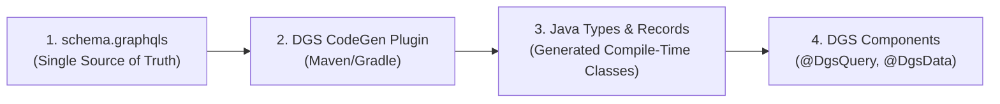
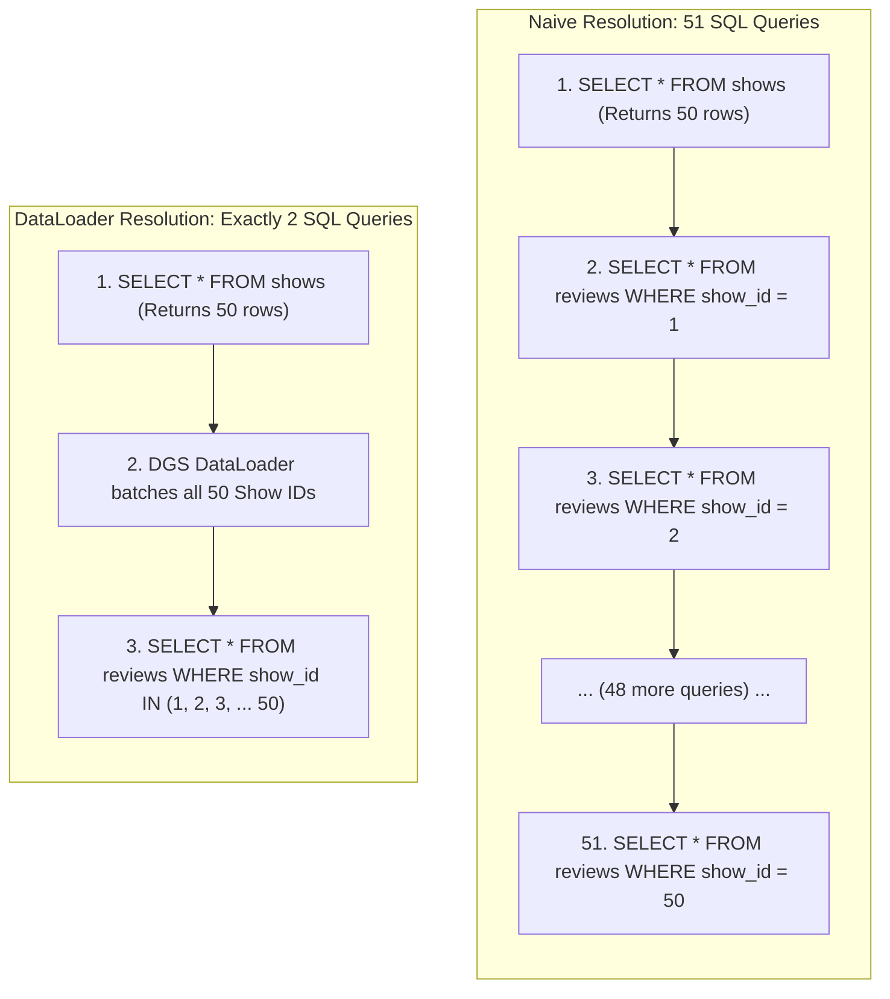
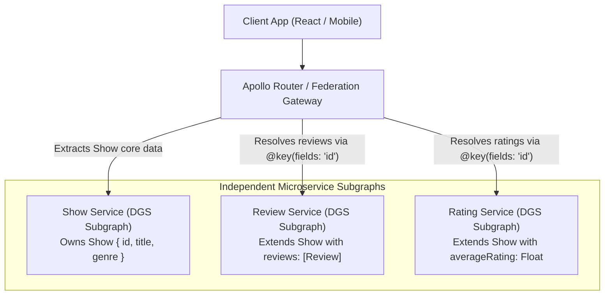

# GraphQL with Netflix DGS

In traditional REST architectures, the server dictates the shape of the data. Over time, as mobile apps, desktop dashboards, and smartwatch clients evolve, REST endpoints encounter two chronic performance bottlenecks:

1. **Over-fetching:** A mobile client calling `GET /api/v1/users/42` receives an enormous 40-field JSON payload containing billing addresses, audit metadata, and account settings when it only needed the user's `firstName` and `avatarUrl`. Over cellular networks, this wastes bandwidth and drains device battery.
2. **Under-fetching (The Waterfall Problem):** To render a single e-commerce product page, the client must execute a cascade of dependent HTTP requests: first `GET /products/100`, then extract the author ID to call `GET /authors/45`, then call `GET /products/100/reviews`, and finally `GET /inventory/100`. Latency compounds sequentially.

**GraphQL** inverts this relationship: the client specifies the exact fields it requires, and the server returns precisely that shape in a single round-trip.

At Netflix, managing hundreds of microservices with millions of concurrent client devices led to the creation of the **Domain Graph Service (DGS) Framework**. Built natively on top of Spring Boot and `graphql-java`, Netflix DGS provides schema-first code generation, enterprise testing harnesses, first-class **DataLoader** batching, and turnkey **Apollo Federation** support.

---

## The Core Philosophy of Netflix DGS

Unlike code-first frameworks that generate GraphQL schemas from Java annotations, Netflix DGS enforces a **Schema-First** paradigm:



1. **Contract-First Collaboration:** Frontend and backend engineers collaborate on a clean `.graphqls` schema file before writing a single line of backend code.
2. **Compile-Time Safety:** The DGS CodeGen plugin parses the schema during the build process and generates type-safe Java records, query builders, and input types. If a field name in the schema changes, your Java code fails to compile immediately rather than throwing runtime reflection errors.
3. **Spring Boot Native:** DGS components are standard Spring beans annotated with `@DgsComponent`, enabling dependency injection, security filters, and metrics out of the box.

---

## Schema Definition and Code Generation

Let's build a domain for an enterprise video streaming catalog.

### Step 1: Define the GraphQL Schema

Place this file in `src/main/resources/schema/schema.graphqls`:

```graphql
type Query {
    shows(titleFilter: String): [Show!]!
    show(id: ID!): Show
}

type Mutation {
    addReview(showId: ID!, review: ReviewInput!): Review!
}

type Show {
    id: ID!
    title: String!
    releaseYear: Int!
    genre: Genre!
    # Resolved lazily by dedicated DataFetcher
    reviews: [Review!]!
    cast: [Actor!]!
}

type Review {
    id: ID!
    starRating: Int!
    comment: String
    authorName: String!
}

type Actor {
    id: ID!
    name: String!
}

input ReviewInput {
    starRating: Int!
    comment: String
    authorName: String!
}

enum Genre {
    SCI_FI
    DRAMA
    COMEDY
    ACTION
}
```

### Step 2: Configure the DGS Maven Plugin

```xml
<dependencies>
    <!-- Netflix DGS Spring Boot 3 Starter -->
    <dependency>
        <groupId>com.netflix.graphql.dgs</groupId>
        <artifactId>graphql-dgs-spring-boot-starter</artifactId>
        <version>8.6.0</version>
    </dependency>
</dependencies>

<build>
    <plugins>
        <plugin>
            <groupId>com.netflix.graphql.dgs.codegen</groupId>
            <artifactId>dgs-codegen-maven-plugin</artifactId>
            <version>6.1.5</version>
            <executions>
                <execution>
                    <goals>
                        <goal>generate</goal>
                    </goals>
                </execution>
            </executions>
            <configuration>
                <schemaPaths>
                    <param>src/main/resources/schema</param>
                </schemaPaths>
                <packageName>com.javahub.generated</packageName>
                <generateBoxedTypes>true</generateBoxedTypes>
                <generateDataTypes>true</generateDataTypes>
            </configuration>
        </plugin>
    </plugins>
</build>
```

When you run `mvn compile`, DGS automatically generates immutable Java models: `Show`, `Review`, `ReviewInput`, and `Genre`.

---

## Implementing DGS Data Fetchers

In GraphQL terminology, a resolver is called a **DataFetcher**. In DGS, you define resolvers using the `@DgsComponent` annotation:

```java
package com.javahub.datafetchers;

import com.javahub.generated.types.Genre;
import com.javahub.generated.types.Review;
import com.javahub.generated.types.ReviewInput;
import com.javahub.generated.types.Show;
import com.javahub.service.ShowService;
import com.netflix.graphql.dgs.DgsComponent;
import com.netflix.graphql.dgs.DgsMutation;
import com.netflix.graphql.dgs.DgsQuery;
import com.netflix.graphql.dgs.InputArgument;

import java.util.List;

@DgsComponent
public class ShowDataFetcher {

    private final ShowService showService;

    public ShowDataFetcher(ShowService showService) {
        this.showService = showService;
    }

    // Resolves Query.shows(titleFilter: String)
    @DgsQuery
    public List<Show> shows(@InputArgument String titleFilter) {
        if (titleFilter == null || titleFilter.isBlank()) {
            return showService.findAllShows();
        }
        return showService.findByTitleContaining(titleFilter);
    }

    // Resolves Query.show(id: ID!)
    @DgsQuery
    public Show show(@InputArgument String id) {
        return showService.findById(id);
    }

    // Resolves Mutation.addReview(...)
    @DgsMutation
    public Review addReview(@InputArgument String showId, @InputArgument ReviewInput review) {
        return showService.addReview(showId, review);
    }
}
```

---

## The GraphQL N+1 Problem and DGS DataLoaders

The most severe architectural hazard in GraphQL is the **N+1 Query Problem**.

### The Anatomy of the Failure

Suppose a client requests 50 shows and their reviews:

```graphql
query {
    shows {
        title
        reviews {
            starRating
            comment
        }
    }
}
```

If you resolve the `reviews` field using a naive `@DgsData` resolver:

```java
// DANGEROUS: Causes the N+1 Database Catastrophe!
@DgsData(parentType = "Show", field = "reviews")
public List<Review> reviews(DgsDataFetchingEnvironment dfe) {
    Show show = dfe.getSource();
    // Executes 1 separate SQL query PER SHOW!
    return reviewRepository.findByShowId(show.getId()); 
}
```

The execution flow triggers:
- 1 SQL query to fetch the 50 shows: `SELECT * FROM shows;`
- **50 separate SQL queries** to fetch reviews for each show: `SELECT * FROM reviews WHERE show_id = ?;`

If the client requests 1,000 items, your database receives 1,001 queries for a single HTTP request, completely exhausting the database connection pool.



### The Remedy: Batch Loading with `@DgsDataLoader`

A **DataLoader** is a utility from `java-dataloader` that batches individual field requests across a single execution context and resolves them in a single aggregated call using deferred `CompletableFuture` promises.

#### Step 1: Implement the MappedBatchLoader

```java
package com.javahub.dataloaders;

import com.javahub.generated.types.Review;
import com.javahub.repository.ReviewRepository;
import com.netflix.graphql.dgs.DgsDataLoader;
import org.dataloader.MappedBatchLoader;

import java.util.List;
import java.util.Map;
import java.util.Set;
import java.util.concurrent.CompletableFuture;
import java.util.concurrent.CompletionStage;

@DgsDataLoader(name = "reviewsLoader")
public class ReviewsDataLoader implements MappedBatchLoader<String, List<Review>> {

    private final ReviewRepository reviewRepository;

    public ReviewsDataLoader(ReviewRepository reviewRepository) {
        this.reviewRepository = reviewRepository;
    }

    @Override
    public CompletionStage<Map<String, List<Review>>> load(Set<String> showIds) {
        // Asynchronously executes ONE single batch query: 
        // SELECT * FROM reviews WHERE show_id IN (:showIds)
        return CompletableFuture.supplyAsync(() -> reviewRepository.findReviewsGroupedByShowIds(showIds));
    }
}
```

#### Step 2: Use the DataLoader in the Field Resolver

```java
package com.javahub.datafetchers;

import com.javahub.dataloaders.ReviewsDataLoader;
import com.javahub.generated.types.Review;
import com.javahub.generated.types.Show;
import com.netflix.graphql.dgs.DgsComponent;
import com.netflix.graphql.dgs.DgsData;
import com.netflix.graphql.dgs.DgsDataFetchingEnvironment;
import org.dataloader.DataLoader;

import java.util.List;
import java.util.concurrent.CompletableFuture;

@DgsComponent
public class ShowReviewsDataFetcher {

    @DgsData(parentType = "Show", field = "reviews")
    public CompletableFuture<List<Review>> reviews(DgsDataFetchingEnvironment dfe) {
        Show show = dfe.getSource();
        
        // Retrieve the registered DataLoader by name
        DataLoader<String, List<Review>> dataLoader = dfe.getDataLoader(ReviewsDataLoader.class);
        
        // Enqueue this show's ID. DataLoader will batch all IDs across the query execution!
        return dataLoader.load(show.getId());
    }
}
```

### How DataLoader Works Under the Hood:
1. When GraphQL resolves the 50 `Show` objects, each `reviews` field resolver invokes `dataLoader.load(show.getId())`.
2. Instead of calling the database, the DataLoader immediately returns an unfulfilled `CompletableFuture` and enqueues the ID into its internal queue.
3. Once all sibling fields in the current execution level are visited, the GraphQL engine triggers `dispatch()`.
4. The DataLoader fires a **single SQL query** containing all 50 show IDs (`WHERE show_id IN (...)`), maps the results, and completes the futures simultaneously.

---

## Apollo Federation: Building the Enterprise Supergraph

In a microservice mesh, you do not want a single monolithic backend maintaining the entire enterprise GraphQL schema. The `Show` service should own show metadata, while an independent `Billing` service owns customer subscriptions, and a `Search` service owns recommendation scores.

**Apollo Federation** allows independent microservices (called **Subgraphs**) to compose into a single unified **Supergraph**:



### Extending Entities Across Microservices

In the Review Service, we extend the `Show` type originally defined in the Show Service:

```graphql
type Show @key(fields: "id") @extends {
    id: ID! @external
    reviews: [Review!]!
}
```

### Implementing `@DgsEntityFetcher`

The Review Service must provide an **Entity Fetcher** so the Apollo Router can resolve the federated `Show` representation:

```java
package com.javahub.federation;

import com.javahub.generated.types.Show;
import com.netflix.graphql.dgs.DgsComponent;
import com.netflix.graphql.dgs.DgsEntityFetcher;

import java.util.Map;

@DgsComponent
public class ShowEntityFetcher {

    @DgsEntityFetcher(name = "Show")
    public Show resolveShow(Map<String, Object> values) {
        // Apollo Router passes the key fields: {"__typename": "Show", "id": "101"}
        String id = (String) values.get("id");
        
        // Return a stub representation; reviews field resolver will resolve the rest!
        return Show.newBuilder().id(id).build();
    }
}
```

---

## Production Security: Defense Against Malicious Queries

Because GraphQL allows clients to specify arbitrary query shapes, malicious attackers or poorly written frontend scripts can trigger Denial-of-Service (DoS) attacks by sending **deeply nested recursive queries**:

```graphql
# MALICIOUS: Circular Recursive DoS Query
query InfiniteLoopAttack {
    show(id: "1") {
        cast {
            shows {
                cast {
                    shows {
                        cast {
                            shows {
                                title
                            }
                        }
                    }
                }
            }
        }
    }
}
```

A query like this can cause millions of nested resolver executions, pinning backend CPU and exhausting database connection pools.

### Defensive Hardening in Production:

1. **Max Query Depth Instrumentation:** Restrict how deep a query can nest (typically max depth = 5 to 7).
2. **Query Complexity Analysis:** Assign numeric cost weights to fields and reject any query exceeding a threshold (e.g., max complexity = 200).
3. **Persisted Queries (Automatic Persisted Queries - APQ):** In production, disable arbitrary GraphQL query execution entirely. The server only executes pre-approved query hashes compiled into the frontend build artifact.

```java
package com.javahub.config;

import graphql.analysis.MaxQueryComplexityInstrumentation;
import graphql.analysis.MaxQueryDepthInstrumentation;
import org.springframework.context.annotation.Bean;
import org.springframework.context.annotation.Configuration;

@Configuration
public class GraphQLSecurityConfig {

    // Enforce maximum query depth of 6 levels
    @Bean
    public MaxQueryDepthInstrumentation maxQueryDepthInstrumentation() {
        return new MaxQueryDepthInstrumentation(6);
    }

    // Enforce maximum computational complexity of 150 points
    @Bean
    public MaxQueryComplexityInstrumentation maxQueryComplexityInstrumentation() {
        return new MaxQueryComplexityInstrumentation(150);
    }
}
```

---

## Senior Engineer Interview Crucible

### How does a `DataLoader` solve the GraphQL N+1 problem under the hood using execution dispatching?

A `DataLoader` decouples the *request* for an entity from the actual *execution* of the fetch. When the GraphQL engine traverses the execution AST and encounters field resolvers for multiple sibling nodes, each resolver invokes `dataLoader.load(key)`. Instead of executing an immediate I/O call, the DataLoader enqueues the key in memory and returns an uncompleted `CompletableFuture`.

Once all field resolvers at that level of the query tree have executed, the GraphQL engine's execution strategy triggers the DataLoader's `dispatch()` phase. The DataLoader flushes its queued keys, invokes a single batch-fetching function (e.g., `WHERE id IN (...)`), and maps the returned entities to resolve the pending futures. This transforms what would have been `N` independent database queries into a single batch query.

---

### Contrast Apollo Federation with a traditional monolithic GraphQL schema or a Backend-for-Frontend (BFF) gateway.

In a **Monolithic GraphQL Schema**, all types, mutations, and business logic reside in a single codebase. While simple initially, it creates a massive deployment bottleneck as dozens of microservice teams attempt to coordinate schema changes and merges within a single repository.

A **Backend-for-Frontend (BFF)** creates specialized gateways tailored to specific clients (e.g., iOS BFF, Web BFF). However, BFFs frequently duplicate business orchestration logic and cross-service aggregation code across multiple gateway services.

**Apollo Federation** is a declarative, distributed architecture. Microservice teams independently own, build, and deploy their own GraphQL subgraphs. Using federation directives like `@key`, `@extends`, and `@external`, independent services extend shared entity types. An intelligent gateway (such as Apollo Router) composes these subgraphs into a unified Supergraph at runtime, automatically planning and routing queries across the microservice mesh without requiring custom aggregation boilerplate.

---

### How do you prevent malicious clients from running denial-of-service queries (e.g. deeply nested circular recursive queries)?

To prevent GraphQL Denial-of-Service attacks, enterprise architectures implement three layers of defensive instrumentation:

1. **Query Depth Limiting:** Using `MaxQueryDepthInstrumentation`, the engine calculates the syntax tree depth of the query. If a query nests beyond a safe threshold (e.g., 5-7 levels deep), it is rejected before execution begins.
2. **Query Complexity Scoring:** Using `MaxQueryComplexityInstrumentation`, every field in the schema is assigned a computational cost (e.g., scalar fields cost 1, paginated list connections cost 10). The total cost is summed, and queries exceeding a maximum complexity limit are blocked.
3. **Persisted Queries (Query Whitelisting):** In high-security or mobile-first environments, arbitrary client queries are forbidden in production. Frontend applications register their query strings at build time, generating a cryptographic SHA-256 hash. The client transmits only the hash over HTTP. If the gateway does not recognize the hash in its approved whitelist, the request is instantly rejected.

---

### What are the performance and architectural trade-offs between GraphQL and REST for microservices? When is REST still superior?

While GraphQL eliminates over-fetching and under-fetching on the client, it introduces architectural trade-offs:

- **HTTP Caching:** REST maps natively to HTTP semantics. Browsers, CDNs (Cloudflare/Akamai), and reverse proxies (Varnish) can effortlessly cache `GET /products/123` responses using standard `Cache-Control` and `ETag` headers. Because GraphQL queries are typically sent via `POST` requests to a single `/graphql` endpoint with varying query payloads, edge caching requires specialized GraphQL CDN support.
- **Complexity and Overhead:** GraphQL parsing, validation, AST execution, and DataLoader dispatching add CPU and memory overhead compared to direct, highly optimized REST JSON serialization.
- **File Uploads and Streaming:** REST is significantly simpler and more performant for binary file uploads (multipart forms), video streaming, and chunked transfers.

**When REST is Still Superior:** High-throughput internal inter-service communication (machine-to-machine), large file transfers, and simple static CRUD APIs where caching at the CDN edge is paramount. GraphQL is superior for client-facing edge aggregation across heterogeneous devices.
