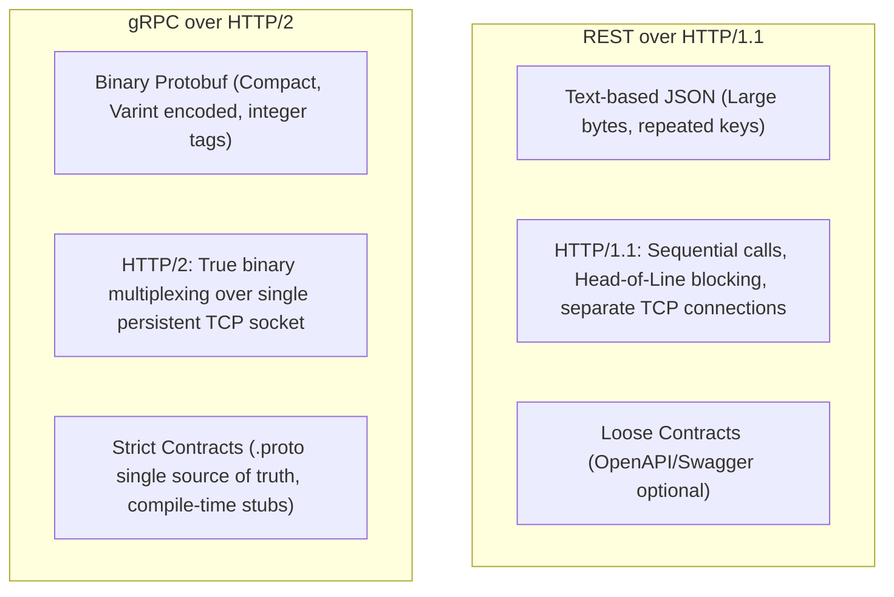
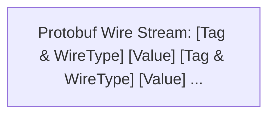
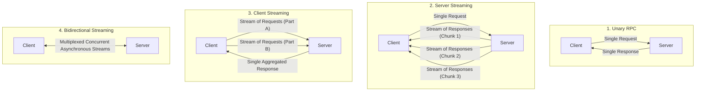
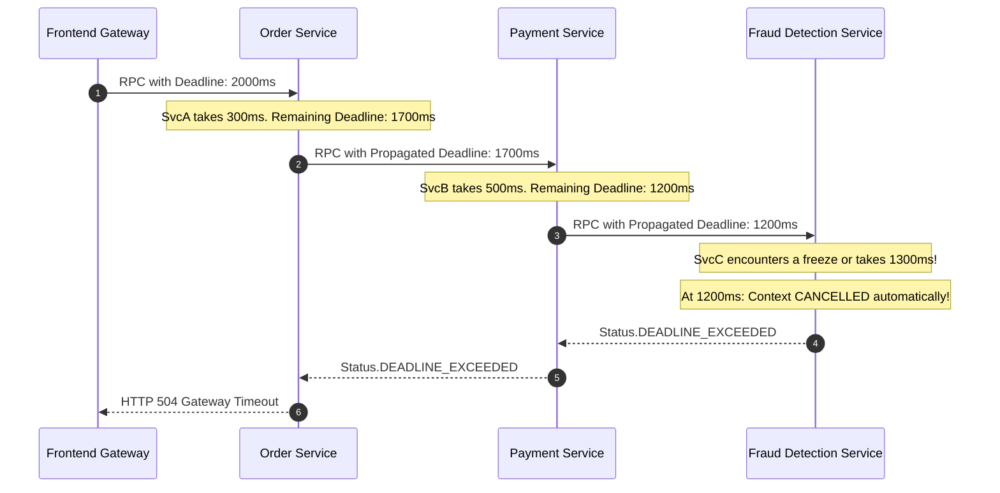
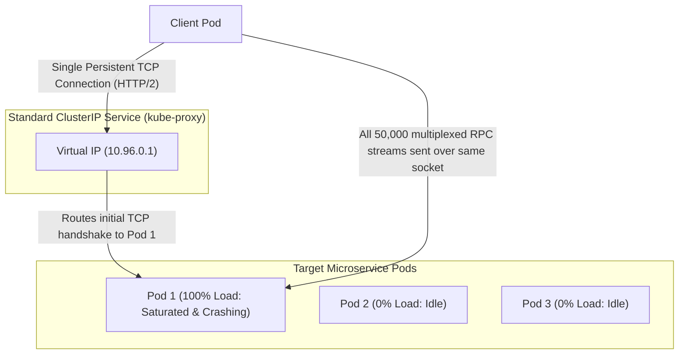

# High-Performance gRPC in Java

When building public-facing APIs for mobile devices and third-party developers, REST over HTTP/1.1 with JSON payloads is the universal standard. Its human-readable text and tooling support make it ideal for the public internet.

However, inside an enterprise microservice mesh where services execute millions of inter-service calls per second, REST and JSON become an architectural bottleneck:
- **JSON Overhead:** JSON is a text-based, uncompressed format. Field names like `"transactionTimestamp"` and `"customerBillingAddress"` are repeated in every single payload. Serializing, parsing strings, and converting text to Java objects consumes massive CPU cycles.
- **HTTP/1.1 Head-of-Line (HoL) Blocking:** HTTP/1.1 can only process one active request at a time per TCP connection. To achieve concurrency, services must maintain large, expensive connection pools, incurring continuous TCP handshakes and TLS overhead.

To achieve sub-millisecond latencies and maximize network bandwidth, high-performance distributed systems rely on **gRPC** (Google Remote Procedure Call) running over **HTTP/2** with binary **Protocol Buffers (Protobuf)**.

In this deep dive, we will unpack Protobuf wire internals, build a production gRPC microservice in Java, optimize it with Java 21 Virtual Threads, and resolve the classic Kubernetes gRPC load balancing dilemma.

---

## Architectural Comparison: REST vs gRPC



| Dimension | REST + JSON | gRPC + Protocol Buffers |
| :--- | :--- | :--- |
| **Payload Format** | Plaintext UTF-8 JSON | Compact binary serialized Protobuf |
| **Transport Protocol** | HTTP/1.1 (or HTTP/2 for transport only) | Native HTTP/2 (Multiplexed bidirectional streams) |
| **Contract Definition** | OpenAPI / JSON Schema (Optional, decoupled) | `.proto` IDL file (Mandatory, compile-time enforced) |
| **Client Code Generation** | Third-party tooling (often out of sync) | Native compiler (`protoc`) generates type-safe stubs |
| **Streaming Capabilities** | Request/Response only (SSE/WebSockets required for streaming) | Native Unary, Client, Server, and Bidirectional Streaming |
| **Performance Profile** | Higher CPU serialization & memory pressure | 7-10x faster serialization, 60-80% smaller bandwidth footprint |

---

## Protocol Buffers (Protobuf) Wire Internals

Protocol Buffers is not just a serialization format; it is an Interface Definition Language (IDL) engineered for minimal wire size and backward compatibility.

### The `.proto` Definition

```protobuf
syntax = "proto3";

package com.javahub.trading;

option java_multiple_files = true;
option java_package = "com.javahub.trading.grpc";

message OrderExecutionRequest {
  string order_id = 1;
  string account_id = 2;
  double price = 3;
  int32 quantity = 4;
  OrderType type = 5;
}

enum OrderType {
  LIMIT = 0;
  MARKET = 1;
  STOP_LOSS = 2;
}

message OrderExecutionResponse {
  string execution_id = 1;
  string order_id = 2;
  bool success = 3;
  int64 executed_at_timestamp = 4;
}

service TradingEngineService {
  rpc ExecuteOrder (OrderExecutionRequest) returns (OrderExecutionResponse);
  rpc StreamMarketPrices (MarketPriceRequest) returns (stream MarketTick);
}
```

### Why Protobuf Payloads Are Tiny: Tag-Length-Value and Varints

In JSON, sending an order looks like this (96 bytes):
```json
{"order_id":"ord-100","account_id":"acc-42","price":150.5,"quantity":10,"type":"LIMIT"}
```

In Protobuf, the same data takes **18 bytes**. Why?



1. **No Field Names on the Wire:** Protobuf never transmits the strings `"order_id"` or `"quantity"`. Instead, it transmits the integer **field tag numbers** (`1`, `2`, `3`, `4`). The receiving Java stub knows from the compiled schema that tag `4` maps to `quantity`.
2. **Varint (Variable-Length Quantity) Encoding:** Standard integers in Java always occupy 4 bytes (32 bits), even if the value is just `10`. Protobuf uses **Varints**, where numbers are stored using only as many 7-bit bytes as needed. The number `10` takes a single byte instead of 4.
3. **ZigZag Encoding for Signed Integers:** Negative numbers normally have the high bit set (`0xFFFFFFFF`), which would require 5 or 10 bytes in standard Varints. Protobuf maps signed integers to unsigned values using ZigZag encoding, ensuring small negative numbers (like `-1`, `-2`) encode into 1 or 2 bytes.

---

## The Four gRPC Communication Paradigms

Unlike REST which is fundamentally request-response, gRPC supports four communication models:



- **Unary:** Client sends 1 request, receives 1 response (traditional RPC).
- **Server Streaming:** Client sends 1 request (e.g., subscribe to stock symbol `"GOOG"`), and the server keeps the stream open, pushing price updates as they occur.
- **Client Streaming:** Client streams data in chunks (e.g., uploading a 2GB file or streaming IoT sensor telemetry), and the server returns a single acknowledgment when complete.
- **Bidirectional Streaming:** Both client and server read and write independent streams over the same persistent HTTP/2 connection simultaneously (ideal for chat systems, multi-player gaming, and live order matching).

---

## Building a gRPC Service in Spring Boot 3

Let's implement a high-throughput trading service using modern Java and Spring Boot.

### Step 1: Maven Dependencies and Protobuf Compiler Plugin

```xml
<dependencies>
    <!-- gRPC Netty Transport -->
    <dependency>
        <groupId>io.grpc</groupId>
        <artifactId>grpc-netty-shaded</artifactId>
        <version>1.63.0</version>
    </dependency>
    <dependency>
        <groupId>io.grpc</groupId>
        <artifactId>grpc-protobuf</artifactId>
        <version>1.63.0</version>
    </dependency>
    <dependency>
        <groupId>io.grpc</groupId>
        <artifactId>grpc-stub</artifactId>
        <version>1.63.0</version>
    </dependency>
    <!-- Modern Spring Boot gRPC Starter -->
    <dependency>
        <groupId>net.devh</groupId>
        <artifactId>grpc-spring-boot-starter</artifactId>
        <version>3.1.0.RELEASE</version>
    </dependency>
</dependencies>

<build>
    <extensions>
        <extension>
            <groupId>kr.motd.maven</groupId>
            <artifactId>os-maven-plugin</artifactId>
            <version>1.7.1</version>
        </extension>
    </extensions>
    <plugins>
        <plugin>
            <groupId>org.xolstice.maven.plugins</groupId>
            <artifactId>protobuf-maven-plugin</artifactId>
            <version>0.6.1</version>
            <configuration>
                <protocArtifact>com.google.protobuf:protoc:3.25.3:exe:${os.detected.classifier}</protocArtifact>
                <pluginId>grpc-java</pluginId>
                <pluginArtifact>io.grpc:protoc-gen-grpc-java:1.63.0:exe:${os.detected.classifier}</pluginArtifact>
            </configuration>
            <executions>
                <execution>
                    <goals>
                        <goal>compile</goal>
                        <goal>compile-custom</goal>
                    </goals>
                </execution>
            </executions>
        </plugin>
    </plugins>
</build>
```

Running `mvn compile` generates the Java stubs:
- `OrderExecutionRequest` (the type-safe model)
- `TradingEngineServiceGrpc.TradingEngineServiceImplBase` (the abstract server base)
- `TradingEngineServiceGrpc.TradingEngineServiceBlockingStub` (synchronous client)
- `TradingEngineServiceGrpc.TradingEngineServiceStub` (asynchronous streaming client)

### Step 2: Implementing the Server Service

```java
package com.javahub.trading.service;

import com.javahub.trading.grpc.OrderExecutionRequest;
import com.javahub.trading.grpc.OrderExecutionResponse;
import com.javahub.trading.grpc.TradingEngineServiceGrpc;
import io.grpc.Status;
import io.grpc.stub.StreamObserver;
import net.devh.boot.grpc.server.service.GrpcService;
import org.slf4j.Logger;
import org.slf4j.LoggerFactory;

import java.time.Instant;
import java.util.UUID;

@GrpcService
public class GrpcTradingService extends TradingEngineServiceGrpc.TradingEngineServiceImplBase {

    private static final Logger log = LoggerFactory.getLogger(GrpcTradingService.class);

    @Override
    public void executeOrder(OrderExecutionRequest request, 
                             StreamObserver<OrderExecutionResponse> responseObserver) {
        log.info("Received order execution request for account: {}, SKU: {}, qty: {}", 
                request.getAccountId(), request.getOrderId(), request.getQuantity());

        // Business Validation
        if (request.getPrice() <= 0 || request.getQuantity() <= 0) {
            // In gRPC, exceptions are returned via StatusRuntimeException with standard codes
            responseObserver.onError(Status.INVALID_ARGUMENT
                    .withDescription("Price and Quantity must be strictly positive")
                    .asRuntimeException());
            return;
        }

        try {
            // Simulated matching engine execution
            String executionId = "exec-" + UUID.randomUUID();
            
            OrderExecutionResponse response = OrderExecutionResponse.newBuilder()
                    .setExecutionId(executionId)
                    .setOrderId(request.getOrderId())
                    .setSuccess(true)
                    .setExecutedAtTimestamp(Instant.now().toEpochMilli())
                    .build();

            // 1. Send the response payload
            responseObserver.onNext(response);
            
            // 2. Complete the stream
            responseObserver.onCompleted();

        } catch (Exception e) {
            log.error("Execution failed for order: {}", request.getOrderId(), e);
            responseObserver.onError(Status.INTERNAL
                    .withDescription("Internal matching engine failure")
                    .asRuntimeException());
        }
    }
}
```

---

## High-Throughput Optimization with Java 21 Virtual Threads

By default, gRPC Java uses a shared Netty thread pool for network I/O, handing RPC invocations off to an executor service. In high-concurrency environments where gRPC methods make blocking calls to databases or other microservices, operating system worker threads quickly exhaust.

With **Java 21 Virtual Threads (Project Loom)**, we can bind gRPC server dispatching to lightweight virtual threads:

```java
package com.javahub.trading.config;

import io.grpc.ServerBuilder;
import net.devh.boot.grpc.server.serverfactory.GrpcServerConfigurer;
import org.springframework.context.annotation.Bean;
import org.springframework.context.annotation.Configuration;

import java.util.concurrent.Executors;

@Configuration
public class GrpcVirtualThreadsConfig {

    @Bean
    public GrpcServerConfigurer grpcServerConfigurer() {
        return serverBuilder -> {
            // Assign a Virtual Thread Per Task Executor to the gRPC server dispatcher!
            serverBuilder.executor(Executors.newVirtualThreadPerTaskExecutor());
        };
    }
}
```

Now, every inbound RPC runs in its own lightweight virtual thread. Even if 20,000 requests block waiting for database responses simultaneously, the JVM consumes almost zero OS thread overhead and avoids thread starvation.

---

## Interceptors, Deadlines, and Cancellation Propagation

In distributed systems, requests that hang indefinitely consume thread pools and cause cascading cluster failures.

### Deadlines: Preventing Orphan Work

A **Deadline** defines how long a client is willing to wait for an RPC to finish. Crucially, gRPC **automatically propagates deadlines across microservices**:



When a client sets `.withDeadlineAfter(2000, TimeUnit.MILLISECONDS)`, gRPC serializes the remaining deadline into the HTTP/2 headers. If Service C detects that the deadline has elapsed while processing, its `io.grpc.Context.current().isCancelled()` becomes `true`. Service C immediately halts expensive calculations, freeing resources.

### Client Interceptor with Deadline and Distributed Tracing

```java
package com.javahub.trading.client;

import io.grpc.CallOptions;
import io.grpc.Channel;
import io.grpc.ClientCall;
import io.grpc.ClientInterceptor;
import io.grpc.ForwardingClientCall;
import io.grpc.Metadata;
import io.grpc.MethodDescriptor;
import org.slf4j.MDC;

import java.util.concurrent.TimeUnit;

public class ResilientClientInterceptor implements ClientInterceptor {

    private static final Metadata.Key<String> CORRELATION_KEY =
            Metadata.Key.of("x-correlation-id", Metadata.ASCII_STRING_MARSHALLER);

    @Override
    public <ReqT, RespT> ClientCall<ReqT, RespT> interceptCall(
            MethodDescriptor<ReqT, RespT> method, 
            CallOptions callOptions, 
            Channel next) {

        // 1. Enforce default 3-second deadline if none was explicitly configured
        if (callOptions.getDeadline() == null) {
            callOptions = callOptions.withDeadlineAfter(3000, TimeUnit.MILLISECONDS);
        }

        return new ForwardingClientCall.SimpleForwardingClientCall<ReqT, RespT>(next.newCall(method, callOptions)) {
            @Override
            public void start(Listener<RespT> responseListener, Metadata headers) {
                // 2. Propagate correlation ID from SLF4J MDC into gRPC Metadata headers
                String correlationId = MDC.get("correlationId");
                if (correlationId != null) {
                    headers.put(CORRELATION_KEY, correlationId);
                }
                super.start(responseListener, headers);
            }
        };
    }
}
```

---

## The Kubernetes gRPC Load Balancing Dilemma

The single most common production failure when deploying gRPC services to Kubernetes is **Load Imbalance**.

### Why Standard Kubernetes ClusterIP Services Fail with gRPC

When a standard Kubernetes Service (`ClusterIP`) balances HTTP/1.1 traffic, kube-proxy works well: clients open a new TCP connection for every few requests, and IPTables routes new connections across different backend pods.

However, **gRPC uses long-lived HTTP/2 TCP connections**:



1. The client resolves the Service IP and initiates a single TCP handshake.
2. Kube-proxy connects the TCP socket to Pod 1.
3. Because HTTP/2 multiplexes all requests over that single connection, **every single RPC stream for the next 48 hours is sent to Pod 1**.
4. Pod 1 spikes to 100% CPU and crashes with OutOfMemory errors, while Pods 2 and 3 sit completely idle.

### The Two Production Solutions

#### Solution A: Client-Side Load Balancing with Headless Services

Instead of a ClusterIP, define a **Headless Service** (`clusterIP: None`):

```yaml
apiVersion: v1
kind: Service
metadata:
  name: trading-engine-headless
spec:
  clusterIP: None # Headless service returns individual Pod IPs via DNS A records!
  selector:
    app: trading-engine
  ports:
    - port: 9090
      targetPort: 9090
```

In the Java client, configure the gRPC channel to use DNS round-robin:

```java
ManagedChannel channel = ManagedChannelBuilder
        .forTarget("dns:///trading-engine-headless:9090")
        .defaultLoadBalancingPolicy("round_robin")
        .usePlaintext()
        .build();
```

The gRPC client queries DNS, receives the IP addresses of all active pods, opens separate HTTP/2 connections to each pod, and distributes streams across them in a round-robin fashion.

#### Solution B: Service Mesh / L7 Sidecar Proxy (Envoy / Istio)

Deploy **Envoy** or **Istio** alongside your services. Envoy terminates the HTTP/2 connection at the local pod boundary, inspects individual gRPC request frames, and balances individual streams across backend pods at Layer 7.

---

## Senior Engineer Interview Crucible

### Why does standard Kubernetes ClusterIP load balancing fail for gRPC traffic, and how do you resolve it?

Standard Kubernetes `ClusterIP` services operate at Layer 4 (Transport Layer). When an application opens a TCP connection to the service's Virtual IP, `kube-proxy` (via iptables or IPVS) selects a single backend pod to receive that TCP connection. 

While this works for HTTP/1.1 where connections are constantly opened and closed, gRPC uses **HTTP/2**, which establishes a single long-lived TCP connection and multiplexes thousands of concurrent RPC streams across it. As a result, the client remains pinned to that single backend pod for the lifetime of the connection, routing 100% of the traffic to one pod while other pods remain idle.

There are two primary solutions:
1. **Client-Side Load Balancing:** Use a Kubernetes **Headless Service** (`clusterIP: None`). The gRPC client resolves DNS to receive all individual pod IPs and uses built-in client-side load balancing (such as round-robin) to open connections to each pod and distribute streams across them.
2. **Layer 7 Proxy / Service Mesh:** Route traffic through an L7 reverse proxy (like Envoy or Istio). The proxy terminates the HTTP/2 connection, inspects each gRPC frame, and distributes individual RPC calls across backend pods.

---

### Explain how Protobuf achieves significantly smaller payload sizes compared to JSON using field tags and Varint encoding.

Protobuf achieves high compression through three primary design mechanisms:

1. **Integer Field Tags Instead of Strings:** In JSON, field names (e.g., `"accountNumber": 12345`) are transmitted as repetitive ASCII text strings in every message. In Protobuf, field names are stripped during compilation. The wire payload contains only the integer field tag number (e.g., `1`), which occupies only a few bits.
2. **Varint (Variable-Length Quantity) Encoding:** Standard Java integers occupy 4 bytes (32 bits), regardless of value. Protobuf uses Varints, which use the most significant bit (MSB) as a continuation flag and store the integer in 7-bit blocks. Small numbers (like 5 or 42) require only a single byte on the wire instead of 4.
3. **ZigZag Encoding for Negatives:** In standard binary, negative numbers have leading 1-bits (`0xFFFFFFFF`), requiring 10 bytes in a 64-bit varint. Protobuf's `sint32` and `sint64` use ZigZag encoding to map negative numbers to small positive numbers (e.g., `-1` becomes `1`, `1` becomes `2`, `-2` becomes `3`), allowing small negative numbers to encode in 1 or 2 bytes.

---

### Walk through the four gRPC communication modes. When would you use Bidirectional Streaming over a message broker like Kafka?

The four gRPC modes are:
1. **Unary:** Single request produces a single response.
2. **Server Streaming:** Single request produces a continuous stream of response messages from the server.
3. **Client Streaming:** Client sends a continuous stream of messages, and the server returns a single response upon completion.
4. **Bidirectional Streaming:** Both client and server send independent streams of messages concurrently over a single HTTP/2 connection.

**When to choose Bidirectional Streaming over Kafka:**
Bidirectional streaming is ideal for **ultra-low-latency, synchronous, interactive point-to-point dialogues** between two specific nodes where intermediate disk persistence is unnecessary. Examples include real-time financial market order matching, interactive video gaming state synchronization, or live audio/video processing pipelines. 

Kafka is designed for durable, multi-consumer event broadcasting, decoupled publish-subscribe topologies, and asynchronous event log replay. If you need immediate sub-millisecond bidirectional handshakes between two running processes, gRPC bidirectional streaming provides lower latency without message broker infrastructure overhead.

---

### How do gRPC Deadlines prevent cascading failures in distributed systems, and what happens if a downstream service ignores deadline propagation?

In a deep microservice call graph (Service A -> Service B -> Service C), if Service C becomes slow or deadlocks, threads in Service A and B block waiting for responses. Under heavy traffic, connection pools and thread pools across the entire chain saturate, causing a complete system outage.

A **gRPC Deadline** specifies an absolute timestamp before which the operation must complete. gRPC automatically serializes the remaining time into the HTTP/2 headers and passes it downstream. If the deadline expires while Service B is waiting for Service C, the gRPC runtime automatically cancels the call, throws `Status.DEADLINE_EXCEEDED`, and releases the waiting threads.

If a downstream service ignores deadline propagation (e.g., does not inspect `io.grpc.Context.current().isCancelled()` during long-running loops or blocking I/O), it becomes an **orphan worker**: it continues consuming database connections, disk I/O, and CPU cycles computing a result that the upstream caller has already abandoned. Properly engineered gRPC services always check context cancellation during expensive loops to terminate work immediately.

