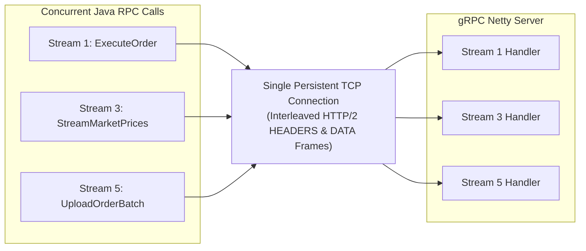
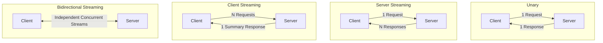
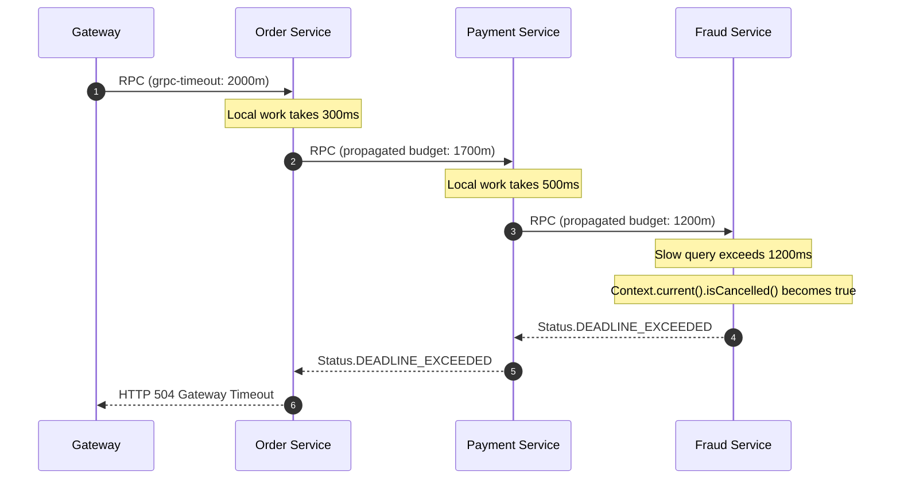
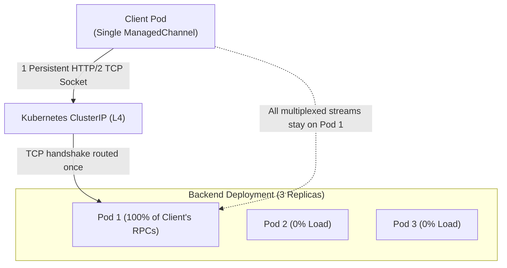

REST over HTTP/1.1 with JSON is easy to debug with `curl` and works everywhere on the public web. Inside a backend cluster, though, a single user action often fans out across five or ten internal microservices. At thousands of internal calls per second, repeating JSON property names as UTF-8 text, parsing them into temporary objects, and maintaining large HTTP/1.1 connection pools adds measurable CPU cost and tail latency.

**gRPC** targets that internal service-to-service gap. It pairs **Protocol Buffers (Protobuf)** for strongly typed binary serialization with **HTTP/2** for multiplexed, bidirectional transport. Instead of maintaining loose OpenAPI documentation alongside handwritten HTTP clients, you define your messages and RPC methods once in a `.proto` file and compile type-safe Java stubs directly from it.

---

## Protocol Buffers Schemas and Backward Compatibility

A `.proto` file is both a serialization schema and a service contract. Here is a trading service definition covering all four RPC communication patterns:

```protobuf
syntax = "proto3";

package com.javahub.trading.v1;

option java_multiple_files = true;
option java_package = "com.javahub.trading.grpc";

message OrderExecutionRequest {
  string order_id = 1;
  string account_id = 2;
  double price = 3;
  int32 quantity = 4;
  OrderType type = 5;

  // Never reuse removed field numbers or names
  reserved 6, 9 to 11;
  reserved "legacy_broker_code";
}

enum OrderType {
  ORDER_TYPE_UNSPECIFIED = 0;
  LIMIT = 1;
  MARKET = 2;
  STOP_LOSS = 3;
}

message OrderExecutionResponse {
  string execution_id = 1;
  string order_id = 2;
  bool accepted = 3;
  int64 executed_at_epoch_ms = 4;
}

message MarketPriceRequest {
  string symbol = 1;
}

message MarketTick {
  string symbol = 1;
  double bid = 2;
  double ask = 3;
  int64 timestamp_epoch_ms = 4;
}

message BatchSummary {
  int32 received_count = 1;
  int32 accepted_count = 2;
}

message TradeCommand {
  string correlation_id = 1;
  OrderExecutionRequest order = 2;
}

message TradeEvent {
  string correlation_id = 1;
  string status = 2;
  double fill_price = 3;
}

service TradingEngineService {
  // 1. Unary RPC
  rpc ExecuteOrder (OrderExecutionRequest) returns (OrderExecutionResponse);

  // 2. Server-Streaming RPC
  rpc StreamMarketPrices (MarketPriceRequest) returns (stream MarketTick);

  // 3. Client-Streaming RPC
  rpc UploadOrderBatch (stream OrderExecutionRequest) returns (BatchSummary);

  // 4. Bidirectional Streaming RPC
  rpc TradeSession (stream TradeCommand) returns (stream TradeEvent);
}
```

### Wire Encoding and Field Numbering Rules

Protobuf payloads are typically much smaller and cheaper to parse than equivalent JSON, especially for numeric and repeated structured data (exact savings depend on payload shape and whether HTTP compression is enabled). Three wire-format choices explain why:

1. **Field tags instead of string keys:** Field names are never sent on the wire. Each field is encoded as a compact Tag-Length-Value entry combining the field number and its wire type. Field numbers `1` through `15` fit in a single byte on the wire; numbers `16` through `2047` take two bytes. Assign `1`–`15` to your most frequently populated fields.
2. **Varint encoding:** Small positive integers (`int32`, `int64`, `uint32`) use variable-length 7-bit encoding where the high bit signals whether another byte follows. A quantity of `10` takes 1 byte instead of 4.
3. **ZigZag encoding for `sint32` and `sint64`:** Standard `int32` and `int64` encode negative numbers in two's complement, which always takes 10 bytes as a varint. If a field frequently carries negative integers (such as price deltas or offsets), declare it as `sint32` or `sint64` so Protobuf applies ZigZag mapping (`-1 -> 1`, `1 -> 2`, `-2 -> 3`) and encodes small negative values in 1 or 2 bytes.

### Evolving `.proto` Contracts Safely

Microservices deploy independently, so old clients and new servers (and vice versa) will always talk to each other during rollouts. Follow these rules to keep wire compatibility intact:

- **Never reuse a deleted field number.** If an old client sends field `6` as a string and a new server reuses tag `6` for an `int64`, deserialization silently corrupts data or throws a wire-format error. Mark retired tags and names with `reserved`.
- **Never change the wire type of an existing field** (for example, changing `string` to `int32`).
- **Keep enum value `0` as `*_UNSPECIFIED`.** In `proto3`, unset enum fields default to `0`. Using an explicit unspecified value lets the server tell the difference between a caller intentionally passing `LIMIT` and a caller omitting the field altogether.
- **Add new fields safely.** Old readers skip unknown field numbers without failing; new readers see the type's default value (`0`, `""`, `false`) when reading messages from older callers. Use the `optional` keyword in `proto3` when you need `hasX()` presence checks on scalar fields.

---

## HTTP/2 Multiplexing, Binary Framing, and HPACK

gRPC relies on **HTTP/2** rather than HTTP/1.1. Under HTTP/1.1, a single TCP connection can handle only one active request-response cycle at a time (pipelining is rarely used due to response ordering constraints). Services compensate by opening pools of dozens of TCP connections, paying extra TLS handshakes and memory per socket.

HTTP/2 restructures the wire into a **binary framing layer**:



- **Binary frames and stream IDs:** Every RPC gets an odd-numbered client-initiated Stream ID (`1`, `3`, `5`, ...). Request and response payloads are split into `HEADERS` and `DATA` frames tagged with that Stream ID and interleaved over one TCP socket. A slow streaming call on Stream 3 does not block a fast unary call on Stream 5 at the HTTP layer. (TCP-level packet loss can still pause the underlying socket until retransmission, which is why transport-level head-of-line blocking is only fully removed by QUIC/HTTP/3.)
- **HPACK header compression:** HTTP/2 compresses metadata headers using static and dynamic lookup tables. Headers repeated on every RPC (`:scheme`, `content-type: application/grpc`, `authorization`, `user-agent`) are transmitted as short integer table indices after the first call.
- **Per-stream and connection flow control:** Receivers send `WINDOW_UPDATE` frames to advertise how many bytes they can buffer, giving streaming RPCs built-in backpressure so a fast producer cannot overwhelm a slow consumer.

---

## Code Generation and All Four RPC Modes in Java

Add the gRPC dependencies and `protobuf-maven-plugin` so Maven invokes `protoc` and `protoc-gen-grpc-java` during `mvn compile`:

```xml
<dependencies>
    <dependency>
        <groupId>io.grpc</groupId>
        <artifactId>grpc-netty-shaded</artifactId>
        <version>1.66.0</version>
    </dependency>
    <dependency>
        <groupId>io.grpc</groupId>
        <artifactId>grpc-protobuf</artifactId>
        <version>1.66.0</version>
    </dependency>
    <dependency>
        <groupId>io.grpc</groupId>
        <artifactId>grpc-stub</artifactId>
        <version>1.66.0</version>
    </dependency>
    <!-- Community Spring Boot 3 gRPC starter (Spring also offers spring-grpc as a newer official project) -->
    <dependency>
        <groupId>net.devh</groupId>
        <artifactId>grpc-spring-boot-starter</artifactId>
        <version>3.1.0.RELEASE</version>
    </dependency>
</dependencies>

<build>
    <extensions>
        <extension>
            <groupId>kr.motd.maven</groupId>
            <artifactId>os-maven-plugin</artifactId>
            <version>1.7.1</version>
        </extension>
    </extensions>
    <plugins>
        <plugin>
            <groupId>org.xolstice.maven.plugins</groupId>
            <artifactId>protobuf-maven-plugin</artifactId>
            <version>0.6.1</version>
            <configuration>
                <protocArtifact>com.google.protobuf:protoc:3.25.5:exe:${os.detected.classifier}</protocArtifact>
                <pluginId>grpc-java</pluginId>
                <pluginArtifact>io.grpc:protoc-gen-grpc-java:1.66.0:exe:${os.detected.classifier}</pluginArtifact>
            </configuration>
            <executions>
                <execution>
                    <goals>
                        <goal>compile</goal>
                        <goal>compile-custom</goal>
                    </goals>
                </execution>
            </executions>
        </plugin>
    </plugins>
</build>
```

Compiling generates the message builders plus three client stub flavors on `TradingEngineServiceGrpc`:

- `TradingEngineServiceBlockingStub`: synchronous calls for unary and server-streaming RPCs.
- `TradingEngineServiceStub`: asynchronous `StreamObserver`-based calls supporting all four modes.
- `TradingEngineServiceFutureStub`: `ListenableFuture`-based calls for unary RPCs.

### Implementing All Four RPC Modes on the Server



```java
package com.javahub.trading.service;

import com.javahub.trading.grpc.*;
import io.grpc.Context;
import io.grpc.Status;
import io.grpc.stub.StreamObserver;
import net.devh.boot.grpc.server.service.GrpcService;
import org.slf4j.Logger;
import org.slf4j.LoggerFactory;

import java.time.Instant;
import java.util.UUID;
import java.util.concurrent.atomic.AtomicInteger;

@GrpcService
public class GrpcTradingService extends TradingEngineServiceGrpc.TradingEngineServiceImplBase {

    private static final Logger log = LoggerFactory.getLogger(GrpcTradingService.class);

    // 1. Unary RPC: one request, one response
    @Override
    public void executeOrder(OrderExecutionRequest request,
                             StreamObserver<OrderExecutionResponse> responseObserver) {
        if (request.getPrice() <= 0 || request.getQuantity() <= 0) {
            responseObserver.onError(Status.INVALID_ARGUMENT
                    .withDescription("Price and quantity must be positive")
                    .asRuntimeException());
            return;
        }

        OrderExecutionResponse response = OrderExecutionResponse.newBuilder()
                .setExecutionId("exec-" + UUID.randomUUID())
                .setOrderId(request.getOrderId())
                .setAccepted(true)
                .setExecutedAtEpochMs(Instant.now().toEpochMilli())
                .build();

        responseObserver.onNext(response);
        responseObserver.onCompleted();
    }

    // 2. Server-Streaming RPC: one request, continuous responses until done or cancelled
    @Override
    public void streamMarketPrices(MarketPriceRequest request,
                                   StreamObserver<MarketTick> responseObserver) {
        if (request.getSymbol().isBlank()) {
            responseObserver.onError(Status.INVALID_ARGUMENT
                    .withDescription("Symbol is required")
                    .asRuntimeException());
            return;
        }

        try {
            for (int i = 0; i < 20; i++) {
                // Stop work immediately if the client disconnected or its deadline expired
                if (Context.current().isCancelled()) {
                    log.info("Client cancelled price stream for {}", request.getSymbol());
                    return;
                }

                double bid = 150.0 + (i * 0.05);
                MarketTick tick = MarketTick.newBuilder()
                        .setSymbol(request.getSymbol())
                        .setBid(bid)
                        .setAsk(bid + 0.02)
                        .setTimestampEpochMs(Instant.now().toEpochMilli())
                        .build();

                responseObserver.onNext(tick);
                Thread.sleep(250);
            }
            responseObserver.onCompleted();
        } catch (InterruptedException e) {
            Thread.currentThread().interrupt();
            responseObserver.onError(Status.CANCELLED
                    .withDescription("Stream interrupted")
                    .asRuntimeException());
        }
    }

    // 3. Client-Streaming RPC: stream of requests, one final summary
    @Override
    public StreamObserver<OrderExecutionRequest> uploadOrderBatch(
            StreamObserver<BatchSummary> responseObserver) {

        AtomicInteger received = new AtomicInteger();
        AtomicInteger accepted = new AtomicInteger();

        return new StreamObserver<>() {
            @Override
            public void onNext(OrderExecutionRequest order) {
                received.incrementAndGet();
                if (order.getPrice() > 0 && order.getQuantity() > 0) {
                    accepted.incrementAndGet();
                }
            }

            @Override
            public void onError(Throwable t) {
                log.warn("Client aborted order batch upload", t);
            }

            @Override
            public void onCompleted() {
                BatchSummary summary = BatchSummary.newBuilder()
                        .setReceivedCount(received.get())
                        .setAcceptedCount(accepted.get())
                        .build();
                responseObserver.onNext(summary);
                responseObserver.onCompleted();
            }
        };
    }

    // 4. Bidirectional Streaming RPC: independent inbound and outbound message streams
    @Override
    public StreamObserver<TradeCommand> tradeSession(StreamObserver<TradeEvent> responseObserver) {
        return new StreamObserver<>() {
            @Override
            public void onNext(TradeCommand command) {
                OrderExecutionRequest order = command.getOrder();
                String status = (order.getPrice() > 0 && order.getQuantity() > 0) ? "FILLED" : "REJECTED";

                TradeEvent event = TradeEvent.newBuilder()
                        .setCorrelationId(command.getCorrelationId())
                        .setStatus(status)
                        .setFillPrice(order.getPrice())
                        .build();

                // StreamObserver is not thread-safe; serialize writes if emitted from multiple threads
                responseObserver.onNext(event);
            }

            @Override
            public void onError(Throwable t) {
                log.warn("Bidirectional trade session closed with error", t);
            }

            @Override
            public void onCompleted() {
                responseObserver.onCompleted();
            }
        };
    }
}
```

### Calling Unary and Streaming RPCs from a Java Client

Always reuse a single `ManagedChannel` across calls to the same backend service. Creating a new channel per request defeats HTTP/2 multiplexing and wastes TCP/TLS handshakes.

```java
// Unary call with explicit deadline using the blocking stub
OrderExecutionResponse res = blockingStub
        .withDeadlineAfter(1500, TimeUnit.MILLISECONDS)
        .executeOrder(OrderExecutionRequest.newBuilder()
                .setOrderId("ord-100")
                .setAccountId("acc-42")
                .setPrice(150.50)
                .setQuantity(10)
                .setType(OrderType.LIMIT)
                .build());

// Client-streaming call using the async stub
StreamObserver<OrderExecutionRequest> requestStream = asyncStub.uploadOrderBatch(
        new StreamObserver<>() {
            @Override
            public void onNext(BatchSummary summary) {
                log.info("Batch finished: accepted {}/{}", summary.getAcceptedCount(), summary.getReceivedCount());
            }

            @Override
            public void onError(Throwable t) {
                log.error("Batch upload failed: {}", Status.fromThrowable(t));
            }

            @Override
            public void onCompleted() {
                log.info("Server closed summary stream");
            }
        });

requestStream.onNext(order1);
requestStream.onNext(order2);
requestStream.onCompleted();
```

### Pairing gRPC Servers with Java 21 Virtual Threads

Netty's event-loop threads handle socket I/O and hand application logic off to a server executor. If your gRPC handlers perform blocking JDBC queries or synchronous downstream calls, switching the gRPC server executor to virtual threads on Java 21+ avoids sizing a large platform thread pool:

```java
@Configuration
public class GrpcVirtualThreadsConfig {

    @Bean
    public GrpcServerConfigurer grpcServerConfigurer() {
        return serverBuilder -> serverBuilder.executor(Executors.newVirtualThreadPerTaskExecutor());
    }
}
```

Keep one caution in mind: virtual threads remove OS thread exhaustion, not database connection pool exhaustion. You still need bounded HikariCP pools and concurrency limits on downstream dependencies.

---

## Interceptors, Deadlines, and Error Handling

Cross-cutting concerns like authentication, distributed tracing, structured logging, and default timeouts belong in `ClientInterceptor` and `ServerInterceptor` rather than duplicated inside every RPC method.

### Deadlines and Automatic Propagation

A **deadline** is an absolute point in time by which a call must finish. When a client configures `.withDeadlineAfter(2000, TimeUnit.MILLISECONDS)`, gRPC transmits the remaining budget in the `grpc-timeout` HTTP/2 header.

If Service A receives a request with 2000ms left, spends 300ms doing local work, and then invokes Service B using the current `io.grpc.Context`, gRPC Java automatically propagates the remaining 1700ms deadline downstream without manual header math.



If a downstream handler never checks `Context.current().isCancelled()` during long loops (or ignores cancellation on blocking work), it keeps burning CPU and DB connections for a caller that has already moved on.

### ClientInterceptor for Deadlines and Trace Propagation

```java
package com.javahub.trading.interceptor;

import io.grpc.*;
import org.slf4j.MDC;

import java.util.concurrent.TimeUnit;

public class TracingDeadlineClientInterceptor implements ClientInterceptor {

    public static final Metadata.Key<String> CORRELATION_KEY =
            Metadata.Key.of("x-correlation-id", Metadata.ASCII_STRING_MARSHALLER);

    @Override
    public <ReqT, RespT> ClientCall<ReqT, RespT> interceptCall(
            MethodDescriptor<ReqT, RespT> method,
            CallOptions callOptions,
            Channel next) {

        if (callOptions.getDeadline() == null) {
            callOptions = callOptions.withDeadlineAfter(3000, TimeUnit.MILLISECONDS);
        }

        return new ForwardingClientCall.SimpleForwardingClientCall<>(next.newCall(method, callOptions)) {
            @Override
            public void start(Listener<RespT> responseListener, Metadata headers) {
                String correlationId = MDC.get("correlationId");
                if (correlationId != null) {
                    headers.put(CORRELATION_KEY, correlationId);
                }
                super.start(responseListener, headers);
            }
        };
    }
}
```

### ServerInterceptor for Authentication and Context Binding

On the server side, interceptors inspect incoming `Metadata`, reject invalid callers before the service method runs, and bind verified identities into `io.grpc.Context` (not `ThreadLocal`, because gRPC execution can hop across threads):

```java
package com.javahub.trading.interceptor;

import io.grpc.*;

public class AuthServerInterceptor implements ServerInterceptor {

    public static final Context.Key<String> USER_ID_CTX_KEY = Context.key("userId");

    private static final Metadata.Key<String> AUTH_HEADER =
            Metadata.Key.of("authorization", Metadata.ASCII_STRING_MARSHALLER);

    private final TokenVerifier tokenVerifier;

    public AuthServerInterceptor(TokenVerifier tokenVerifier) {
        this.tokenVerifier = tokenVerifier;
    }

    @Override
    public <ReqT, RespT> ServerCall.Listener<ReqT> interceptCall(
            ServerCall<ReqT, RespT> call,
            Metadata headers,
            ServerCallHandler<ReqT, RespT> next) {

        String authValue = headers.get(AUTH_HEADER);
        if (authValue == null || !authValue.startsWith("Bearer ")) {
            call.close(Status.UNAUTHENTICATED.withDescription("Missing bearer token"), new Metadata());
            return new ServerCall.Listener<>() {};
        }

        try {
            String userId = tokenVerifier.verifyAndExtractSubject(authValue.substring(7));
            Context ctx = Context.current().withValue(USER_ID_CTX_KEY, userId);
            return Contexts.interceptCall(ctx, call, headers, next);
        } catch (IllegalArgumentException ex) {
            call.close(Status.UNAUTHENTICATED.withDescription("Invalid or expired token"), new Metadata());
            return new ServerCall.Listener<>() {};
        }
    }
}
```

Inside any RPC handler, read the authenticated subject via `AuthServerInterceptor.USER_ID_CTX_KEY.get()`.

### Status Codes and `StatusRuntimeException`

gRPC does not serialize Java exceptions across the wire. Every failure is mapped to one of 16 canonical status codes carried in HTTP/2 trailing headers (`grpc-status` and `grpc-message`), surfaced to Java callers as `StatusRuntimeException`.

| gRPC Status Code | Meaning | Typical REST Equivalent | Safe to Retry? |
| :--- | :--- | :--- | :--- |
| `INVALID_ARGUMENT` | Caller sent invalid input | `400 Bad Request` | No |
| `UNAUTHENTICATED` | Missing or invalid credentials | `401 Unauthorized` | Only after refreshing token |
| `PERMISSION_DENIED` | Authenticated caller lacks rights | `403 Forbidden` | No |
| `NOT_FOUND` | Requested entity does not exist | `404 Not Found` | No |
| `ALREADY_EXISTS` / `ABORTED` | Duplicate key or concurrency conflict | `409 Conflict` | `ABORTED` yes, with backoff |
| `FAILED_PRECONDITION` | System state disallows the operation | `400` / `412` | No |
| `RESOURCE_EXHAUSTED` | Rate limit or quota exceeded | `429 Too Many Requests` | Yes, with backoff |
| `DEADLINE_EXCEEDED` | Call exceeded its deadline | `504 Gateway Timeout` | Only if idempotent |
| `UNAVAILABLE` | Transient network or pod restart error | `503 Service Unavailable` | Yes, with backoff |
| `INTERNAL` | Unexpected server bug | `500 Internal Server Error` | Usually no |

Keep `withDescription(...)` concise and free of internal stack traces or SQL snippets. When callers need structured machine-readable error fields (such as which input fields failed validation), attach a `com.google.rpc.Status` protobuf payload via `StatusProto.toStatusRuntimeException(...)` in trailing metadata rather than stuffing JSON into the description string.

---

## The L4 vs. L7 Load Balancing Gotcha

One of the most frequent production surprises with gRPC happens right after deploying to Kubernetes or behind a cloud Layer 4 load balancer (such as AWS NLB or Kubernetes `ClusterIP` via `kube-proxy`).

Layer 4 load balancers operate on TCP connections, not HTTP/2 streams. When a client opens a gRPC channel to a `ClusterIP` virtual IP, `kube-proxy` picks one backend pod for the TCP handshake. Because HTTP/2 multiplexes every subsequent RPC over that same long-lived TCP socket, **all traffic from that client stays pinned to that single pod**.



Scaling the backend from 2 pods to 10 pods during a traffic spike will not help existing clients at all: they keep hammering the original pods while the 8 new pods sit idle.

### Three Ways to Balance gRPC Properly

1. **Layer 7 Proxy or Service Mesh (Recommended for larger clusters):** Route traffic through an HTTP/2-aware L7 proxy such as Envoy, Istio, Linkerd, or an AWS ALB configured for gRPC. The proxy terminates the client's HTTP/2 connection, inspects individual RPC streams, and distributes each request across healthy backend pods.
2. **Client-Side Load Balancing with Kubernetes Headless Services:** Define a Headless Service (`clusterIP: None`) so DNS returns all individual pod IP addresses instead of a single virtual IP, then enable gRPC's built-in `round_robin` policy:

```yaml
apiVersion: v1
kind: Service
metadata:
  name: trading-engine-headless
spec:
  clusterIP: None
  selector:
    app: trading-engine
  ports:
    - name: grpc
      port: 9090
      targetPort: 9090
```

```java
ManagedChannel channel = ManagedChannelBuilder
        .forTarget("dns:///trading-engine-headless:9090")
        .defaultLoadBalancingPolicy("round_robin")
        .usePlaintext() // Use TLS in production
        .build();
```

Keep one caveat in mind with `dns:///`: gRPC's default DNS resolver does not continuously poll DNS unless connections drop or a refresh is triggered, so newly scaled pods may not receive traffic immediately unless paired with `maxConnectionAge` or an xDS control plane.

3. **Configure `maxConnectionAge` on the gRPC Server:** Even when using L4 balancers or DNS load balancing, configure a periodic connection age (for example, 5 minutes with jitter) on the server (`NettyServerBuilder.maxConnectionAge(...)` and `maxConnectionAgeGrace(...)`). The server gracefully sends an HTTP/2 `GOAWAY` frame, finishes in-flight RPCs, and forces clients to open fresh connections that pick up newly deployed pods.

---

## Interview Questions

### Why does a standard Kubernetes `ClusterIP` service unevenly balance gRPC traffic, and how do you fix it?

`ClusterIP` (via `kube-proxy` iptables or IPVS) performs Layer 4 connection-level load balancing. That works for short-lived HTTP/1.1 connections, but gRPC opens a single persistent HTTP/2 TCP connection and multiplexes all concurrent RPCs over it. Once the initial TCP connection lands on Pod 1, every RPC from that client stays on Pod 1 even if you scale out more pods.

You solve this either by introducing a Layer 7 HTTP/2-aware proxy or service mesh (Envoy, Istio, Linkerd) that balances per RPC stream, or by using client-side load balancing with a Kubernetes Headless Service (`clusterIP: None`) and gRPC's `round_robin` policy. Setting `maxConnectionAge` on the gRPC server also helps clients reconnect and discover new pods during scaling and rolling updates.

### What happens if you reuse a deleted Protobuf field number or change a field's type?

Because Protobuf transmits numeric field tags instead of field names, reusing a deleted tag causes older clients and newer servers to interpret the same bytes using different types or semantics. At best, deserialization throws a wire-type exception; at worst, it silently decodes garbage values (for instance, reading an old `bool` tag as an `int32` because both use varint wire type `0`). Always retire removed tags with `reserved` in the `.proto` file.

### How does gRPC deadline propagation stop cascading failures, and what must server code do to cooperate?

When a gateway sets a deadline (say 2 seconds), gRPC serializes the remaining time in the `grpc-timeout` header and subtracts elapsed time at each hop. If a downstream service takes too long, upstream callers fail fast with `Status.DEADLINE_EXCEEDED` instead of holding threads and connections open indefinitely. On the server side, handlers performing loops, streaming, or expensive computations should check `Context.current().isCancelled()` (or register a `CancellationListener`) so they stop work immediately rather than running as orphan tasks after the caller has timed out.

### Why are `sint32` and `sint64` different from `int32` and `int64` in Protobuf?

Standard `int32` and `int64` encode negative values in two's complement as 64-bit unsigned varints, which always consumes 10 bytes on the wire even for `-1`. `sint32` and `sint64` apply ZigZag encoding first, mapping small negative and positive numbers to small unsigned integers (`-1` becomes `1`, `1` becomes `2`, `-2` becomes `3`), so small negative numbers encode in 1 or 2 bytes.
