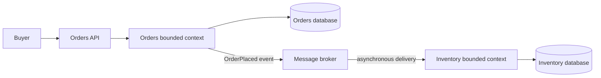

Microservices are not simply small Java applications or a way to split a large codebase into more repositories. They are an architectural style for building a system as independently deployable services, each responsible for a cohesive business capability. The design has to account for the consequences of moving calls, data, failures, and operations across process boundaries.

The central question is not “How small can a service be?” It is “Which business capability needs an independent boundary, and can the team operate that boundary reliably?”

## Monolith, SOA, and microservices

| Style | Typical deployment and ownership | Typical strengths | Typical costs |
|---|---|---|---|
| Monolith | One deployable application, which may contain many well-separated internal modules. | In-process calls and transactions are straightforward; local development, testing, and deployment can be simpler. | A tightly coupled codebase or shared deployment can make independent change and scaling harder. |
| Service-oriented architecture (SOA) | A family of service-oriented designs; service size, ownership, and integration governance vary widely. Some systems use shared integration infrastructure. | Can establish reusable service contracts and integrate heterogeneous systems. | Shared infrastructure or centralized change processes can increase coupling if services cannot evolve independently. |
| Microservices | A suite of autonomous, independently deployable services organized around business capabilities, with data and operations owned at service boundaries. | Teams can change, deploy, and scale suitable capabilities independently. | Network communication, distributed data, deployment automation, observability, and failure handling add system-wide complexity. |

These are architectural tendencies, not three mutually exclusive, precisely standardized definitions. Microservices are a service-oriented style, and the term does not guarantee a service's quality or size. A modular monolith can preserve strong domain boundaries while remaining one deployable application; a system with many services that require coordinated releases may still behave like a distributed monolith.

Do not split a well-structured monolith simply because microservices are popular. Independent deployment is useful only when the organizational and operational ability to deliver it outweighs the distributed-systems costs.

## Use Domain-Driven Design to find candidate boundaries

Domain-Driven Design (DDD) gives teams a vocabulary and process for modeling complex business software with domain experts:

- The **domain** is the business problem the software serves. A **subdomain** is a distinct part of that problem, such as catalog, inventory, or order fulfillment in a commerce system.
- **Strategic DDD** focuses on the large-scale model: subdomains, bounded contexts, and how the contexts relate.
- A **bounded context** is a boundary within which a particular domain model and its language have a defined meaning. The same word can mean different things in different contexts; for example, “product” in a catalog may include descriptions and merchandising details, while an order records the product facts agreed at purchase time.
- **Ubiquitous language** is the vocabulary domain experts and developers use consistently in discussion, documentation, and code within a context. It helps expose when apparently shared terms actually represent different rules.
- **Tactical DDD** supplies design tools inside a context, such as entities, value objects, aggregates, and domain services. An aggregate is a consistency boundary for domain changes; it is not automatically a microservice.

Map business processes and domain events with people who understand the business before choosing service boundaries. Event storming or another collaborative modeling technique can help surface responsibilities, policies, and language differences. Use the resulting contexts as candidates, then test whether each candidate has cohesive rules, owned data, a clear contract, and a team that can evolve it.

A bounded context is not mechanically identical to a service. One context might need several deployable components for technical or scaling reasons; several small contexts might initially live as modules in one application. Starting with clear module and data ownership can keep options open while the domain is still being learned.

## Align services with business capabilities

Consider a commerce system:

- **Catalog** owns product descriptions and the current catalog representation.
- **Inventory** owns stock levels and reservation rules.
- **Orders** owns the order lifecycle and the purchase-time facts it needs to fulfill the accepted order.

Each context can define its own model. The `Product` in a catalog context need not be the same Java class or schema as an item snapshot in an order. Sharing a single domain entity library across every service can quietly couple their release cycles and force them to use one model even when their business rules differ.

Draw boundaries around cohesive business capabilities and the invariants they protect, not around technical layers such as “all controllers,” “all repositories,” or “the database team.” A service should have a clear reason to change and an accountable owner. If a normal business change requires coordinated code edits and synchronized releases across several services, revisit the boundary or the contract.

## The database-per-service principle

Each service owns its persistent data and changes that data through its own application boundary. Other services interact through documented APIs or published events; they should not query or update the service's tables directly.

“Database per service” is about **logical ownership and access control**, not a requirement to buy a separate database server for every service. Depending on scale and isolation requirements, services may use private tables, separate schemas, or separate database instances. Separate credentials and database grants can enforce ownership even when services share infrastructure.

This boundary has important consequences:

- A service can evolve its schema without asking every consumer to coordinate a direct database query change.
- A local transaction can protect invariants owned by one service and its database.
- Cross-service reads cannot be solved with an ordinary database join. A client can compose API results, or a service can maintain a read model from events; either choice introduces latency, availability, and consistency trade-offs.
- A workflow that changes data in multiple services is not one local ACID transaction. It needs a business process for partial success, retries, and compensation; distributed transaction and saga patterns are covered later in the roadmap.
- Data duplication may be appropriate for a read model or historical snapshot. Define how it is refreshed and what staleness the business can tolerate instead of pretending all copies are instantly consistent.

The example shows the ownership boundary: Orders writes only its database and emits an event; Inventory reacts and writes its own database. The event crossing the boundary does not create one shared transaction, so Inventory's view may update later.

In this flow, an order can be accepted before inventory processes the event. If the business needs an immediate stock guarantee, define that reservation interaction explicitly; do not assume eventual event delivery is equivalent to synchronous confirmation.

## Independent services require explicit contracts

Once a boundary crosses a process or network, a method call becomes a protocol contract. Consumers and providers must agree on request and response meaning, error behavior, authorization, compatibility, and how changes are rolled out. A service can often evolve an additive contract independently, but removing or changing behavior still requires consumer coordination.

Choose synchronous requests when the caller needs an immediate answer and the dependency is appropriate for the request path. Choose asynchronous messaging when the producer and consumer can progress independently, absorb bursts, or react to facts later. Neither choice removes failure: synchronous calls add latency and dependency availability to the caller, while asynchronous delivery requires handling duplicates, delays, ordering constraints, and eventual consistency.

Keep the number of cross-service calls needed for one operation deliberate. A chatty chain of synchronous calls can make the user-facing request depend on the latency and availability of every service in the chain. The upcoming roadmap topics cover gateways, communication, and resilience patterns in more detail.

## Operational and organizational consequences

An application with many services is a distributed system, even when every service is written in Java and deployed on one platform. Production operations need repeatable builds and deployments, configuration and secret management, health checks, metrics, centralized logs, and distributed tracing that connects work across service boundaries. Each additional service adds a unit to monitor, secure, upgrade, and support.

Teams also need clear ownership of their service, its interface, and its data. Autonomy without automated delivery, observability, or on-call responsibility is not true independence; it simply moves integration work to another team or to production incidents.

## When to choose a modular monolith instead

A modular monolith is often a better starting point when:

- The domain boundaries are still changing or poorly understood.
- One team can deliver the application effectively as a single unit.
- Strong consistency across several capabilities is central to most use cases.
- The organization does not yet have the deployment automation and operational practices to run many services safely.
- Independent scaling or deployment has not been shown to be a meaningful constraint.

Keep modules cohesive, enforce dependency direction, and give data clear ownership even inside one process. If a capability later needs independent deployment, the existing boundaries provide a more reliable seam than an arbitrary split by package or database table.

## Common failure modes

- **Too many tiny services.** A service per entity, table, or Java class multiplies network and operational overhead without creating meaningful autonomy.
- **Shared database writes.** Consumers bypass the owner, couple themselves to its schema, and make safe independent changes difficult.
- **A distributed monolith.** Services are separate processes but must be released together, call each other synchronously for routine operations, or share internal models and databases.
- **Boundaries based only on technology.** Layer-based ownership forces ordinary business changes across teams and services.
- **Assuming eventual consistency is immediate.** A consumer may temporarily see a stale projection or process an event after the producer responds.
- **Applying one model everywhere.** The same business word can describe different concepts and invariants in different bounded contexts.
- **Choosing infrastructure before domain boundaries.** A message broker, service mesh, or orchestrator cannot repair unclear ownership or poorly split responsibilities.

## A practical boundary checklist

Before creating or extracting a service, ask:

1. What business capability and domain rules does it own?
2. Which team owns its code, data, interface, deployment, and operational response?
3. What invariant can it enforce locally, and which workflows cross the boundary?
4. What information must it expose, and can consumers use a stable API or event rather than its database?
5. What consistency delay, network failure, and partial-success behavior can the business accept?
6. Is independent scaling or deployment valuable enough to justify the extra system-wide cost?

If these questions have no clear answers, begin with a well-modularized application and learn the domain before distributing it.

## Further reading

- Microsoft Azure Architecture Center, [Microservices Architecture Style](https://learn.microsoft.com/en-us/azure/architecture/guide/architecture-styles/microservices)
- Microsoft Azure Architecture Center, [Use Domain Analysis to Model Microservices](https://learn.microsoft.com/en-us/azure/architecture/microservices/model/domain-analysis)
- Microsoft Azure Architecture Center, [Data Considerations for Microservices](https://learn.microsoft.com/en-us/azure/architecture/microservices/design/data-considerations)
- Martin Fowler, [Microservices](https://martinfowler.com/articles/microservices.html)
- microservices.io, [Database per Service](https://microservices.io/patterns/data/database-per-service.html)
- [Spring Data JPA](../level-8/spring-data-jpa)
- [Building RESTful APIs](../level-8/building-restful-apis)
