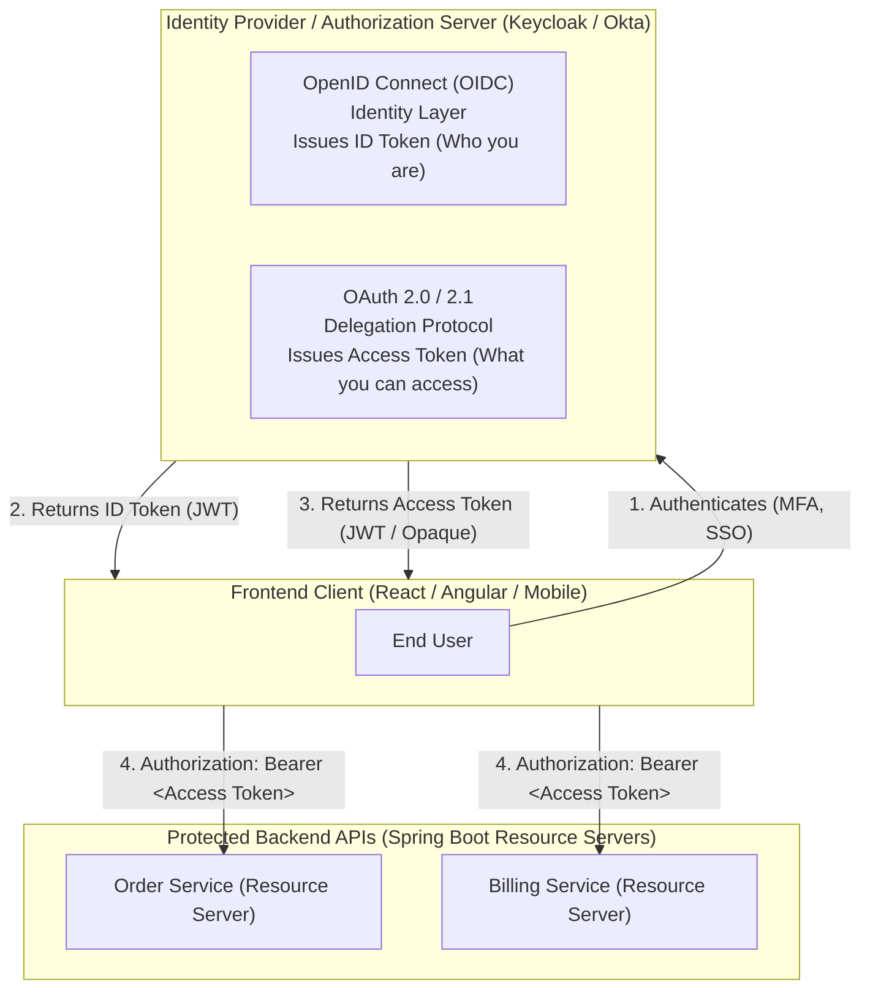
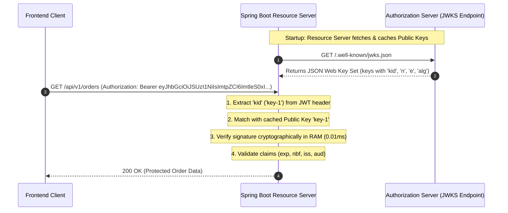
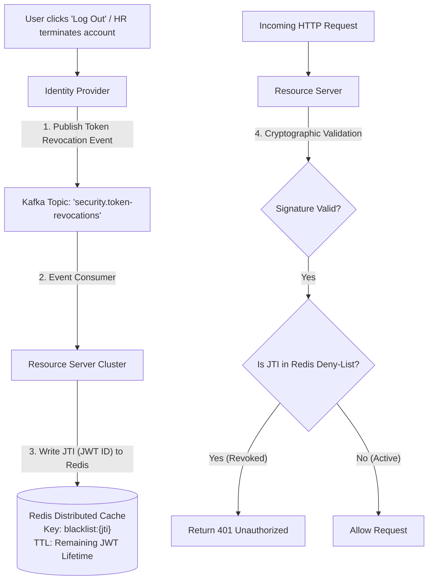

# OAuth2 and OIDC Resource Servers

In modern cloud-native architectures, microservices rarely handle user credentials, password hashing, or multi-factor authentication directly. Instead, identity is delegated to a centralized **Identity Provider (IdP)** or **Authorization Server**—such as Keycloak, Okta, or Auth0.

Your Spring Boot microservices operate as **OAuth2 Resource Servers**. Their job is not to log users in, but to guard protected endpoints, cryptographically verify bearer tokens on incoming HTTP requests, and enforce fine-grained authorization policies based on scopes and roles.

However, moving from simple monolithic authentication to an OAuth2/OIDC ecosystem introduces cryptographic and architectural nuances: public key distribution via **JWKS**, asymmetric key rotation, custom claim extraction, and token revocation. 

In this guide, we will unpack how Spring Security 6 implements the Resource Server specification and build a battle-tested token verification pipeline.

---

## OAuth 2.1 and OpenID Connect (OIDC) Fundamentals

Developers often conflate authentication and authorization. OAuth 2.0 and OIDC solve two completely different problems:



### The Separation of Responsibilities

- **OpenID Connect (OIDC) = Authentication:** Built on top of OAuth 2.0, OIDC issues an **ID Token**. The ID Token is meant *strictly for the client application* (the frontend) to display the user's name, profile picture, and email. Your backend Resource Servers should never use the ID Token to authorize API calls.
- **OAuth 2.0 / 2.1 = Authorization:** Issues an **Access Token**. The Access Token is presented to backend Resource Servers in the HTTP `Authorization: Bearer <token>` header to grant access to protected endpoints.
- **The Resource Server:** Your Spring Boot API. It holds the protected resources (order data, user profiles, payment records). It accepts requests accompanied by an Access Token, validates the token's cryptographic signature, checks its claims, and returns the requested data.

---

## Cryptographic Token Validation: The JWKS Architecture

In early microservice setups, developers often signed JWTs using symmetric algorithms like `HS256` (HMAC with SHA-256).

### Why Symmetric Signing (`HS256`) Breaks in Microservices

With symmetric signing, the same secret key used to sign the token must be shared with every single microservice that verifies it. If your organization has 40 microservices, that secret key exists in 40 configuration files, environment variables, and CI/CD pipelines. If a single junior developer accidentally commits the secret to a public Git repository or a single service is compromised, an attacker can forge valid administrative tokens for every service in your enterprise.

### The Modern Standard: Asymmetric Signatures and JWKS (`RS256` / `ES256`)

In production, OAuth2 Resource Servers use **asymmetric public-key cryptography**:

1. The Authorization Server holds the **Private Key** securely in hardware or an encrypted key vault. It signs Access Tokens using this private key.
2. The Authorization Server exposes its **Public Keys** over HTTPS via a standardized **JSON Web Key Set (JWKS)** endpoint, typically located at:
   `https://auth.company.com/realms/enterprise/.well-known/jwks.json`
3. Resource Servers download and cache the public keys. When an API request arrives, the Resource Server verifies the cryptographic signature using the public key locally in memory (taking less than 10 microseconds).



### Key Rotation via the `kid` (Key ID) Header

What happens when security policy requires rotating the signing key every 90 days?

Every JWT header contains a `kid` (Key ID) attribute:
```json
{
  "alg": "RS256",
  "typ": "JWT",
  "kid": "prod-auth-key-2026-q4"
}
```

When the Authorization Server rotates keys:
1. It begins signing new tokens with a new key ID (`prod-auth-key-2027-q1`) and adds this new public key to the JWKS JSON document.
2. When the Resource Server receives a token with the new `kid` that is not present in its local in-memory cache, Spring Security automatically issues an HTTP request to refresh its cached JWKS set.
3. Zero downtime. Zero microservice restarts required.

---

## Configuring a Spring Boot 3 / Spring Security 6 Resource Server

Let's implement a production-grade OAuth2 Resource Server using Spring Boot 3 and Spring Security 6.

### Maven Dependencies

```xml
<dependency>
    <groupId>org.springframework.boot</groupId>
    <artifactId>spring-boot-starter-oauth2-resource-server</artifactId>
</dependency>
<dependency>
    <groupId>org.springframework.boot</groupId>
    <artifactId>spring-boot-starter-security</artifactId>
</dependency>
<dependency>
    <groupId>org.springframework.boot</groupId>
    <artifactId>spring-boot-starter-web</artifactId>
</dependency>
```

### Step 1: Application Configuration (`application.yml`)

Spring Boot can auto-configure the entire `JwtDecoder` pipeline from a single issuer URI or JWKS URI:

```yaml
spring:
  security:
    oauth2:
      resourceserver:
        jwt:
          # Automatically discovers JWKS URI from OpenID configuration endpoint
          issuer-uri: https://auth.company.com/realms/enterprise
          # Or specify JWKS directly if custom or internal network
          # jwk-set-uri: https://auth.company.com/realms/enterprise/protocol/openid-connect/certs
          audiences:
            - https://api.company.com/orders
```

---

## Custom Claims Extraction and Role-Based Access Control

By default, Spring Security inspects the `scope` or `scp` claim in the JWT and maps it to authorities prefixed with `SCOPE_`. For example, `"scope": "orders.read"` becomes `GrantedAuthority("SCOPE_orders.read")`.

However, enterprise Identity Providers like **Keycloak** or **Auth0** store user roles inside nested custom JSON structures:

```json
{
  "iss": "https://auth.company.com/realms/enterprise",
  "sub": "usr_998877",
  "aud": "https://api.company.com/orders",
  "exp": 1793260800,
  "scope": "openid email orders.read orders.write",
  "realm_access": {
    "roles": [
      "ADMIN",
      "BILLING_MANAGER"
    ]
  }
}
```

If you rely on default mappings, the `realm_access.roles` are ignored, and role-based checks like `@PreAuthorize("hasRole('ADMIN')")` will fail.

### Step 2: Building the Enterprise JWT Authentication Converter

We must create a custom converter that combines both standard OAuth2 scopes (prefixed with `SCOPE_`) and nested IdP roles (prefixed with `ROLE_`):

```java
package com.javahub.security.converter;

import org.springframework.core.convert.converter.Converter;
import org.springframework.security.authentication.AbstractAuthenticationToken;
import org.springframework.security.core.GrantedAuthority;
import org.springframework.security.core.authority.SimpleGrantedAuthority;
import org.springframework.security.oauth2.jwt.Jwt;
import org.springframework.security.oauth2.server.resource.authentication.JwtAuthenticationToken;
import org.springframework.security.oauth2.server.resource.authentication.JwtGrantedAuthoritiesConverter;
import org.springframework.stereotype.Component;

import java.util.Collection;
import java.util.Collections;
import java.util.List;
import java.util.Map;
import java.util.stream.Collectors;
import java.util.stream.Stream;

@Component
public class EnterpriseJwtAuthenticationConverter implements Converter<Jwt, AbstractAuthenticationToken> {

    private final JwtGrantedAuthoritiesConverter defaultScopesConverter = new JwtGrantedAuthoritiesConverter();

    @Override
    public AbstractAuthenticationToken convert(Jwt jwt) {
        // 1. Extract standard scopes (e.g. SCOPE_orders.read)
        Collection<GrantedAuthority> scopeAuthorities = defaultScopesConverter.convert(jwt);
        if (scopeAuthorities == null) {
            scopeAuthorities = Collections.emptyList();
        }

        // 2. Extract nested realm_access.roles from Keycloak / IdP
        Collection<GrantedAuthority> roleAuthorities = extractRealmRoles(jwt);

        // 3. Combine both collections into a single authority set
        List<GrantedAuthority> combinedAuthorities = Stream.concat(scopeAuthorities.stream(), roleAuthorities.stream())
                .collect(Collectors.toList());

        // Use the preferred username or subject as the Principal name
        String principalClaimName = jwt.hasClaim("preferred_username") 
                ? jwt.getClaimAsString("preferred_username") 
                : jwt.getSubject();

        return new JwtAuthenticationToken(jwt, combinedAuthorities, principalClaimName);
    }

    @SuppressWarnings("unchecked")
    private Collection<GrantedAuthority> extractRealmRoles(Jwt jwt) {
        Map<String, Object> realmAccess = jwt.getClaim("realm_access");
        if (realmAccess == null || realmAccess.isEmpty()) {
            return Collections.emptyList();
        }

        Object rolesObj = realmAccess.get("roles");
        if (!(rolesObj instanceof List<?> rawRoles)) {
            return Collections.emptyList();
        }

        return rawRoles.stream()
                .filter(String.class::isInstance)
                .map(role -> new SimpleGrantedAuthority("ROLE_" + role))
                .collect(Collectors.toList());
    }
}
```

---

## Modern Spring Security 6 Configuration

In Spring Security 6, all legacy adapter classes (`WebSecurityConfigurerAdapter`) are gone. Everything is configured using lambda-based domain-specific configuration in a `@Bean SecurityFilterChain`.

```java
package com.javahub.security.config;

import com.javahub.security.converter.EnterpriseJwtAuthenticationConverter;
import org.springframework.beans.factory.annotation.Value;
import org.springframework.context.annotation.Bean;
import org.springframework.context.annotation.Configuration;
import org.springframework.http.HttpMethod;
import org.springframework.security.config.annotation.method.configuration.EnableMethodSecurity;
import org.springframework.security.config.annotation.web.builders.HttpSecurity;
import org.springframework.security.config.annotation.web.configuration.EnableWebSecurity;
import org.springframework.security.config.http.SessionCreationPolicy;
import org.springframework.security.oauth2.core.DelegatingOAuth2TokenValidator;
import org.springframework.security.oauth2.core.OAuth2TokenValidator;
import org.springframework.security.oauth2.jwt.Jwt;
import org.springframework.security.oauth2.jwt.JwtClaimValidator;
import org.springframework.security.oauth2.jwt.JwtDecoder;
import org.springframework.security.oauth2.jwt.JwtDecoders;
import org.springframework.security.oauth2.jwt.JwtValidators;
import org.springframework.security.oauth2.jwt.NimbusJwtDecoder;
import org.springframework.security.web.SecurityFilterChain;

import java.util.List;

@Configuration
@EnableWebSecurity
@EnableMethodSecurity(prePostEnabled = true) // Enables @PreAuthorize and @PostAuthorize
public class ResourceServerSecurityConfig {

    private final EnterpriseJwtAuthenticationConverter jwtAuthenticationConverter;

    @Value("${spring.security.oauth2.resourceserver.jwt.issuer-uri}")
    private String issuerUri;

    public ResourceServerSecurityConfig(EnterpriseJwtAuthenticationConverter jwtAuthenticationConverter) {
        this.jwtAuthenticationConverter = jwtAuthenticationConverter;
    }

    @Bean
    public SecurityFilterChain securityFilterChain(HttpSecurity http) throws Exception {
        http
            // 1. Disable CSRF for stateless REST APIs using Bearer tokens
            .csrf(csrf -> csrf.disable())

            // 2. Enforce completely stateless sessions (no JSESSIONID)
            .sessionManagement(session -> session.sessionCreationPolicy(SessionCreationPolicy.STATELESS))

            // 3. Define URL Authorization Rules
            .authorizeHttpRequests(auth -> auth
                .requestMatchers("/actuator/health", "/actuator/info").permitAll()
                .requestMatchers("/swagger-ui/**", "/v3/api-docs/**").permitAll()
                .requestMatchers(HttpMethod.GET, "/api/v1/products/**").permitAll()
                .requestMatchers("/api/v1/admin/**").hasRole("ADMIN")
                .anyRequest().authenticated()
            )

            // 4. Configure OAuth2 Resource Server with JWT decoding and custom converter
            .oauth2ResourceServer(oauth2 -> oauth2
                .jwt(jwt -> jwt
                    .jwtAuthenticationConverter(jwtAuthenticationConverter)
                )
            );

        return http.build();
    }

    // Custom Token Validator: Enforce Audience Verification
    @Bean
    public JwtDecoder jwtDecoder() {
        NimbusJwtDecoder jwtDecoder = JwtDecoders.fromIssuerLocation(issuerUri);

        OAuth2TokenValidator<Jwt> withIssuer = JwtValidators.createDefaultWithIssuer(issuerUri);
        
        // Ensure the token was specifically issued for this microservice audience
        OAuth2TokenValidator<Jwt> audienceValidator = new JwtClaimValidator<List<String>>(
                "aud",
                aud -> aud != null && aud.contains("https://api.company.com/orders")
        );

        OAuth2TokenValidator<Jwt> combinedValidator = new DelegatingOAuth2TokenValidator<>(withIssuer, audienceValidator);
        jwtDecoder.setJwtValidator(combinedValidator);

        return jwtDecoder;
    }
}
```

---

## Method-Level Security: Scopes vs Roles

With `@EnableMethodSecurity` active, you can apply fine-grained access control directly at your service and controller methods.

Understand the difference:
- **`hasAuthority('SCOPE_read:orders')`:** Verifies the *client application* has been delegated permission to perform this action.
- **`hasRole('ADMIN')`:** Verifies the *human user* possesses administrative business privileges.

```java
package com.javahub.controller;

import com.javahub.model.Order;
import com.javahub.service.OrderService;
import org.springframework.http.ResponseEntity;
import org.springframework.security.access.prepost.PreAuthorize;
import org.springframework.security.core.annotation.AuthenticationPrincipal;
import org.springframework.security.oauth2.jwt.Jwt;
import org.springframework.web.bind.annotation.DeleteMapping;
import org.springframework.web.bind.annotation.GetMapping;
import org.springframework.web.bind.annotation.PathVariable;
import org.springframework.web.bind.annotation.RequestMapping;
import org.springframework.web.bind.annotation.RestController;

@RestController
@RequestMapping("/api/v1/orders")
public class OrderController {

    private final OrderService orderService;

    public OrderController(OrderService orderService) {
        this.orderService = orderService;
    }

    // Requires the client app to have 'orders.read' scope AND user must be authenticated
    @GetMapping("/{orderId}")
    @PreAuthorize("hasAuthority('SCOPE_orders.read')")
    public ResponseEntity<Order> getOrder(@PathVariable String orderId,
                                          @AuthenticationPrincipal Jwt jwt) {
        String userId = jwt.getSubject();
        return ResponseEntity.ok(orderService.findByIdAndUser(orderId, userId));
    }

    // Requires both 'orders.delete' scope AND the user must hold the 'ADMIN' role
    @DeleteMapping("/{orderId}")
    @PreAuthorize("hasAuthority('SCOPE_orders.delete') and hasRole('ADMIN')")
    public ResponseEntity<Void> deleteOrder(@PathVariable String orderId) {
        orderService.delete(orderId);
        return ResponseEntity.noContent().build();
    }
}
```

---

## The Revocation Dilemma: Distributed Token Deny-Listing

The primary strength of JWTs—their statelessness—is also their greatest operational vulnerability.

If a user reports their laptop stolen, clicks "Log out of all devices", or is terminated by HR, their active JWT remains cryptographically valid until its `exp` timestamp passes. Because Resource Servers validate tokens purely using the local cached public key without calling the Authorization Server, standard JWTs cannot be revoked immediately.

### Production Solution: Redis Deny-List with Event Streaming

To achieve sub-second revocation without sacrificing stateless performance:



1. Every JWT must include a unique **`jti` (JWT ID)** claim.
2. When a token is revoked, the Auth Server publishes a revocation event containing the `jti` and remaining expiration duration to Kafka.
3. Resource Servers or a security gateway write the `jti` to Redis with a TTL set to the exact remaining validity time of the token.
4. During request evaluation, after the cryptographic signature passes, a rapid Redis `EXISTS blacklist:{jti}` check is performed. Once the token naturally expires, Redis automatically evicts the key, keeping memory strictly bounded.

---

## Senior Engineer Interview Crucible

### How does a Resource Server verify the authenticity of a JWT signed with RS256 without contacting the Authorization Server on every HTTP request?

The Resource Server fetches and caches the Authorization Server's public keys from its **JWKS (JSON Web Key Set)** endpoint during application startup or upon first encounter of an unknown Key ID (`kid`). 

When an HTTP request arrives, the Resource Server extracts the JWT from the `Authorization: Bearer` header, inspects the unencrypted header to retrieve the `kid`, and retrieves the matching public key from its local in-memory cache. It then cryptographically verifies the signature over the header and payload using the public key in RAM. This operation is purely mathematical, takes fractions of a millisecond, and requires zero network round-trips to the Authorization Server.

---

### In an enterprise microservice mesh, why should you use asymmetric cryptography (RS256/ES256) rather than symmetric signing (HS256) for OAuth2 tokens?

Symmetric signing (`HS256`) uses the exact same secret key to both create (sign) and verify tokens. If a microservice mesh consists of 30 services, all 30 services must possess the shared secret key. If a single microservice is compromised or an engineer accidentally logs the secret, an attacker can use that secret to forge arbitrary administrative tokens for any service in the mesh.

Asymmetric cryptography (`RS256` or `ES256`) uses a Public/Private key pair. The private signing key resides strictly within the secured boundaries of the centralized Authorization Server. Microservices only possess the public verification key. Even if all 30 microservices are completely compromised, an attacker cannot forge new tokens because the private key was never distributed.

---

### If JWTs are completely stateless and self-contained, how do you handle instantaneous user revocation or forced logout before the token expires?

There are three architectural patterns to handle revocation of stateless JWTs:

1. **Short-Lived Access Tokens + Refresh Token Rotation:** Keep Access Token lifetimes extremely short (e.g., 5 to 15 minutes). When an account is terminated, revoke the long-lived Refresh Token on the Authorization Server. The user is locked out as soon as their current 5-minute access token expires.
2. **Distributed Redis Deny-List (Blacklist):** Every JWT is issued with a unique `jti` (JWT ID). Upon logout or revocation, an event is published to write the `jti` to a distributed Redis cache with a TTL equal to the token's remaining lifespan. Resource Servers check Redis before completing authorization. Once the token reaches its original expiration date, Redis evicts the key automatically.
3. **OAuth2 Token Introspection (RFC 7662):** Instead of validating JWTs locally, the Resource Server makes an HTTP back-channel call to the Authorization Server's `/introspect` endpoint for every request. This provides instantaneous revocation at the cost of high network latency and significant load on the Authorization Server.

---

### Walk through the difference between OAuth 2.0 Scopes and Role-Based Access Control (RBAC) permissions. How should a Spring Security Resource Server handle both?

- **OAuth 2.0 Scopes (`scope` / `scp` claim):** Scopes represent **delegated permissions granted to a client application**. For example, when a user allows a third-party reporting tool to access their data, the user delegates `read:reports` scope. Scopes restrict what the *client application* is permitted to do on behalf of the user, regardless of how much power the user actually possesses.
- **RBAC Roles (`realm_access.roles` / `roles` claim):** Roles represent the **business permissions assigned to the human user** (e.g., `ROLE_ADMIN`, `ROLE_AUDITOR`).

In enterprise systems, authorization must enforce the intersection of both. Spring Security should map scopes to `SCOPE_<name>` and roles to `ROLE_<name>` using a custom `Converter<Jwt, AbstractAuthenticationToken>`. Critical operations can then require both using compound method security expressions:

```java
@PreAuthorize("hasAuthority('SCOPE_orders.write') and hasRole('FINANCE_MANAGER')")
```

This guarantees that an action only executes if the client application is authorized to perform it *and* the authenticated human user has the organizational authority to do so.
