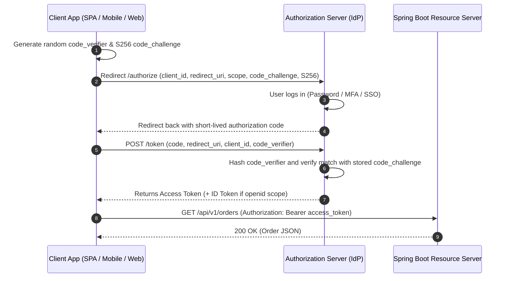
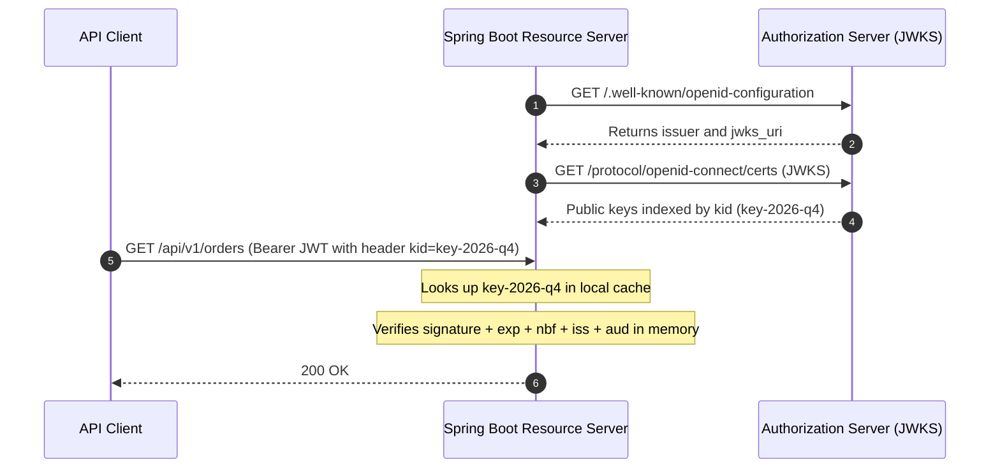
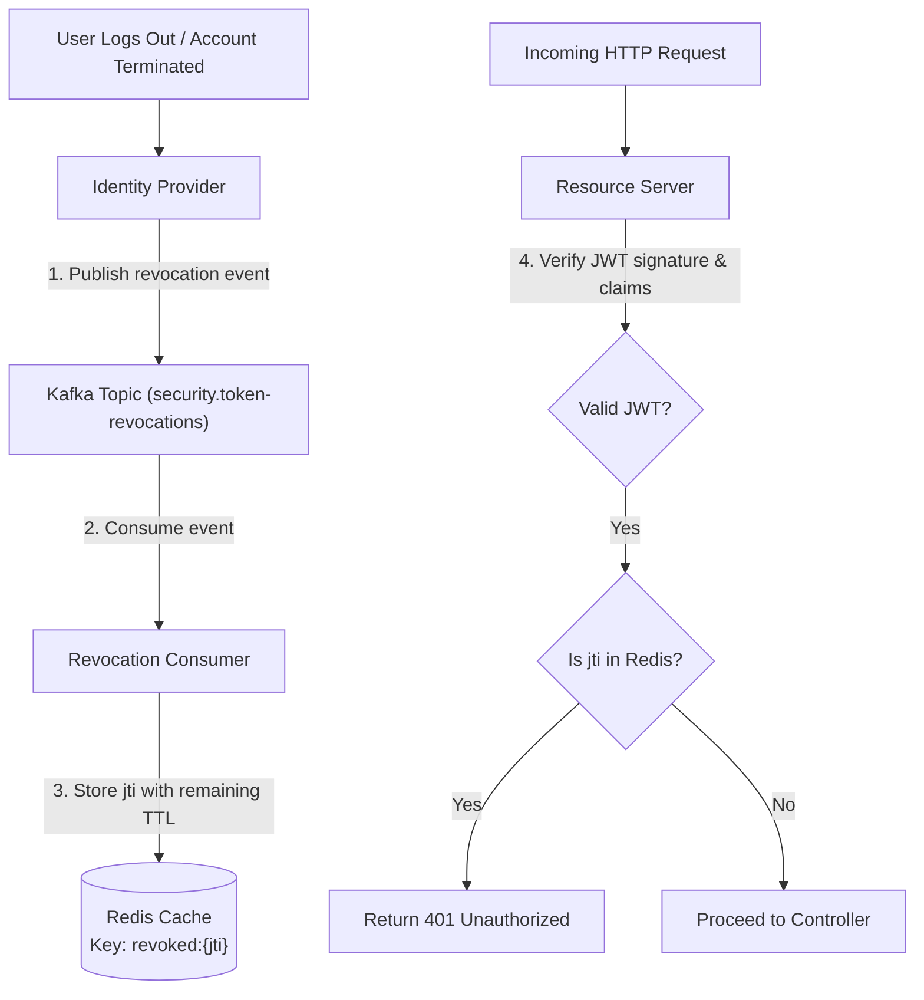

Once an organization grows beyond a single application, storing passwords and running login screens inside each backend service stops making sense. Instead, authentication is centralized in an **Authorization Server / Identity Provider (IdP)** such as Keycloak, Okta, Auth0, or Microsoft Entra ID.

Your Spring Boot APIs then act as **OAuth2 Resource Servers**. They do not collect passwords or render login pages. Their responsibility is narrower and well-defined: extract the bearer token from incoming HTTP requests, verify that it came from a trusted issuer and is still valid, map its claims into Spring Security authorities, and enforce authorization rules.

## OAuth2 Grant Flows: Authorization Code with PKCE and Client Credentials

Before configuring a resource server, it helps to be clear on how clients actually obtain the access tokens your API receives. OAuth 2.1 (the ongoing consolidation of OAuth 2.0 best practices) removes legacy flows like the Implicit Grant and Resource Owner Password Credentials (ROPC). In modern systems, almost every interaction uses one of two flows.

### Authorization Code Flow with PKCE (Human Users)

Whenever a human user signs in through a browser, single-page app (SPA), mobile app, or server-rendered web app, the client uses the **Authorization Code Flow with PKCE (Proof Key for Code Exchange, RFC 7636)**.

Historically, confidential web servers proved their identity during the code-for-token exchange with a `client_secret`. Public clients (SPAs and native mobile apps) cannot hide a secret inside bundled JavaScript or an app binary. Without PKCE, an attacker who intercepted the authorization code on redirect could exchange it for tokens. PKCE closes that gap using a per-login cryptographic proof, and OAuth 2.1 now recommends it for confidential clients as well as public ones.



Notice the separation of outputs when the `openid` scope is requested:
- The **ID Token** (OpenID Connect) is consumed by the **client app** to identify the logged-in user.
- The **Access Token** (OAuth2) is sent to your **Resource Server** in the `Authorization: Bearer` header. Never accept an ID Token as an API credential.

### Client Credentials Grant (Machine-to-Machine)

When a backend service (such as an Order Service or scheduled billing job) calls another backend API with no human user involved, there is no browser redirect or login screen. The calling service authenticates directly with the Authorization Server using the **Client Credentials Grant** (`grant_type=client_credentials`), presenting its `client_id` and `client_secret` (or a signed `private_key_jwt` assertion) to obtain an access token scoped for the downstream API.

In Spring Boot 3, `OAuth2AuthorizedClientManager` handles requesting, caching, and refreshing these M2M tokens automatically when calling downstream services with `RestClient` (Spring Security 6.4+ even provides `OAuth2ClientHttpRequestInterceptor` out of the box):

```yaml
spring:
  security:
    oauth2:
      client:
        registration:
          billing-m2m:
            provider: corporate-idp
            authorization-grant-type: client_credentials
            client-id: order-service
            client-secret: ${ORDER_SERVICE_CLIENT_SECRET}
            scope: billing.charge
        provider:
          corporate-idp:
            token-uri: https://auth.company.com/realms/enterprise/protocol/openid-connect/token
```

## JWT Validation Against a JWKS Endpoint

When an Authorization Server issues self-contained JWT access tokens, microservices validate them using asymmetric cryptography (`RS256`, `ES256`, or `PS256`) rather than a shared `HS256` secret. With asymmetric signing, only the Authorization Server holds the private signing key; resource servers only need the public keys, so a compromised microservice cannot forge tokens.

### OIDC Discovery, Caching, and Zero-Downtime Key Rotation

Rather than hardcoding PEM files into every microservice, the Authorization Server publishes its active public keys at a **JSON Web Key Set (JWKS)** endpoint, discovered automatically from `/.well-known/openid-configuration`:



Under the hood, Spring Security's `NimbusJwtDecoder` uses Nimbus JOSE's `RemoteJWKSet` (and `DefaultJWKSetCache`), which caches the fetched JWKS in memory (by default with a 5-minute cache lifespan and rate-limited refresh protection).

When your security team rotates signing keys:
1. The Authorization Server publishes the new public key (`kid: "key-2027-q1"`) alongside the previous key in the JWKS response and starts signing new tokens with the new key.
2. When a Resource Server receives a token carrying an unknown `kid`, Nimbus triggers a rate-limited JWKS refresh, caches the new public key, and validates the token.
3. Once all tokens signed by the old key have expired, the Authorization Server removes the old key from the JWKS document.

No pods need to restart, and no configuration secrets need to be redeployed.

> [!NOTE]
> The rate limit on unknown-`kid` refreshes matters for security: without it, an attacker could send thousands of forged tokens with random `kid` values to force your Resource Server into flooding your IdP's JWKS endpoint.

## Opaque Tokens and Token Introspection (RFC 7662)

Not every OAuth2 Access Token is a JWT. Many organizations issue **opaque tokens**: high-entropy random reference strings that carry no readable claims at all.

Because an opaque token cannot be decoded locally, the Resource Server validates it by making a back-channel HTTP `POST` to the Authorization Server's **Token Introspection** endpoint (RFC 7662), authenticating itself with its own client credentials:

```http
POST /realms/enterprise/protocol/openid-connect/token/introspect HTTP/1.1
Host: auth.company.com
Authorization: Basic <base64(resource-server-id:resource-server-secret)>
Content-Type: application/x-www-form-urlencoded

token=2YotnFZFEjr1zCsicMWpAA
```

The Authorization Server checks its session/token store and responds with the live status and metadata:

```json
{
  "active": true,
  "sub": "usr_998877",
  "username": "alice",
  "scope": "orders.read orders.write",
  "client_id": "web-portal",
  "exp": 1793260800
}
```

If the user logged out two seconds ago or an admin revoked the session, the IdP immediately returns `{ "active": false }` and the Resource Server rejects the request with `401`.

### Configuring Opaque Token Introspection in Spring Security

Add `spring-boot-starter-oauth2-resource-server` (plus `com.nimbusds:oauth2-oidc-sdk` on the classpath, which Spring Security requires for `SpringOpaqueTokenIntrospector`) and configure the introspection properties:

```yaml
spring:
  security:
    oauth2:
      resourceserver:
        opaquetoken:
          introspection-uri: https://auth.company.com/realms/enterprise/protocol/openid-connect/token/introspect
          client-id: order-resource-server
          client-secret: ${RESOURCE_SERVER_INTROSPECTION_SECRET}
```

In your `SecurityFilterChain`, switch from `.jwt(...)` to `.opaqueToken(...)`:

```java
@Bean
public SecurityFilterChain opaqueSecurityFilterChain(HttpSecurity http) throws Exception {
    return http
        .csrf(csrf -> csrf.disable())
        .sessionManagement(sm -> sm.sessionCreationPolicy(SessionCreationPolicy.STATELESS))
        .authorizeHttpRequests(auth -> auth
            .requestMatchers("/actuator/health").permitAll()
            .anyRequest().authenticated()
        )
        .oauth2ResourceServer(oauth2 -> oauth2
            .opaqueToken(Customizer.withDefaults())
        )
        .build();
}
```

### JWT vs Opaque Tokens: Architectural Trade-Offs

| Dimension | Self-Contained JWT (JWKS) | Opaque Token (RFC 7662 Introspection) |
|---|---|---|
| **Validation latency** | Sub-millisecond local CPU check using cached public key. | Adds a network round-trip to the Authorization Server per request (unless briefly cached). |
| **IdP availability impact** | Resource servers continue validating existing tokens even if the IdP is briefly unreachable. | If the IdP goes down or slows down, every API request stalls or fails. |
| **Instant revocation** | Hard; valid until `exp` unless paired with short TTLs or a shared Redis `jti` deny-list. | Immediate; revoking the token on the IdP stops access on the very next call. |
| **Claim confidentiality** | Payload is Base64URL-encoded and readable by the client. | Zero internal claims or roles exposed to browsers or mobile devices. |

A common hybrid pattern is the **Phantom Token** approach: the API Gateway receives an opaque token from external clients, calls `/introspect` (or exchanges it) once at the edge, and forwards a short-lived signed JWT to internal microservices.

## Configuring Spring Security as an OAuth2 Resource Server

For most Spring Boot 3 microservices using JWTs, start with the official starter:

```xml
<dependency>
    <groupId>org.springframework.boot</groupId>
    <artifactId>spring-boot-starter-oauth2-resource-server</artifactId>
</dependency>
<dependency>
    <groupId>org.springframework.boot</groupId>
    <artifactId>spring-boot-starter-web</artifactId>
</dependency>
```

Configure the issuer and expected audience in `application.yml` (Spring Boot 3.2+ natively supports the `audiences` property):

```yaml
spring:
  security:
    oauth2:
      resourceserver:
        jwt:
          issuer-uri: https://auth.company.com/realms/enterprise
          audiences:
            - https://api.company.com/orders
```

### Mapping Custom Claims with `JwtAuthenticationConverter`

By default, Spring Security's `JwtGrantedAuthoritiesConverter` reads the `scope` (or `scp`) claim and creates authorities prefixed with `SCOPE_` (for example, `SCOPE_orders.read`).

Identity providers like Keycloak or Auth0 often place user roles in nested claims such as `realm_access.roles` or `resource_access.<client>.roles`:

```json
{
  "iss": "https://auth.company.com/realms/enterprise",
  "sub": "usr_998877",
  "aud": "https://api.company.com/orders",
  "exp": 1793260800,
  "scope": "openid email orders.read orders.write",
  "realm_access": {
    "roles": ["ADMIN", "BILLING_MANAGER"]
  }
}
```

If you leave the default converter untouched, `@PreAuthorize("hasRole('ADMIN')")` will always fail because `realm_access.roles` is never read. You can preserve standard `SCOPE_*` authorities while adding `ROLE_*` authorities by customizing `JwtAuthenticationConverter`:

```java
package com.javahub.security.converter;

import org.springframework.core.convert.converter.Converter;
import org.springframework.security.core.GrantedAuthority;
import org.springframework.security.core.authority.SimpleGrantedAuthority;
import org.springframework.security.oauth2.jwt.Jwt;
import org.springframework.security.oauth2.server.resource.authentication.JwtAuthenticationConverter;
import org.springframework.security.oauth2.server.resource.authentication.JwtGrantedAuthoritiesConverter;

import java.util.Collection;
import java.util.Collections;
import java.util.List;
import java.util.Map;
import java.util.stream.Stream;

public class EnterpriseAuthoritiesConverter implements Converter<Jwt, Collection<GrantedAuthority>> {

    private final JwtGrantedAuthoritiesConverter scopeConverter = new JwtGrantedAuthoritiesConverter();

    @Override
    public Collection<GrantedAuthority> convert(Jwt jwt) {
        Collection<GrantedAuthority> scopes = scopeConverter.convert(jwt);
        if (scopes == null) {
            scopes = Collections.emptyList();
        }

        Collection<GrantedAuthority> realmRoles = extractRealmRoles(jwt);

        return Stream.concat(scopes.stream(), realmRoles.stream()).toList();
    }

    private Collection<GrantedAuthority> extractRealmRoles(Jwt jwt) {
        Map<String, Object> realmAccess = jwt.getClaimAsMap("realm_access");
        if (realmAccess == null || !(realmAccess.get("roles") instanceof List<?> rawRoles)) {
            return Collections.emptyList();
        }

        return rawRoles.stream()
                .filter(String.class::isInstance)
                .map(String.class::cast)
                .map(role -> (GrantedAuthority) new SimpleGrantedAuthority("ROLE_" + role))
                .toList();
    }

    public static JwtAuthenticationConverter buildAuthenticationConverter() {
        JwtAuthenticationConverter converter = new JwtAuthenticationConverter();
        converter.setJwtGrantedAuthoritiesConverter(new EnterpriseAuthoritiesConverter());
        converter.setPrincipalClaimName("preferred_username");
        return converter;
    }
}
```

### Full Resource Server Configuration and Audience Validation

Wire the converter and an explicit `JwtDecoder` (including issuer, timestamp, and audience validation) into your Spring Security 6 configuration:

```java
package com.javahub.security.config;

import com.javahub.security.converter.EnterpriseAuthoritiesConverter;
import org.springframework.beans.factory.annotation.Value;
import org.springframework.context.annotation.Bean;
import org.springframework.context.annotation.Configuration;
import org.springframework.http.HttpMethod;
import org.springframework.security.config.annotation.method.configuration.EnableMethodSecurity;
import org.springframework.security.config.annotation.web.builders.HttpSecurity;
import org.springframework.security.config.annotation.web.configuration.EnableWebSecurity;
import org.springframework.security.config.http.SessionCreationPolicy;
import org.springframework.security.oauth2.core.DelegatingOAuth2TokenValidator;
import org.springframework.security.oauth2.core.OAuth2TokenValidator;
import org.springframework.security.oauth2.jwt.Jwt;
import org.springframework.security.oauth2.jwt.JwtClaimValidator;
import org.springframework.security.oauth2.jwt.JwtDecoder;
import org.springframework.security.oauth2.jwt.JwtDecoders;
import org.springframework.security.oauth2.jwt.JwtValidators;
import org.springframework.security.oauth2.jwt.NimbusJwtDecoder;
import org.springframework.security.web.SecurityFilterChain;

import java.util.List;

@Configuration
@EnableWebSecurity
@EnableMethodSecurity
public class ResourceServerSecurityConfig {

    @Value("${spring.security.oauth2.resourceserver.jwt.issuer-uri}")
    private String issuerUri;

    @Bean
    public SecurityFilterChain securityFilterChain(HttpSecurity http) throws Exception {
        return http
            .csrf(csrf -> csrf.disable())
            .sessionManagement(session -> session.sessionCreationPolicy(SessionCreationPolicy.STATELESS))
            .authorizeHttpRequests(auth -> auth
                .requestMatchers("/actuator/health", "/actuator/info").permitAll()
                .requestMatchers(HttpMethod.GET, "/api/v1/products/**").permitAll()
                .requestMatchers("/api/v1/admin/**").hasRole("ADMIN")
                .anyRequest().authenticated()
            )
            .oauth2ResourceServer(oauth2 -> oauth2
                .jwt(jwt -> jwt
                    .jwtAuthenticationConverter(EnterpriseAuthoritiesConverter.buildAuthenticationConverter())
                )
            )
            .build();
    }

    @Bean
    public JwtDecoder jwtDecoder() {
        NimbusJwtDecoder decoder = JwtDecoders.fromIssuerLocation(issuerUri);

        // Validates exp, nbf (with 60s default clock skew), and iss
        OAuth2TokenValidator<Jwt> withIssuer = JwtValidators.createDefaultWithIssuer(issuerUri);

        // Ensures the token was explicitly minted for this microservice
        OAuth2TokenValidator<Jwt> audienceValidator = new JwtClaimValidator<List<String>>(
                "aud",
                aud -> aud != null && aud.contains("https://api.company.com/orders")
        );

        decoder.setJwtValidator(new DelegatingOAuth2TokenValidator<>(withIssuer, audienceValidator));
        return decoder;
    }
}
```

### Combining Scopes and Roles at the Method Level

Scopes and roles protect different axes of authorization:
- **`hasAuthority('SCOPE_orders.delete')`** checks what the *client application* was permitted to do.
- **`hasRole('ADMIN')`** checks what the *human user* is allowed to do.

Requiring both prevents an overly privileged user from accidentally performing destructive actions through a restricted third-party client, and prevents a privileged client from escalating a regular user's access:

```java
@RestController
@RequestMapping("/api/v1/orders")
public class OrderController {

    private final OrderService orderService;

    public OrderController(OrderService orderService) {
        this.orderService = orderService;
    }

    @GetMapping("/{orderId}")
    @PreAuthorize("hasAuthority('SCOPE_orders.read')")
    public ResponseEntity<Order> getOrder(@PathVariable String orderId,
                                          @AuthenticationPrincipal Jwt jwt) {
        return ResponseEntity.ok(orderService.findByIdAndUser(orderId, jwt.getSubject()));
    }

    @DeleteMapping("/{orderId}")
    @PreAuthorize("hasAuthority('SCOPE_orders.delete') and hasRole('ADMIN')")
    public ResponseEntity<Void> deleteOrder(@PathVariable String orderId) {
        orderService.delete(orderId);
        return ResponseEntity.noContent().build();
    }
}
```

### Multi-Tenant Resource Servers with `JwtIssuerAuthenticationManagerResolver`

In B2B SaaS platforms, each enterprise customer often has its own realm or identity provider (for example, `https://auth.company.com/realms/tenant-a` and `https://auth.company.com/realms/tenant-b`, or a customer's own Okta tenant). A single `issuer-uri` property cannot validate tokens from multiple issuers.

Spring Security handles this with `JwtIssuerAuthenticationManagerResolver`. It peeks at the `iss` claim of the incoming JWT, checks it against a **strict allowlist of trusted issuers**, and delegates validation to the `AuthenticationManager` (and cached `JwtDecoder`) for that tenant:

```java
package com.javahub.security.config;

import com.javahub.security.converter.EnterpriseAuthoritiesConverter;
import org.springframework.context.annotation.Bean;
import org.springframework.context.annotation.Configuration;
import org.springframework.security.authentication.AuthenticationManager;
import org.springframework.security.authentication.AuthenticationManagerResolver;
import org.springframework.security.config.annotation.web.builders.HttpSecurity;
import org.springframework.security.oauth2.jwt.JwtDecoder;
import org.springframework.security.oauth2.jwt.JwtDecoders;
import org.springframework.security.oauth2.server.resource.authentication.JwtAuthenticationProvider;
import org.springframework.security.oauth2.server.resource.authentication.JwtIssuerAuthenticationManagerResolver;
import org.springframework.security.web.SecurityFilterChain;

import jakarta.servlet.http.HttpServletRequest;
import java.util.Map;
import java.util.Set;
import java.util.concurrent.ConcurrentHashMap;

@Configuration
public class MultiTenantResourceServerConfig {

    private static final Set<String> TRUSTED_ISSUERS = Set.of(
            "https://auth.company.com/realms/tenant-a",
            "https://auth.company.com/realms/tenant-b"
    );

    @Bean
    public SecurityFilterChain multiTenantFilterChain(HttpSecurity http) throws Exception {
        Map<String, AuthenticationManager> managers = new ConcurrentHashMap<>();

        AuthenticationManagerResolver<HttpServletRequest> resolver =
                new JwtIssuerAuthenticationManagerResolver(issuer -> {
                    if (!TRUSTED_ISSUERS.contains(issuer)) {
                        return null; // Reject untrusted issuers immediately
                    }
                    return managers.computeIfAbsent(issuer, this::createManagerForIssuer);
                });

        return http
            .csrf(csrf -> csrf.disable())
            .authorizeHttpRequests(auth -> auth.anyRequest().authenticated())
            .oauth2ResourceServer(oauth2 -> oauth2
                .authenticationManagerResolver(resolver)
            )
            .build();
    }

    private AuthenticationManager createManagerForIssuer(String issuer) {
        JwtDecoder decoder = JwtDecoders.fromIssuerLocation(issuer);
        JwtAuthenticationProvider provider = new JwtAuthenticationProvider(decoder);
        provider.setJwtAuthenticationConverter(EnterpriseAuthoritiesConverter.buildAuthenticationConverter());
        return provider::authenticate;
    }
}
```

> [!WARNING]
> Never blindly resolve any `iss` URL present in an incoming JWT without checking it against an explicit allowlist or tenant registry. If you auto-discover arbitrary issuer URLs from unverified tokens, an attacker can host their own JWKS server, point `iss` to it, and forge valid signatures for any role, while also turning your Resource Server into an SSRF proxy.

## Handling Immediate Revocation for JWTs

When you choose JWTs for their low latency, keep access token lifetimes short (5 to 15 minutes). If your compliance requirements demand sub-second logout or immediate account lockout across microservices, combine JWT validation with a shared Redis deny-list fed by revocation events:



Because each Redis key expires automatically when the token's `exp` timestamp passes, memory stays tightly bounded while giving you near-instant revocation.

## Interview Questions

### How does a Resource Server validate an RS256 JWT without calling the Authorization Server on every request?

On startup (or when it first sees an unknown `kid`), `NimbusJwtDecoder` fetches the Authorization Server's public keys from its JWKS endpoint and caches them in memory. On each incoming request, it reads the `kid` from the JWT header, looks up the matching cached public key, verifies the RSA signature locally in memory, and validates `exp`, `nbf`, `iss`, and `aud`. No network call is made on the hot path.

### Why does PKCE matter even if your authorization server only issues short-lived authorization codes?

An authorization code returned to a mobile custom URL scheme or browser redirect can be intercepted by a malicious app registered on the same URI scheme or read from browser history/logs. Without PKCE, a public client has no `client_secret`, so anyone who captures that code can immediately exchange it at `/token` before the legitimate app does. With PKCE, the authorization server requires the original random `code_verifier` whose SHA-256 hash matches the `code_challenge` sent at the start of the login flow, making an intercepted code useless on its own.

### When should you choose opaque tokens with introspection over JWTs?

Choose opaque tokens when immediate revocation is mandatory, when you cannot expose internal roles or user metadata to untrusted frontend clients, or when your Authorization Server sits on the same low-latency internal network and can absorb introspection traffic (often aided by a short-lived cache). Choose JWTs when minimizing per-request latency and decoupling microservice availability from the IdP matter most, and pair them with short expirations.

### How do OAuth2 scopes and RBAC roles complement each other in a Resource Server?

Scopes represent what the **client application** is authorized to do (for example, a read-only analytics integration only gets `SCOPE_orders.read`). Roles represent what the **human user** is authorized to do within the business (for example, `ROLE_FINANCE_MANAGER`). Enforcing both on sensitive endpoints ensures that neither a compromised low-privilege client nor an under-privileged user can execute restricted operations.
