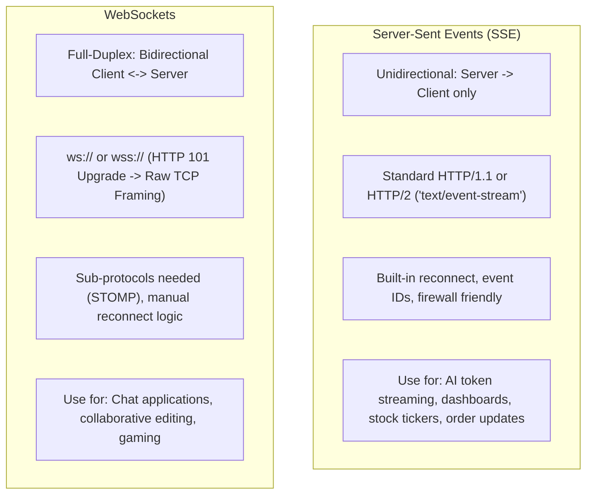
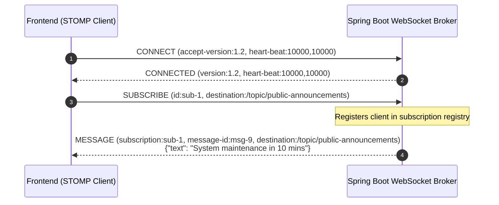
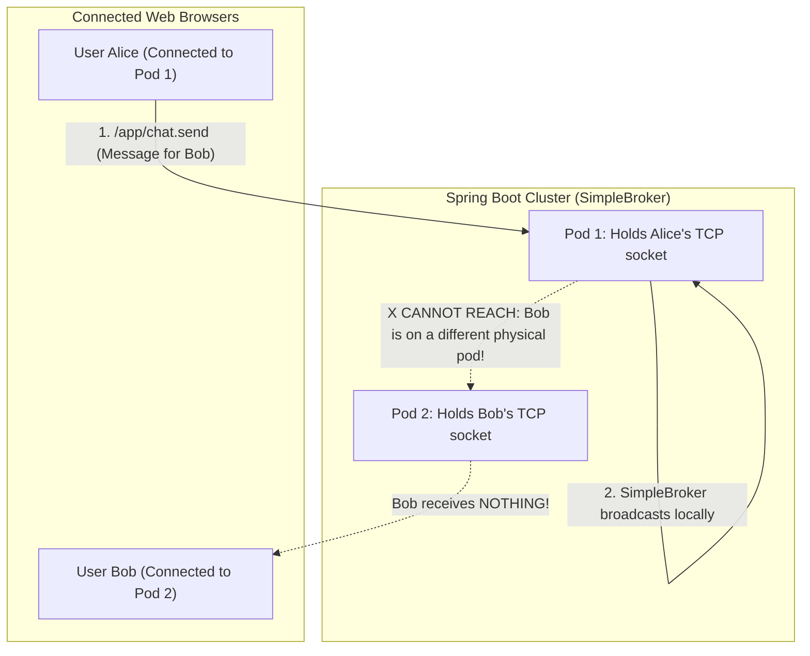
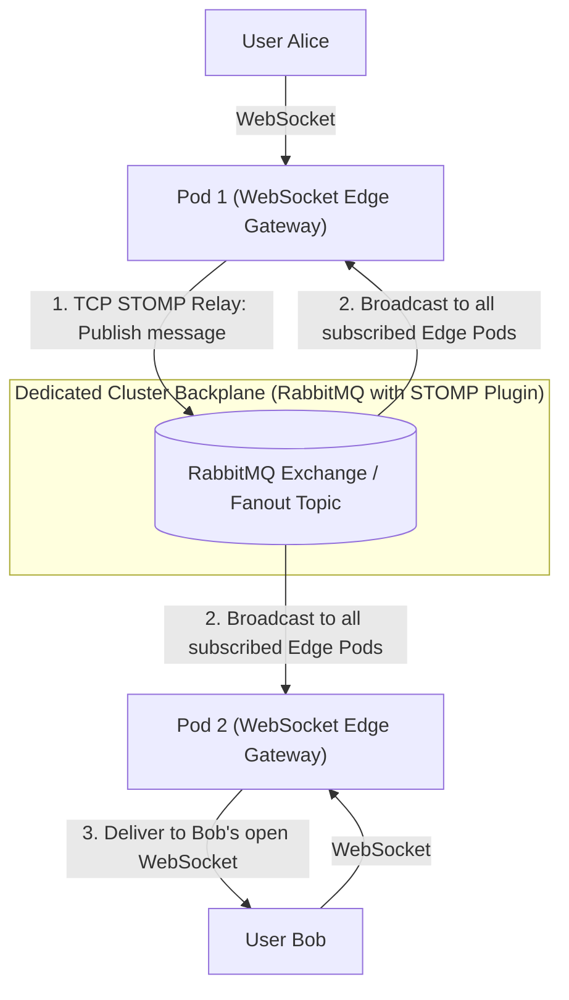
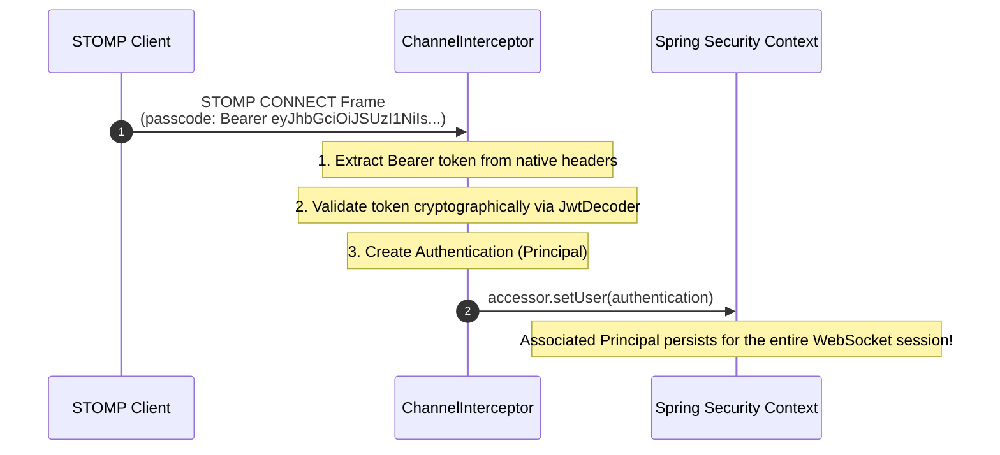

# Real-Time Messaging: WebSockets and SSE

In the early days of the web, applications simulated real-time updates using **Short Polling**: a JavaScript timer fired `fetch('/api/notifications')` every two seconds.

In a system with 50,000 active users, short polling generates 1.5 million HTTP requests per minute. Ninety-nine percent of those requests return empty payloads (`200 OK []`), yet each one incurs TCP handshakes, TLS negotiation, HTTP header parsing, and database queries. It saturates server thread pools and drains client mobile batteries.

Modern distributed systems require persistent, event-driven communication channels between clients and servers. In the modern web architecture, two protocols dominate real-time messaging:
- **Server-Sent Events (SSE):** Lightweight, unidirectional streaming over standard HTTP.
- **WebSockets:** Full-duplex, bidirectional communication over a dedicated persistent TCP socket.

In this guide, we will contrast the two paradigms, build production-grade SSE pipelines, implement enterprise STOMP WebSockets in Spring Boot, and solve the multi-node clustering challenge using external message relays.

---

## Architectural Decision: WebSockets vs Server-Sent Events

Before writing code, an architect must determine the directionality and complexity of the communication.



| Feature | Server-Sent Events (SSE) | WebSockets (with STOMP) |
| :--- | :--- | :--- |
| **Direction** | Unidirectional (Server to Client) | Full-Duplex Bidirectional (Both ways) |
| **Protocol** | Standard HTTP/1.1 or HTTP/2 | Custom `ws://` / `wss://` protocol |
| **Data Format** | UTF-8 Text (`text/event-stream`) | Binary or UTF-8 Text |
| **Reconnection** | Native browser handling with backoff | Manual client-side reconnection logic |
| **Corporate Proxies** | Traverses firewalls and CDNs seamlessly | Can be blocked or terminated by strict proxies |
| **Browser Limit** | 6 connections per domain under HTTP/1.1; unlimited under HTTP/2 | 1 connection per tab (multiplexed easily) |
| **Primary Use Cases** | LLM token streaming, notifications, price feeds | Chat, multiplayer games, collaborative tools |

> **Architectural Rule:** If the client only needs to *listen* to updates from the server (e.g., ChatGPT-style response streaming, order tracking, trading feeds), **always choose SSE**. It is simpler, leverages existing HTTP security filters, and supports automatic reconnection out of the box. Only choose WebSockets when the client must continuously *send* high-frequency messages upstream.

---

## Server-Sent Events (SSE) in Modern Spring Boot

SSE operates over standard HTTP using the `Content-Type: text/event-stream` header. The connection remains open indefinitely, allowing the server to stream discrete text events formatted as:

```text
id: evt-101
event: order-updated
data: {"orderId":"99","status":"SHIPPED"}

```

### Reactive Streaming with Spring WebFlux

In reactive applications, building an SSE endpoint requires returning a `Flux<ServerSentEvent<T>>`:

```java
package com.javahub.sse.controller;

import org.springframework.http.MediaType;
import org.springframework.http.codec.ServerSentEvent;
import org.springframework.web.bind.annotation.GetMapping;
import org.springframework.web.bind.annotation.PathVariable;
import org.springframework.web.bind.annotation.RequestMapping;
import org.springframework.web.bind.annotation.RestController;
import reactor.core.publisher.Flux;

import java.time.Duration;
import java.time.Instant;
import java.util.UUID;

@RestController
@RequestMapping("/api/v1/market-feed")
public class MarketFeedSseController {

    @GetMapping(path = "/tickers/{symbol}", produces = MediaType.TEXT_EVENT_STREAM_VALUE)
    public Flux<ServerSentEvent<StockTick>> streamPriceUpdates(@PathVariable String symbol) {
        return Flux.interval(Duration.ofMillis(500))
                .map(sequence -> ServerSentEvent.<StockTick>builder()
                        .id(UUID.randomUUID().toString())
                        .event("price-tick")
                        .retry(Duration.ofSeconds(3)) // Tells browser to wait 3s before reconnecting if dropped
                        .data(new StockTick(symbol, generateSimulatedPrice(symbol), Instant.now()))
                        .build());
    }

    private double generateSimulatedPrice(String symbol) {
        return 150.0 + (Math.random() * 10.0 - 5.0);
    }

    public record StockTick(String symbol, double price, Instant timestamp) {}
}
```

### Production Hazards with Spring MVC `SseEmitter`

In traditional servlet-based Spring MVC, engineers use `SseEmitter`. While functional, you must manage connection lifecycles defensively:

```java
@GetMapping(path = "/notifications", produces = MediaType.TEXT_EVENT_STREAM_VALUE)
public SseEmitter subscribeNotifications(@AuthenticationPrincipal User user) {
    // 1. Set explicit timeout (e.g., 30 minutes); 0 means infinite which risks connection leaks
    SseEmitter emitter = new SseEmitter(1800_000L);

    notificationService.registerEmitter(user.getId(), emitter);

    // 2. CRITICAL: Clean up emitter when completed or timed out
    emitter.onCompletion(() -> notificationService.removeEmitter(user.getId(), emitter));
    emitter.onTimeout(() -> {
        emitter.complete();
        notificationService.removeEmitter(user.getId(), emitter));
    });
    emitter.onError(e -> notificationService.removeEmitter(user.getId(), emitter));

    return emitter;
}
```

If you omit the completion and error listeners, dropped client connections will remain cached in JVM memory, leaking memory and exhausting server socket limits.

---

## Enterprise WebSockets with STOMP

Raw WebSockets only define how to transmit bytes or text frames over a TCP socket. They specify nothing about:
- Which user should receive a message.
- How to subscribe to a specific topic (`/topic/orders`).
- How to route a private message to a specific user (`/user/queue/messages`).

Without a higher-level sub-protocol, you would be forced to invent your own custom JSON message envelope format. In the enterprise Java ecosystem, that problem is solved by **STOMP (Simple Text Oriented Messaging Protocol)**.



### Configuring Spring Boot STOMP Message Broker

```java
package com.javahub.websocket.config;

import org.springframework.context.annotation.Configuration;
import org.springframework.messaging.simp.config.MessageBrokerRegistry;
import org.springframework.web.socket.config.annotation.EnableWebSocketMessageBroker;
import org.springframework.web.socket.config.annotation.StompEndpointRegistry;
import org.springframework.web.socket.config.annotation.WebSocketMessageBrokerConfigurer;

@Configuration
@EnableWebSocketMessageBroker
public class WebSocketBrokerConfig implements WebSocketMessageBrokerConfigurer {

    @Override
    public void registerStompEndpoints(StompEndpointRegistry registry) {
        // The raw WebSocket handshake endpoint
        registry.addEndpoint("/ws-connect")
                .setAllowedOriginPatterns("https://*.company.com", "http://localhost:3000")
                // Fallback to SockJS if browser or corporate proxy blocks native WebSockets
                .withSockJS();
    }

    @Override
    public void configureMessageBroker(MessageBrokerRegistry registry) {
        // Destinations handled by application @MessageMapping controllers
        registry.setApplicationDestinationPrefixes("/app");

        // Simple in-memory broker for local development
        registry.enableSimpleBroker("/topic", "/queue");

        // Destination prefix for private user-to-user messaging
        registry.setUserDestinationPrefix("/user");
    }
}
```

### The STOMP Message Controller

```java
package com.javahub.websocket.controller;

import org.springframework.messaging.handler.annotation.DestinationVariable;
import org.springframework.messaging.handler.annotation.MessageMapping;
import org.springframework.messaging.handler.annotation.Payload;
import org.springframework.messaging.handler.annotation.SendTo;
import org.springframework.messaging.simp.SimpMessagingTemplate;
import org.springframework.messaging.simp.annotation.SendToUser;
import org.springframework.stereotype.Controller;

import java.security.Principal;
import java.time.Instant;

@Controller
public class ChatMessageController {

    private final SimpMessagingTemplate messagingTemplate;

    public ChatMessageController(SimpMessagingTemplate messagingTemplate) {
        this.messagingTemplate = messagingTemplate;
    }

    // Listens on /app/chat.send/{roomId} and broadcasts to /topic/room.{roomId}
    @MessageMapping("/chat.send/{roomId}")
    @SendTo("/topic/room.{roomId}")
    public ChatOutputMessage broadcastToRoom(@DestinationVariable String roomId,
                                             @Payload ChatInputMessage input,
                                             Principal principal) {
        return new ChatOutputMessage(principal.getName(), input.content(), Instant.now());
    }

    // Private Direct Message: Sends strictly to destination user's queue
    @MessageMapping("/chat.private")
    public void sendDirectMessage(@Payload PrivateMessageRequest request, Principal principal) {
        ChatOutputMessage message = new ChatOutputMessage(principal.getName(), request.content(), Instant.now());
        
        // Pushes to /user/{targetUsername}/queue/messages
        messagingTemplate.convertAndSendToUser(request.recipientUsername(), "/queue/messages", message);
    }

    public record ChatInputMessage(String content) {}
    public record PrivateMessageRequest(String recipientUsername, String content) {}
    public record ChatOutputMessage(String sender, String content, Instant timestamp) {}
}
```

---

## The Clustered Pod Dilemma: Scaling Across Kubernetes

Spring Boot's default `SimpleBroker` stores active WebSocket client connections in a local JVM `ConcurrentHashMap`.

In a production Kubernetes cluster with multiple pods, this leads to silent message drops:



1. Alice establishes a WebSocket handshake to Pod 1.
2. Bob establishes a WebSocket handshake to Pod 2.
3. Alice posts a message to a shared room. Pod 1's `SimpleBroker` delivers the message to all clients *connected to Pod 1*.
4. Bob receives nothing because Pod 1 has no visibility into Pod 2's TCP sockets.

### The Production Remedy: External STOMP Relay (RabbitMQ / ActiveMQ)

To scale WebSockets horizontally, replace the in-memory `SimpleBroker` with an **External STOMP Broker Relay** backed by **RabbitMQ** or **Apache ActiveMQ Artemis**:



### Configuring the External Relay in Spring Boot

Enable the STOMP plugin in RabbitMQ:
```bash
rabbitmq-plugins enable rabbitmq_stomp
```

Update your Spring Boot configuration:

```java
@Configuration
@EnableWebSocketMessageBroker
public class ClusteredWebSocketConfig implements WebSocketMessageBrokerConfigurer {

    @Value("${spring.rabbitmq.host:localhost}")
    private String relayHost;

    @Value("${spring.rabbitmq.stomp-port:61613}")
    private int relayPort;

    @Override
    public void configureMessageBroker(MessageBrokerRegistry registry) {
        registry.setApplicationDestinationPrefixes("/app");

        // Forward /topic and /queue subscriptions directly to the external RabbitMQ cluster!
        registry.enableStompBrokerRelay("/topic", "/queue")
                .setRelayHost(relayHost)
                .setRelayPort(relayPort)
                .setClientLogin("guest")
                .setClientPasscode("guest")
                .setSystemLogin("guest")
                .setSystemPasscode("guest")
                .setSystemHeartbeatSendInterval(10000)
                .setSystemHeartbeatReceiveInterval(10000);
    }
}
```

Now, when Pod 1 receives a message, it forwards the STOMP frame over a persistent TCP socket to RabbitMQ. RabbitMQ fans out the frame across all connected Spring Boot pods, guaranteeing that Bob receives Alice's message regardless of which Kubernetes pod terminates his WebSocket.

---

## Authentication and Security in WebSockets

### The URL Query Parameter Anti-Pattern

Many tutorials suggest passing authentication tokens in the connection URL:
```text
wss://api.company.com/ws-connect?token=eyJhbGciOi...
```

**Never do this in production.**
- Query strings are logged in plaintext by reverse proxies, load balancers, and CDN access logs.
- Browser extensions and history trackers can leak the token.
- WebSockets cannot be refreshed mid-stream; when the token expires after 15 minutes, the connection remains open until manually closed.

### The Standard Enterprise Pattern: STOMP CONNECT Headers

The standard approach uses the HTTP `Authorization` header during the initial HTTP handshake or the STOMP `CONNECT` frame:



### Implementing the Authentication Channel Interceptor

```java
package com.javahub.websocket.security;

import org.springframework.messaging.Message;
import org.springframework.messaging.MessageChannel;
import org.springframework.messaging.simp.stomp.StompCommand;
import org.springframework.messaging.simp.stomp.StompHeaderAccessor;
import org.springframework.messaging.support.ChannelInterceptor;
import org.springframework.messaging.support.MessageHeaderAccessor;
import org.springframework.security.authentication.UsernamePasswordAuthenticationToken;
import org.springframework.security.oauth2.jwt.Jwt;
import org.springframework.security.oauth2.jwt.JwtDecoder;
import org.springframework.stereotype.Component;

import java.util.Collections;

@Component
public class WebSocketAuthInterceptor implements ChannelInterceptor {

    private final JwtDecoder jwtDecoder;

    public WebSocketAuthInterceptor(JwtDecoder jwtDecoder) {
        this.jwtDecoder = jwtDecoder;
    }

    @Override
    public Message<?> preSend(Message<?> message, MessageChannel channel) {
        StompHeaderAccessor accessor = MessageHeaderAccessor.getAccessor(message, StompHeaderAccessor.class);

        // Intercept the initial STOMP CONNECT frame
        if (accessor != null && StompCommand.CONNECT.equals(accessor.getCommand())) {
            String authHeader = accessor.getFirstNativeHeader("Authorization");

            if (authHeader != null && authHeader.startsWith("Bearer ")) {
                String token = authHeader.substring(7);
                try {
                    // Validate token signature and expiration
                    Jwt jwt = jwtDecoder.decode(token);
                    
                    // Bind authenticated Principal to the WebSocket session
                    UsernamePasswordAuthenticationToken authentication =
                            new UsernamePasswordAuthenticationToken(jwt.getSubject(), null, Collections.emptyList());
                    accessor.setUser(authentication);

                } catch (Exception e) {
                    throw new IllegalArgumentException("Invalid JWT token presented during STOMP CONNECT", e);
                }
            } else {
                throw new IllegalArgumentException("Missing or malformed Authorization header in STOMP CONNECT frame");
            }
        }
        return message;
    }
}
```

Register this interceptor in `WebSocketBrokerConfig`:

```java
@Override
public void configureClientInboundChannel(ChannelRegistration registration) {
    registration.interceptors(webSocketAuthInterceptor);
}
```

---

## Senior Engineer Interview Crucible

### When should an architect select Server-Sent Events (SSE) over WebSockets, and what are the specific advantages of SSE?

An architect should select SSE when data flow is strictly **unidirectional** from the server to the client. Examples include real-time financial market price tickers, background job progress monitors, live sports scores, system notifications, and streaming responses from Large Language Models (LLMs).

The specific advantages of SSE over WebSockets include:
1. **Simpler Protocol:** SSE runs over standard HTTP (`text/event-stream`). It requires no custom handshake protocol or specialized sub-protocol (like STOMP).
2. **Transparent Infrastructure Compatibility:** Because SSE is standard HTTP, it traverses corporate firewalls, API gateways, load balancers, and reverse proxies without requiring special WebSocket tunneling configurations.
3. **Native Client Reconnection:** The browser `EventSource` API automatically reconnects if the network connection drops, using an exponential backoff. It sends a `Last-Event-ID` header upon reconnecting, allowing the server to replay missed events seamlessly.
4. **Existing Security Pipeline Integration:** Standard HTTP authentication mechanisms (cookies, bearer tokens, CSRF protection) apply directly to SSE endpoints.

---

### Why does an in-memory STOMP broker (`SimpleBroker`) fail in a multi-pod Kubernetes deployment, and how do you resolve it?

Spring Boot's `SimpleBroker` stores active WebSocket sessions and subscription mappings in local JVM memory (`ConcurrentHashMap`). In a multi-pod deployment, client TCP connections are distributed across different pods by the ingress controller or load balancer.

If User A is connected to Pod 1, and User B is connected to Pod 2, Pod 1 has no knowledge of User B's open TCP connection. When User A publishes a message to a shared topic, Pod 1 broadcasts the message only to clients connected to its own local memory, resulting in silent message loss for User B.

**The Resolution:** Replace `SimpleBroker` with a dedicated **External STOMP Broker Relay** (such as RabbitMQ with its STOMP plugin enabled, or Apache ActiveMQ Artemis) using `registry.enableStompBrokerRelay()`. In this topology, Spring Boot pods act as stateless edge proxies. All publishes and subscriptions are forwarded to the centralized message broker over a TCP relay backplane. The broker fans out messages to all connected pods, ensuring global delivery across the cluster.

---

### Why is passing a JWT in the WebSocket connection URL (`wss://api/ws?token=...`) a security hazard, and what is the standard enterprise alternative?

Passing JWTs in the query string introduces severe security vulnerabilities:
1. **Access Log Exposure:** Query strings are recorded in plaintext by reverse proxies (Nginx, Envoy), API gateways, and cloud load balancers. Anyone with access to server logs can retrieve valid credentials.
2. **Browser History and Referrer Leaks:** Full URLs containing query parameters are stored in browser history and can be leaked via HTTP `Referer` headers to third-party endpoints.
3. **Inability to Refresh Tokens:** Once established, a WebSocket connection can stay open for days. If a 15-minute access token in the query string expires, the connection remains authenticated indefinitely.

**The Standard Enterprise Alternative:** Use the **STOMP `CONNECT` frame headers**. During the initial STOMP handshake over the established WebSocket, the client passes the bearer token inside the STOMP `passcode` or native `Authorization` header. A Spring `ChannelInterceptor` intercepts the `CONNECT` frame, validates the token via `JwtDecoder`, and binds the authenticated `Principal` to the session before granting access.

---

### How do HTTP/1.1 vs HTTP/2 affect browser connection limits for Server-Sent Events (SSE), and what happens if a user opens multiple browser tabs?

Under **HTTP/1.1**, web browsers enforce a strict limit of **6 concurrent open TCP connections per domain**. Because an SSE stream holds an HTTP connection open indefinitely, opening 6 browser tabs to the application exhausts the browser's entire connection allocation for that origin. Opening a 7th tab causes all subsequent HTTP requests (`fetch`, images, scripts) to hang indefinitely in a pending state until an SSE connection is closed.

Under **HTTP/2**, this limitation is eliminated. HTTP/2 supports **multiplexing**, allowing hundreds of concurrent bidirectional streams (both regular REST calls and SSE event streams) to share a single underlying TCP connection. A user can open dozens of browser tabs without exhausting browser connection limits. In production, SSE should always be served over HTTP/2.
