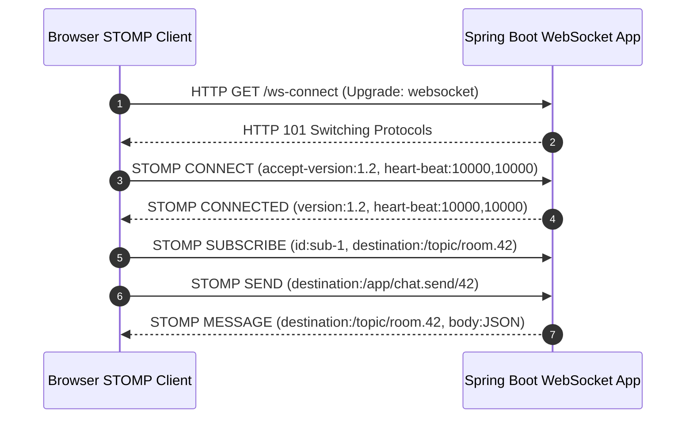
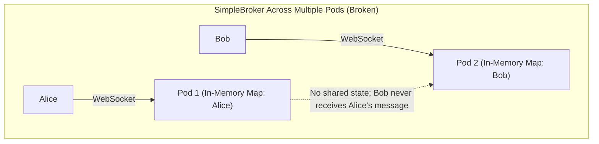
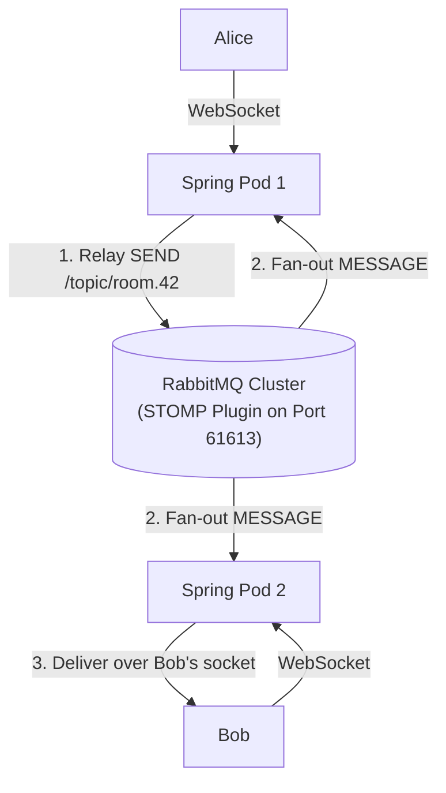
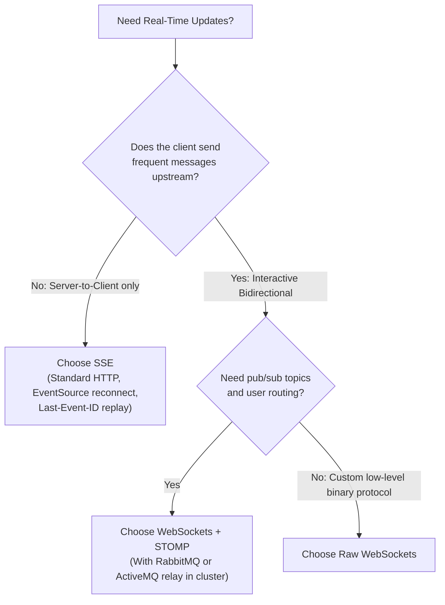

When an application needs to push live order statuses, chat messages, or streaming LLM tokens to browsers, short polling breaks down quickly. If 50,000 connected users call `GET /api/notifications` every two seconds, your backend processes 25,000 requests per second where almost every response is empty, burning CPU on TLS, auth filters, and database reads.

Modern web backends solve this with two complementary protocols:

- **Server-Sent Events (SSE):** Unidirectional server-to-client streaming over standard HTTP (`text/event-stream`).
- **WebSockets:** Full-duplex, bidirectional communication over a persistent TCP socket upgraded from HTTP.

Choosing the right one and configuring it properly for multi-pod deployments and reverse proxies avoids most real-time production incidents.

---

## WebSocket Handshake and Protocol Mechanics

A WebSocket connection does not start on a separate port or custom transport. It begins as an ordinary HTTP/1.1 `GET` request asking the server to switch protocols (RFC 6455).

### The HTTP 101 Switching Protocols Upgrade

The client sends upgrade headers along with a random 16-byte Base64 nonce in `Sec-WebSocket-Key`:

```http
GET /ws-connect HTTP/1.1
Host: api.example.com
Upgrade: websocket
Connection: Upgrade
Sec-WebSocket-Key: dGhlIHNhbXBsZSBub25jZQ==
Sec-WebSocket-Version: 13
Origin: https://app.example.com
```

If the server accepts the handshake, it concatenates the client's key with the fixed RFC 6455 GUID (`258EAFA5-E914-47DA-95CA-C5AB0DC85B11`), computes the SHA-1 hash, Base64-encodes the digest, and replies with `101 Switching Protocols`:

```http
HTTP/1.1 101 Switching Protocols
Upgrade: websocket
Connection: Upgrade
Sec-WebSocket-Accept: s3pPLMBiTxaQ9kYGzzhZRbK+xOo=
```

That challenge-response step is not authentication; it verifies that the server genuinely speaks WebSockets and prevents HTTP caching proxies from replaying a stale response.

### Framing After the Upgrade

Once `101` is returned, HTTP ends and the same underlying TCP socket carries lightweight **WebSocket frames**. Each frame has a compact header (2 to 14 bytes) containing:

- **FIN bit:** Marks whether this is the final fragment of a message.
- **Opcode:** Identifies the frame type: text (`0x1`), binary (`0x2`), close (`0x8`), ping (`0x9`), or pong (`0xA`).
- **Masking key:** All client-to-server frames must be XOR-masked with a 4-byte random key to prevent malicious browser payloads from poisoning misconfigured intermediate HTTP proxies. Server-to-client frames are not masked.
- **Payload length and data:** The raw UTF-8 text or binary payload.

Control frames (`Ping` / `Pong`) let either side detect silent half-open TCP connections when a mobile device drops off Wi-Fi without sending a TCP `FIN`.

---

## STOMP Messaging Over WebSockets

Raw WebSockets give you a bidirectional pipe of text or binary frames, nothing more. They do not define message routing, topic subscriptions, user destinations, or content-type headers. Writing your own JSON envelope and subscription map quickly becomes fragile.

Spring Framework pairs WebSockets with **STOMP (Simple Text Oriented Messaging Protocol)**, a lightweight text-based sub-protocol modeled loosely on HTTP frames (`CONNECT`, `SUBSCRIBE`, `SEND`, `MESSAGE`, `DISCONNECT`).



### Destination Prefixes in Spring Boot

Spring routes STOMP destinations using three clear prefixes:

- **`/app` (`setApplicationDestinationPrefixes`):** Messages sent by clients to `/app/...` are routed to your `@MessageMapping` controller methods for validation, persistence, and business logic.
- **`/topic`:** Pub/sub broadcast destinations (one-to-many). Every subscriber on `/topic/room.42` receives published messages.
- **`/queue` (with `/user` prefix):** Point-to-point or user-specific destinations. A client subscribes to `/user/queue/messages`, and Spring translates that internally to a session-bound destination so only that authenticated user receives frames sent via `convertAndSendToUser`.

```java
package com.javahub.websocket.config;

import org.springframework.context.annotation.Configuration;
import org.springframework.messaging.simp.config.MessageBrokerRegistry;
import org.springframework.web.socket.config.annotation.EnableWebSocketMessageBroker;
import org.springframework.web.socket.config.annotation.StompEndpointRegistry;
import org.springframework.web.socket.config.annotation.WebSocketMessageBrokerConfigurer;

@Configuration
@EnableWebSocketMessageBroker
public class WebSocketBrokerConfig implements WebSocketMessageBrokerConfigurer {

    @Override
    public void registerStompEndpoints(StompEndpointRegistry registry) {
        // Native WebSocket endpoint (add .withSockJS() only if legacy fallback is genuinely needed)
        registry.addEndpoint("/ws-connect")
                .setAllowedOriginPatterns("https://*.example.com", "http://localhost:3000");
    }

    @Override
    public void configureMessageBroker(MessageBrokerRegistry registry) {
        registry.setApplicationDestinationPrefixes("/app");
        registry.setUserDestinationPrefix("/user");

        // In-memory broker: fine for local dev or single-instance deployments only
        registry.enableSimpleBroker("/topic", "/queue");
    }
}
```

### Handling Inbound and Outbound Messages

```java
package com.javahub.websocket.controller;

import org.springframework.messaging.handler.annotation.DestinationVariable;
import org.springframework.messaging.handler.annotation.MessageMapping;
import org.springframework.messaging.handler.annotation.Payload;
import org.springframework.messaging.handler.annotation.SendTo;
import org.springframework.messaging.simp.SimpMessagingTemplate;
import org.springframework.stereotype.Controller;

import java.security.Principal;
import java.time.Instant;

@Controller
public class ChatMessageController {

    private final SimpMessagingTemplate messagingTemplate;

    public ChatMessageController(SimpMessagingTemplate messagingTemplate) {
        this.messagingTemplate = messagingTemplate;
    }

    // Receives frames at /app/chat.send/{roomId} and broadcasts to /topic/room.{roomId}
    @MessageMapping("/chat.send/{roomId}")
    @SendTo("/topic/room.{roomId}")
    public ChatOutputMessage broadcastToRoom(@DestinationVariable String roomId,
                                             @Payload ChatInputMessage input,
                                             Principal principal) {
        return new ChatOutputMessage(principal.getName(), input.content(), Instant.now());
    }

    // Routes a private message only to the target user's subscribed session(s)
    @MessageMapping("/chat.private")
    public void sendDirectMessage(@Payload PrivateMessageRequest request, Principal principal) {
        ChatOutputMessage message = new ChatOutputMessage(
                principal.getName(),
                request.content(),
                Instant.now()
        );
        messagingTemplate.convertAndSendToUser(
                request.recipientUsername(),
                "/queue/messages",
                message
        );
    }

    public record ChatInputMessage(String content) {}
    public record PrivateMessageRequest(String recipientUsername, String content) {}
    public record ChatOutputMessage(String sender, String content, Instant timestamp) {}
}
```

### Authenticating STOMP Connections Safely

Avoid putting JWTs in the WebSocket URL (`wss://api.example.com/ws-connect?token=eyJ...`). Query parameters end up in Nginx access logs, cloud load balancer logs, browser history, and APM traces.

Because the browser `WebSocket` API does not let JavaScript attach custom `Authorization` headers to the initial HTTP upgrade request, teams typically use one of two patterns:

1. **HttpOnly session cookie** sent automatically during the HTTP 101 handshake (with strict `Origin` validation to block Cross-Site WebSocket Hijacking).
2. **Bearer token in the STOMP `CONNECT` frame** validated by a Spring `ChannelInterceptor` before any `SUBSCRIBE` or `SEND` frame is allowed.

```java
package com.javahub.websocket.security;

import org.springframework.messaging.Message;
import org.springframework.messaging.MessageChannel;
import org.springframework.messaging.simp.stomp.StompCommand;
import org.springframework.messaging.simp.stomp.StompHeaderAccessor;
import org.springframework.messaging.support.ChannelInterceptor;
import org.springframework.messaging.support.MessageHeaderAccessor;
import org.springframework.security.access.AccessDeniedException;
import org.springframework.security.authentication.UsernamePasswordAuthenticationToken;
import org.springframework.security.oauth2.jwt.Jwt;
import org.springframework.security.oauth2.jwt.JwtDecoder;
import org.springframework.stereotype.Component;

import java.util.Collections;

@Component
public class WebSocketAuthInterceptor implements ChannelInterceptor {

    private final JwtDecoder jwtDecoder;

    public WebSocketAuthInterceptor(JwtDecoder jwtDecoder) {
        this.jwtDecoder = jwtDecoder;
    }

    @Override
    public Message<?> preSend(Message<?> message, MessageChannel channel) {
        StompHeaderAccessor accessor =
                MessageHeaderAccessor.getAccessor(message, StompHeaderAccessor.class);

        if (accessor != null && StompCommand.CONNECT.equals(accessor.getCommand())) {
            String authHeader = accessor.getFirstNativeHeader("Authorization");
            if (authHeader == null || !authHeader.startsWith("Bearer ")) {
                throw new AccessDeniedException("Missing Bearer token in STOMP CONNECT frame");
            }

            Jwt jwt = jwtDecoder.decode(authHeader.substring(7));
            UsernamePasswordAuthenticationToken principal =
                    new UsernamePasswordAuthenticationToken(jwt.getSubject(), null, Collections.emptyList());
            accessor.setUser(principal);
        }
        return message;
    }
}
```

Register it via `configureClientInboundChannel(ChannelRegistration registration)` in your `WebSocketMessageBrokerConfigurer`.

---

## Scaling Across Instances with an External Broker Relay

`registry.enableSimpleBroker("/topic", "/queue")` stores subscriptions in local JVM memory. That works fine on a laptop, and silently breaks as soon as you deploy two replicas behind a load balancer.



If Alice's TCP socket lands on Pod 1 and Bob's lands on Pod 2, Pod 1 has no record of Bob's subscription. Messages Alice sends to `/topic/room.42` reach everyone on Pod 1 and vanish for everyone on Pod 2.

### Replacing SimpleBroker with RabbitMQ STOMP Relay

To scale horizontally, swap `enableSimpleBroker` for `enableStompBrokerRelay` backed by **RabbitMQ** (with `rabbitmq_stomp` enabled) or **ActiveMQ Artemis**. Spring opens persistent TCP connections to the broker and relays STOMP `SUBSCRIBE`, `SEND`, and `MESSAGE` frames across all pods.



Enable the STOMP plugin in RabbitMQ:

```bash
rabbitmq-plugins enable rabbitmq_stomp
```

Make sure `spring-boot-starter-reactor-netty` (or `io.projectreactor.netty:reactor-netty`) is on your classpath, because Spring's `StompBrokerRelayMessageHandler` uses Reactor Netty for the TCP connection to the broker.

```java
package com.javahub.websocket.config;

import org.springframework.beans.factory.annotation.Value;
import org.springframework.context.annotation.Configuration;
import org.springframework.messaging.simp.config.MessageBrokerRegistry;
import org.springframework.web.socket.config.annotation.EnableWebSocketMessageBroker;
import org.springframework.web.socket.config.annotation.StompEndpointRegistry;
import org.springframework.web.socket.config.annotation.WebSocketMessageBrokerConfigurer;

@Configuration
@EnableWebSocketMessageBroker
public class ClusteredWebSocketConfig implements WebSocketMessageBrokerConfigurer {

    @Value("${app.stomp.relay-host:localhost}")
    private String relayHost;

    @Value("${app.stomp.relay-port:61613}")
    private int relayPort;

    @Value("${app.stomp.relay-user:stomp_user}")
    private String relayUser;

    @Value("${app.stomp.relay-pass:change_me}")
    private String relayPass;

    @Override
    public void registerStompEndpoints(StompEndpointRegistry registry) {
        registry.addEndpoint("/ws-connect")
                .setAllowedOriginPatterns("https://*.example.com");
    }

    @Override
    public void configureMessageBroker(MessageBrokerRegistry registry) {
        registry.setApplicationDestinationPrefixes("/app");
        registry.setUserDestinationPrefix("/user");

        registry.enableStompBrokerRelay("/topic", "/queue")
                .setRelayHost(relayHost)
                .setRelayPort(relayPort)
                .setClientLogin(relayUser)
                .setClientPasscode(relayPass)
                .setSystemLogin(relayUser)
                .setSystemPasscode(relayPass)
                .setSystemHeartbeatSendInterval(10_000)
                .setSystemHeartbeatReceiveInterval(10_000);
    }
}
```

> [!WARNING]
> **RabbitMQ destination naming gotcha:** Unlike `SimpleBroker`, RabbitMQ's STOMP plugin maps `/topic/<routing-key>` to the `amq.topic` exchange and does **not** allow extra `/` characters inside queue or routing key names. Prefer dot-separated names such as `/topic/room.42` instead of `/topic/room/42`. Also note that `systemLogin` authenticates Spring's shared system connection (used by `SimpMessagingTemplate`), while `clientLogin` authenticates relayed client sessions.

---

## Server-Sent Events (SSE) with Spring MVC `SseEmitter`

When updates only flow from server to client—dashboards, build logs, stock tickers, notification feeds, or streaming AI tokens—WebSockets and a STOMP broker are often unnecessary machinery.

SSE runs over plain HTTP using `Content-Type: text/event-stream`. The server keeps the response open and flushes UTF-8 text blocks separated by a blank line (`\n\n`):

```text
id: evt-1042
event: order-updated
retry: 3000
data: {"orderId":"99","status":"SHIPPED"}

```

On the browser side, the built-in `EventSource` API parses those frames automatically. If the network drops, `EventSource` waits for the `retry` interval, reconnects on its own, and sends the last seen event ID in the `Last-Event-ID` HTTP request header so your server can replay missed messages.

### Production-Safe `SseEmitter` Registry and Controller

In Spring MVC, `SseEmitter` builds on Servlet 3.1 asynchronous request processing. Once your controller returns the `SseEmitter`, the Tomcat request thread is released back to the pool; you do not pin one Servlet thread per connected user.

However, you must manage timeouts, dead emitters, replay via `Last-Event-ID`, and proxy headers deliberately:

```java
package com.javahub.sse;

import jakarta.servlet.http.HttpServletResponse;
import org.slf4j.Logger;
import org.slf4j.LoggerFactory;
import org.springframework.http.MediaType;
import org.springframework.scheduling.annotation.Scheduled;
import org.springframework.web.bind.annotation.GetMapping;
import org.springframework.web.bind.annotation.RequestHeader;
import org.springframework.web.bind.annotation.RequestMapping;
import org.springframework.web.bind.annotation.RequestParam;
import org.springframework.web.bind.annotation.RestController;
import org.springframework.web.servlet.mvc.method.annotation.SseEmitter;

import java.io.IOException;
import java.time.Instant;
import java.util.List;
import java.util.Map;
import java.util.Set;
import java.util.concurrent.ConcurrentHashMap;

@RestController
@RequestMapping("/api/v1/events")
public class OrderEventSseController {

    private static final Logger log = LoggerFactory.getLogger(OrderEventSseController.class);
    private static final long EMITTER_TIMEOUT_MS = 30 * 60 * 1000L; // 30 minutes

    private final Map<String, Set<SseEmitter>> emittersByUser = new ConcurrentHashMap<>();
    private final OrderEventHistory eventHistory;

    public OrderEventSseController(OrderEventHistory eventHistory) {
        this.eventHistory = eventHistory;
    }

    @GetMapping(path = "/orders", produces = MediaType.TEXT_EVENT_STREAM_VALUE)
    public SseEmitter streamOrderEvents(
            @RequestParam String userId,
            @RequestHeader(value = "Last-Event-ID", required = false) String lastEventId,
            HttpServletResponse response) {

        // Tell Nginx not to buffer SSE chunks before flushing to the browser
        response.setHeader("X-Accel-Buffering", "no");
        response.setHeader("Cache-Control", "no-cache");

        SseEmitter emitter = new SseEmitter(EMITTER_TIMEOUT_MS);
        emittersByUser.computeIfAbsent(userId, key -> ConcurrentHashMap.newKeySet()).add(emitter);

        Runnable cleanup = () -> removeEmitter(userId, emitter);
        emitter.onCompletion(cleanup);
        emitter.onTimeout(() -> {
            emitter.complete();
            cleanup.run();
        });
        emitter.onError(ex -> cleanup.run());

        try {
            // Send an initial comment so proxies flush response headers immediately
            emitter.send(SseEmitter.event()
                    .comment("connected")
                    .reconnectTime(3000L));

            // Replay any missed events when EventSource automatically reconnects
            if (lastEventId != null && !lastEventId.isBlank()) {
                List<OrderEvent> missed = eventHistory.findAfter(userId, lastEventId);
                for (OrderEvent event : missed) {
                    emitter.send(SseEmitter.event()
                            .id(event.id())
                            .name("order-updated")
                            .data(event));
                }
            }
        } catch (IOException ex) {
            cleanup.run();
            emitter.completeWithError(ex);
        }

        return emitter;
    }

    public void publish(String userId, OrderEvent event) {
        Set<SseEmitter> emitters = emittersByUser.get(userId);
        if (emitters == null || emitters.isEmpty()) {
            return;
        }

        for (SseEmitter emitter : emitters) {
            try {
                emitter.send(SseEmitter.event()
                        .id(event.id())
                        .name("order-updated")
                        .data(event));
            } catch (IOException ex) {
                // Client disconnected mid-stream; remove immediately to avoid leaks
                log.debug("Removing closed SSE emitter for user {}", userId);
                removeEmitter(userId, emitter);
                emitter.completeWithError(ex);
            }
        }
    }

    // Keep connections alive through idle load balancer timeouts (e.g., 60s AWS ALB idle timeout)
    @Scheduled(fixedRate = 25_000L)
    public void sendHeartbeats() {
        emittersByUser.forEach((userId, emitters) -> {
            for (SseEmitter emitter : emitters) {
                try {
                    emitter.send(SseEmitter.event().comment("keepalive"));
                } catch (IOException ex) {
                    removeEmitter(userId, emitter);
                }
            }
        });
    }

    private void removeEmitter(String userId, SseEmitter emitter) {
        Set<SseEmitter> emitters = emittersByUser.get(userId);
        if (emitters != null) {
            emitters.remove(emitter);
            if (emitters.isEmpty()) {
                emittersByUser.remove(userId, emitters);
            }
        }
    }

    public record OrderEvent(String id, String orderId, String status, Instant updatedAt) {}
}
```

### Operational Pitfalls with SSE in Production

Four real-world issues trip teams up the first time they deploy SSE:

1. **Nginx buffering stalls events:** By default, Nginx buffers upstream HTTP responses (`proxy_buffering on`) until a buffer fills (often 4KB to 8KB) or the response closes. Your browser sees nothing for minutes and then receives a burst of events at once. Set `X-Accel-Buffering: no` from Spring, or configure the Nginx location block explicitly:

```nginx
location /api/v1/events/ {
    proxy_pass http://spring_backend;
    proxy_http_version 1.1;
    proxy_set_header Connection "";
    proxy_buffering off;
    proxy_cache off;
    gzip off;
    proxy_read_timeout 3600s;
}
```

2. **Open-Session-in-View (`spring.jpa.open-in-view`):** Spring Boot enables OSIV by default. Combined with async `SseEmitter` streams, a database connection can stay checked out for the entire lifetime of the HTTP response, draining HikariCP under modest concurrency. Set `spring.jpa.open-in-view=false`.
3. **HTTP/1.1 browser connection limit:** Browsers cap concurrent HTTP/1.1 connections at **6 per origin**. If a user opens 6 tabs with open SSE streams, a 7th tab hangs on every normal API call. Serving your site over **HTTP/2** removes this bottleneck because all tabs multiplex streams over one shared connection.
4. **Multi-pod SSE fan-out:** Just like `SimpleBroker`, `emittersByUser` lives in local JVM memory. In a multi-pod cluster, publish events to Redis Pub/Sub or Kafka so every pod receives the event and forwards it to whichever users hold an active `SseEmitter` on that pod.

> [!TIP]
> If your service already uses reactive **Spring WebFlux**, returning `Flux<ServerSentEvent<T>>` with `produces = MediaType.TEXT_EVENT_STREAM_VALUE` gives you non-blocking backpressure and automatic cancellation cleanup when a client disconnects, without manually tracking `SseEmitter` instances.

---

## Choosing Between SSE and WebSockets



| Dimension | Server-Sent Events (SSE) | WebSockets (with STOMP) |
| :--- | :--- | :--- |
| **Direction** | Server to client only (use regular HTTP `POST` for occasional client actions) | Full-duplex bidirectional |
| **Protocol** | Standard HTTP/1.1 or HTTP/2 (`text/event-stream`) | `ws://` / `wss://` after HTTP `101` upgrade |
| **Payload** | UTF-8 text | UTF-8 text or binary |
| **Reconnection** | Built into browser `EventSource` with `Last-Event-ID` | Must be implemented in client library (e.g., `@stomp/stompjs`) |
| **Proxies and Firewalls** | Works through standard HTTP proxies (watch response buffering) | Requires proxy upgrade support (`Upgrade` / `Connection` headers) |
| **Browser Connection Cap** | 6 per origin over HTTP/1.1; multiplexed under HTTP/2 | No 6-connection HTTP/1.1 cap |
| **Best Fit** | Notifications, dashboards, live feeds, job progress, LLM streaming | Chat, collaborative editors, multiplayer state sync, live auctions |

A good default rule: start with **SSE** whenever updates flow from server to client and user actions are ordinary HTTP requests (`POST /api/orders`). Reach for **WebSockets** when the client continuously streams low-latency data back to the server (cursor positions, typing indicators, game ticks, high-frequency chat).

---

## Interview Questions

### Why does `SimpleBroker` work locally but drop messages in a multi-pod Kubernetes cluster?

`SimpleBroker` keeps active WebSocket sessions and topic subscriptions in local JVM memory. When a load balancer places User A on Pod 1 and User B on Pod 2, Pod 1 has no visibility into User B's socket. Messages published to Pod 1 only fan out to clients connected to Pod 1. Replacing `SimpleBroker` with `enableStompBrokerRelay` backed by RabbitMQ or ActiveMQ Artemis turns each Spring Boot pod into a stateless relay connected to a shared broker that fans messages out to every pod.

### Why do SSE streams sometimes appear frozen behind Nginx even though the Spring Boot controller is emitting events?

Nginx enables `proxy_buffering` by default and waits until its internal buffer fills up before forwarding response bytes to the client. Because SSE events are typically small JSON snippets, they sit trapped in the Nginx buffer. Setting the `X-Accel-Buffering: no` header in the Spring response (or configuring `proxy_buffering off` and disabling `gzip` on the SSE location in Nginx) forces immediate flushing. Periodic heartbeat comments also keep intermediate load balancers from closing idle streams.

### How does browser `EventSource` reconnection work, and how should the server handle missed events?

When an SSE connection drops, the browser's `EventSource` client waits for the server-specified `retry` duration (defaulting to a few seconds) and opens a new HTTP `GET` request automatically. If the server attached an `id:` field to previous events, the browser includes `Last-Event-ID: <id>` in the reconnect request headers. The Spring controller reads `@RequestHeader("Last-Event-ID")`, queries a bounded event store or message log for events created after that ID, and replays them before resuming live delivery.

### What happens if you omit `onCompletion`, `onTimeout`, and `onError` cleanup on `SseEmitter`, or leave `spring.jpa.open-in-view` enabled?

Without cleanup callbacks (and `IOException` handling during `send()`), closed client connections stay referenced in your emitter registry map, leaking heap memory and causing every broadcast loop to iterate over dead sockets. Leaving `spring.jpa.open-in-view=true` on an async `SseEmitter` endpoint can also hold a JDBC connection from HikariCP open for the entire duration of the SSE stream, rapidly starving normal database requests under load.
