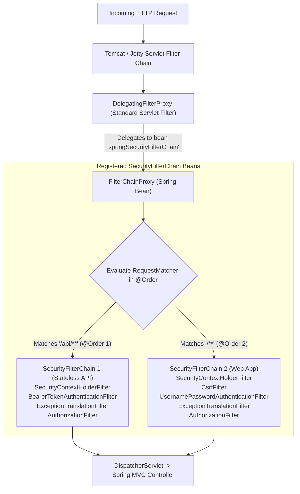
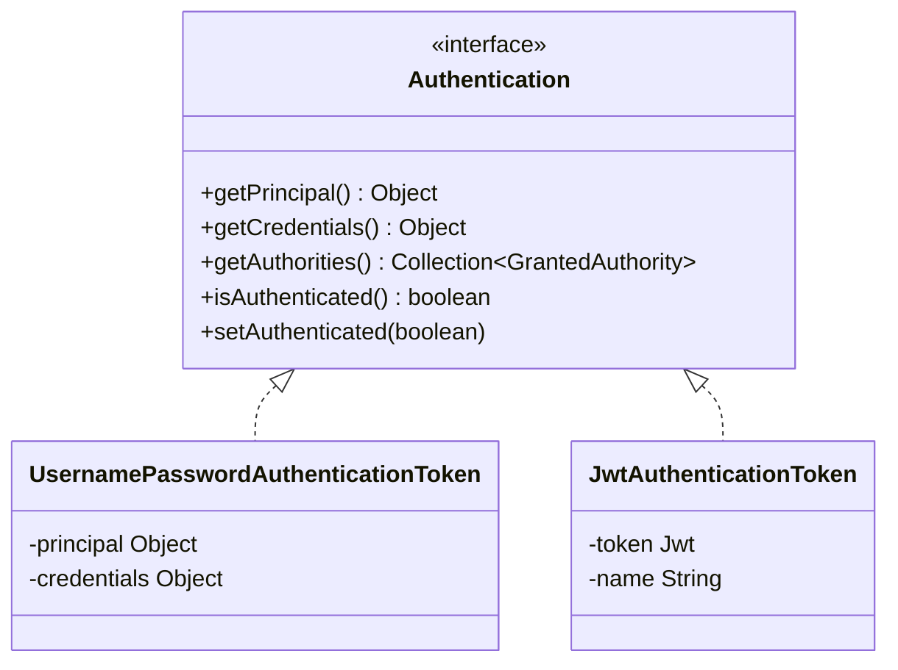
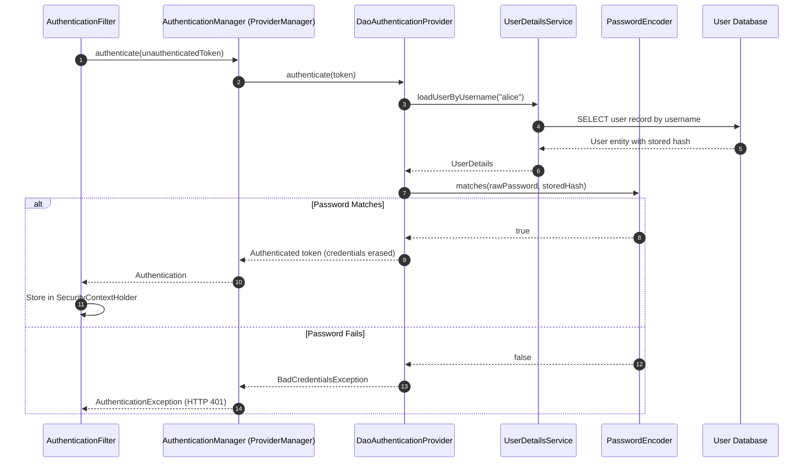
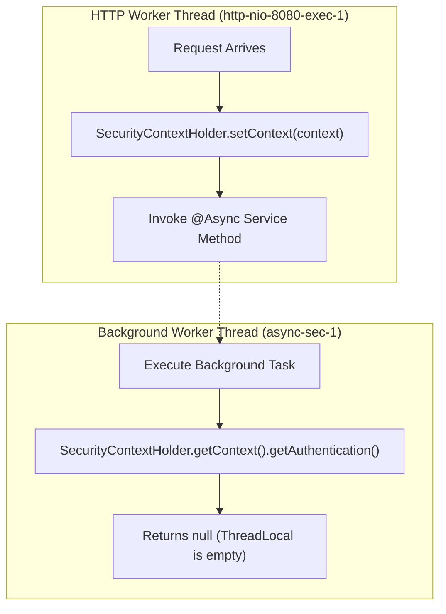
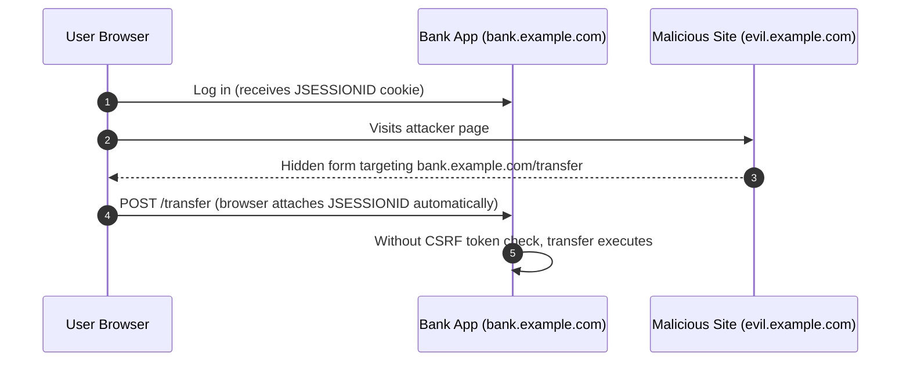

Many Java developers treat Spring Security like a black box. When an endpoint starts returning `401` or `403`, it is tempting to copy `.csrf(csrf -> csrf.disable())` or widen a `.permitAll()` rule until tests turn green, without realizing what protection was just removed.

Underneath the DSL, Spring Security has a straightforward design. It plugs into the Servlet container's standard filter pipeline, routes each HTTP request through an ordered chain of security filters, separates identity verification from access checks, and stores the active caller in a request-scoped context. Once you understand those moving parts, debugging an unexpected `403 Forbidden` stops feeling like guesswork.

## How Requests Enter Spring Security: `FilterChainProxy` and `SecurityFilterChain`

A Servlet container like Tomcat or Jetty knows nothing about Spring beans or dependency injection. It only knows how to execute standard `jakarta.servlet.Filter` instances (note that Spring Boot 3 uses the `jakarta.servlet` package rather than the older `javax.servlet` namespace).

Spring bridges the Servlet container and the Spring `ApplicationContext` using two components: `DelegatingFilterProxy` and `FilterChainProxy`.



Here is what happens on every incoming request:

1. **Servlet container dispatch**: Tomcat receives the HTTP request and runs its registered Servlet filters.
2. **`DelegatingFilterProxy`**: Spring Boot automatically registers this standard Servlet filter. It contains no security logic of its own. Its only job is to look up the Spring bean named `springSecurityFilterChain` from the `ApplicationContext` and delegate the request to it.
3. **`FilterChainProxy`**: That bean is `FilterChainProxy`. It holds an ordered list of all `SecurityFilterChain` beans defined in your application. When a request arrives, `FilterChainProxy` checks each chain's `RequestMatcher` from first to last and picks the first match. Only that single chain executes.
4. **`SecurityFilterChain`**: Each chain is an ordered list of 10 to 15 individual filters. Earlier filters establish the security context and attempt authentication; `ExceptionTranslationFilter` catches security exceptions and translates them into HTTP `401` or `403` responses; `AuthorizationFilter` runs near the end to check URL rules. If any filter rejects the request, execution stops before `DispatcherServlet` or your controller ever sees it.

### Configuring Multiple Filter Chains in Spring Security 6

Spring Security 6 removed `WebSecurityConfigurerAdapter`. Instead, you declare one or more `SecurityFilterChain` beans using the lambda DSL. When an application serves both a stateless REST API and a server-rendered admin portal, separate chains keep their rules cleanly isolated:

```java
package com.example.ecommerce.security;

import org.springframework.context.annotation.Bean;
import org.springframework.context.annotation.Configuration;
import org.springframework.core.annotation.Order;
import org.springframework.http.HttpMethod;
import org.springframework.security.config.Customizer;
import org.springframework.security.config.annotation.method.configuration.EnableMethodSecurity;
import org.springframework.security.config.annotation.web.builders.HttpSecurity;
import org.springframework.security.config.annotation.web.configuration.EnableWebSecurity;
import org.springframework.security.config.http.SessionCreationPolicy;
import org.springframework.security.web.SecurityFilterChain;

@Configuration
@EnableWebSecurity
@EnableMethodSecurity
public class WebSecurityConfig {

    @Bean
    @Order(1)
    public SecurityFilterChain apiSecurityFilterChain(HttpSecurity http) throws Exception {
        return http
            // Restrict this chain strictly to /api/** requests
            .securityMatcher("/api/**")
            .authorizeHttpRequests(auth -> auth
                .requestMatchers("/api/v1/public/**").permitAll()
                .requestMatchers(HttpMethod.GET, "/api/v1/products/**").permitAll()
                .requestMatchers("/api/v1/admin/**").hasRole("ADMIN")
                .anyRequest().authenticated()
            )
            .sessionManagement(session -> session
                .sessionCreationPolicy(SessionCreationPolicy.STATELESS)
            )
            .csrf(csrf -> csrf.disable())
            .httpBasic(Customizer.withDefaults())
            .build();
    }

    @Bean
    @Order(2)
    public SecurityFilterChain webSecurityFilterChain(HttpSecurity http) throws Exception {
        return http
            // Fallback chain for everything not matched by @Order(1)
            .authorizeHttpRequests(auth -> auth
                .requestMatchers("/actuator/health", "/login", "/css/**").permitAll()
                .anyRequest().authenticated()
            )
            .formLogin(Customizer.withDefaults())
            .build();
    }
}
```

Notice `.securityMatcher("/api/**")` on the first chain. Without it, a chain matches every URL (`/**`), which would swallow all requests before `@Order(2)` ever gets evaluated.

> [!IMPORTANT]
> Rule order inside `authorizeHttpRequests` is evaluated strictly top to bottom, and the first matching rule wins. Always declare specific paths before broad catch-alls like `.anyRequest().authenticated()`. Putting `.requestMatchers("/**").permitAll()` above an admin rule makes the admin rule unreachable.

## Authentication vs Authorization

Conflating authentication and authorization is behind a surprising number of security bugs, so it helps to keep the boundary sharp:

- **Authentication (AuthN)** answers *"Who is making this request?"* It verifies credentials such as a password, bearer JWT, API key, or X.509 client certificate. Failures produce HTTP `401 Unauthorized`.
- **Authorization (AuthZ)** answers *"Is this authenticated caller allowed to perform this action on this resource?"* Failures produce HTTP `403 Forbidden`.

In Spring Security, the result of authentication is stored as an `Authentication` object inside `SecurityContextHolder`:



An `Authentication` instance carries three pieces of state:
- **Principal**: Who the user is, typically a `UserDetails` implementation, a `Jwt`, or a username string.
- **Credentials**: The proof used during login (such as a raw password). Once authentication succeeds, `ProviderManager` calls `eraseCredentials()` so raw secrets are not left sitting in heap memory.
- **Authorities**: A collection of `GrantedAuthority` instances representing roles and fine-grained permissions (for example `ROLE_ADMIN` or `invoice:approve`).

## How `UserDetailsService`, `DaoAuthenticationProvider`, and `PasswordEncoder` Work Together

When a client logs in with a username and password, an authentication filter builds an unauthenticated `UsernamePasswordAuthenticationToken` and hands it to `AuthenticationManager`. The default implementation, `ProviderManager`, iterates through its configured `AuthenticationProvider` beans until one supports that token type.

For database-backed username/password login, that provider is `DaoAuthenticationProvider`.



### Implementing `UserDetailsService`

`UserDetailsService` has a single responsibility: look up a user by identifier and return a `UserDetails` object containing the stored password hash, account status flags, and granted authorities. It does not check the password itself; `DaoAuthenticationProvider` handles password verification.

```java
package com.example.ecommerce.security;

import com.example.ecommerce.domain.AppUser;
import com.example.ecommerce.repository.UserRepository;
import org.springframework.security.core.authority.SimpleGrantedAuthority;
import org.springframework.security.core.userdetails.User;
import org.springframework.security.core.userdetails.UserDetails;
import org.springframework.security.core.userdetails.UserDetailsService;
import org.springframework.security.core.userdetails.UsernameNotFoundException;
import org.springframework.stereotype.Service;

import java.util.List;

@Service
public class JpaUserDetailsService implements UserDetailsService {

    private final UserRepository userRepository;

    public JpaUserDetailsService(UserRepository userRepository) {
        this.userRepository = userRepository;
    }

    @Override
    public UserDetails loadUserByUsername(String username) throws UsernameNotFoundException {
        AppUser user = userRepository.findByEmailIgnoreCase(username)
                .orElseThrow(() -> new UsernameNotFoundException("User not found: " + username));

        List<SimpleGrantedAuthority> authorities = user.getRoles().stream()
                .map(role -> new SimpleGrantedAuthority("ROLE_" + role.getName()))
                .toList();

        return User.withUsername(user.getEmail())
                .password(user.getPasswordHash())
                .authorities(authorities)
                .accountLocked(user.isLocked())
                .disabled(!user.isEnabled())
                .build();
    }
}
```

Two subtle details in `DaoAuthenticationProvider` are worth knowing:
- By default, `hideUserNotFoundExceptions` is `true`, so `UsernameNotFoundException` is converted into a generic `BadCredentialsException`. This prevents login responses from leaking whether an email address is registered.
- When a user is not found, `DaoAuthenticationProvider` still runs `passwordEncoder.matches(...)` against a pre-encoded dummy password. That keeps response times consistent between valid and invalid usernames, reducing timing-based username enumeration.

### Why MD5 and SHA-256 Are Unsafe for Passwords

A common mistake in older codebases is hashing passwords with MD5, SHA-1, or SHA-256. Those algorithms are general-purpose cryptographic hashes designed to be fast. On modern consumer GPUs, an attacker with a leaked database dump can evaluate billions of SHA-256 hashes per second. Without a unique random salt per password, identical passwords also produce identical hashes, making precomputed lookup tables trivial to use.

Password storage requires a **slow, salted, adaptive key derivation function** whose work factor can be increased as hardware gets faster.

### `BCryptPasswordEncoder` vs `Argon2PasswordEncoder`

Spring Security provides several adaptive `PasswordEncoder` implementations. In practice, two stand out:

| Algorithm | Resistance Profile | Strengths | Things to Watch Out For |
|---|---|---|---|
| **BCrypt** (`BCryptPasswordEncoder`) | CPU-hard | Built into Spring Security with no extra dependency; embeds a random 128-bit salt and cost factor in the output string. | Truncates inputs silently at 72 bytes. Less resistant to custom GPU/ASIC rigs than memory-hard algorithms. |
| **Argon2id** (`Argon2PasswordEncoder`) | Memory-hard and CPU-hard | Current OWASP recommendation; configurable memory cost, iterations, and parallelism make GPU/ASIC cracking expensive. | Requires Bouncy Castle (`org.bouncycastle:bcprov-jdk18on`) on the classpath. Tune memory settings carefully so concurrent logins do not exhaust container RAM. |

When choosing BCrypt, pick a strength (work factor) that takes roughly 100 to 300 milliseconds on your target production CPU (often strength 10 to 12). When using Argon2id, Spring Security 6 provides `Argon2PasswordEncoder.defaultsForSpringSecurity_v5_8()`, which uses Argon2id with 16 MiB of memory, 2 iterations, and 1 thread as a sensible baseline.

### Upgrading Hash Algorithms Safely with `DelegatingPasswordEncoder`

Hardcoding a single `BCryptPasswordEncoder` bean makes future algorithm migrations painful, because every stored hash in your database assumes that one algorithm. Spring Security solves this with `PasswordEncoderFactories.createDelegatingPasswordEncoder()`.

`DelegatingPasswordEncoder` prepends an algorithm identifier in curly braces to every encoded hash:
- `{bcrypt}` followed by the BCrypt version, cost factor, salt, and hash
- `{argon2}` followed by the Argon2id parameters, salt, and hash
- `{pbkdf2}` or `{scrypt}` for other supported encoders

When `matches(rawPassword, storedHash)` runs, `DelegatingPasswordEncoder` inspects the `{id}` prefix and delegates verification to the matching encoder. When `encode(rawPassword)` runs, it always uses the configured default encoder.

```java
package com.example.ecommerce.security;

import org.springframework.context.annotation.Bean;
import org.springframework.context.annotation.Configuration;
import org.springframework.security.crypto.argon2.Argon2PasswordEncoder;
import org.springframework.security.crypto.bcrypt.BCryptPasswordEncoder;
import org.springframework.security.crypto.factory.PasswordEncoderFactories;
import org.springframework.security.crypto.password.DelegatingPasswordEncoder;
import org.springframework.security.crypto.password.PasswordEncoder;

import java.util.Map;

@Configuration
public class PasswordEncoderConfig {

    // Standard default: encodes new passwords with {bcrypt}, verifies legacy/other prefixes too
    @Bean
    public PasswordEncoder defaultPasswordEncoder() {
        return PasswordEncoderFactories.createDelegatingPasswordEncoder();
    }

    // Example: migrating an existing BCrypt user base to Argon2id without forcing resets
    public PasswordEncoder argon2MigratingEncoder() {
        Map<String, PasswordEncoder> encoders = Map.of(
                "argon2", Argon2PasswordEncoder.defaultsForSpringSecurity_v5_8(),
                "bcrypt", new BCryptPasswordEncoder(12)
        );
        return new DelegatingPasswordEncoder("argon2", encoders);
    }
}
```

If you also implement Spring Security's `UserDetailsPasswordService` bean (`updatePassword(UserDetails user, String newPassword)`), `DaoAuthenticationProvider` checks `passwordEncoder.upgradeEncoding(storedHash)` after every successful login. Whenever a user logs in with an older `{bcrypt}` hash or a lower BCrypt cost factor, Spring automatically re-hashes their password with the new encoder and persists it transparently.

## Role-Based and Permission-Based Access Control with `@PreAuthorize`

Spring Security distinguishes between **roles** and **authorities** by a naming convention:
- `hasRole("ADMIN")` automatically prepends `ROLE_` and checks whether the caller holds `ROLE_ADMIN`.
- `hasAuthority("invoice:delete")` checks for that exact string with no prefix added.

Coarse roles (`ADMIN`, `SUPPORT`, `CUSTOMER`) work well for small apps, but they tend to grow messy as requirements diverge. Many teams pair roles with fine-grained permissions (Permission-Based Access Control, or PBAC) such as `invoice:read` or `refund:issue`. Checking authorities in code lets administrators assemble new custom roles in the database or identity provider without redeploying the service.

### Why URL Security Cannot Stop IDOR

URL rules in `SecurityFilterChain` only know the route and the user's roles. They cannot tell whether a user owns the specific record being requested. Consider this endpoint:

```java
@GetMapping("/api/v1/invoices/{id}")
public InvoiceResponse getInvoice(@PathVariable UUID id) {
    return invoiceService.getInvoice(id);
}
```

Even if `/api/v1/invoices/**` requires `hasRole("CUSTOMER")`, any logged-in customer can substitute someone else's invoice UUID and read their billing data. This is an **Insecure Direct Object Reference (IDOR)** vulnerability (classified under Broken Object Level Authorization in the OWASP API Security Top 10).

### Enforcing Ownership with `@PreAuthorize`

With `@EnableMethodSecurity` active (`prePostEnabled = true` is on by default in Spring Security 6), you can place SpEL authorization expressions directly on service methods. For non-trivial ownership logic, keep the expression clean by delegating to a dedicated Spring bean:

```java
package com.example.ecommerce.security;

import com.example.ecommerce.repository.InvoiceRepository;
import org.springframework.security.core.Authentication;
import org.springframework.stereotype.Component;

import java.util.UUID;

@Component("invoiceSecurity")
public class InvoiceSecurityEvaluator {

    private final InvoiceRepository invoiceRepository;

    public InvoiceSecurityEvaluator(InvoiceRepository invoiceRepository) {
        this.invoiceRepository = invoiceRepository;
    }

    public boolean canView(Authentication authentication, UUID invoiceId) {
        if (authentication == null || !authentication.isAuthenticated()) {
            return false;
        }

        boolean isAdmin = authentication.getAuthorities().stream()
                .anyMatch(a -> a.getAuthority().equals("ROLE_ADMIN"));
        if (isAdmin) {
            return true;
        }

        String currentUsername = authentication.getName();
        return invoiceRepository.findOwnerUsernameById(invoiceId)
                .map(owner -> owner.equalsIgnoreCase(currentUsername))
                .orElse(false);
    }
}
```

Then attach `@PreAuthorize` to the service method so the check runs regardless of which controller, GraphQL resolver, or message handler calls it:

```java
package com.example.ecommerce.service;

import com.example.ecommerce.dto.InvoiceResponse;
import org.springframework.security.access.prepost.PreAuthorize;
import org.springframework.stereotype.Service;

import java.util.UUID;

@Service
public class InvoiceService {

    @PreAuthorize("@invoiceSecurity.canView(authentication, #id)")
    public InvoiceResponse getInvoice(UUID id) {
        return loadInvoice(id);
    }

    @PreAuthorize("hasRole('ADMIN') or hasAuthority('invoice:void')")
    public void voidInvoice(UUID id) {
        // Void invoice logic
    }
}
```

Note one subtle point on error responses: returning `false` from `@PreAuthorize` throws `AccessDeniedException` (`403 Forbidden`), even if the invoice UUID does not exist. That is often preferable to returning `404` for missing IDs and `403` for other users' IDs, which would allow an attacker to probe which UUIDs exist.

## Security Context Propagation and Async Threads

By default, `SecurityContextHolder` stores the current `SecurityContext` in a `ThreadLocal` (`MODE_THREADLOCAL`). When a request finishes, `SecurityContextHolderFilter` clears that `ThreadLocal` before the thread returns to the Tomcat pool so the next request cannot accidentally see the previous user's identity.

That default breaks down the moment your controller or service hands work off to another thread via `@Async` or `CompletableFuture`:



Because the background pool thread has its own empty `ThreadLocal`, reading `SecurityContextHolder` inside an `@Async` method returns `null` (or fails any `@PreAuthorize` check placed on that async method).

To propagate the caller's security context cleanly, wrap your `TaskExecutor` with `DelegatingSecurityContextAsyncTaskExecutor`:

```java
package com.example.ecommerce.config;

import org.springframework.context.annotation.Bean;
import org.springframework.context.annotation.Configuration;
import org.springframework.core.task.AsyncTaskExecutor;
import org.springframework.scheduling.annotation.EnableAsync;
import org.springframework.scheduling.concurrent.ThreadPoolTaskExecutor;
import org.springframework.security.task.DelegatingSecurityContextAsyncTaskExecutor;

@Configuration
@EnableAsync
public class AsyncSecurityConfig {

    @Bean
    public AsyncTaskExecutor taskExecutor() {
        ThreadPoolTaskExecutor executor = new ThreadPoolTaskExecutor();
        executor.setCorePoolSize(10);
        executor.setMaxPoolSize(50);
        executor.setThreadNamePrefix("async-sec-");
        executor.initialize();

        // Copies the caller's SecurityContext onto the worker thread and clears it afterward
        return new DelegatingSecurityContextAsyncTaskExecutor(executor);
    }
}
```

## CSRF Protection: When to Keep It and When to Disable It

Cross-Site Request Forgery (CSRF) exploits the fact that web browsers automatically attach session cookies to cross-origin requests. If a user is logged into `bank.example.com` via a `JSESSIONID` cookie and visits a malicious page that submits a hidden form to `bank.example.com/transfer`, the browser sends the cookie along with the forged request.



Spring Security enables CSRF protection by default. You should disable it (`csrf -> csrf.disable()`) **only** when both of these are true:
- Your API is stateless (`SessionCreationPolicy.STATELESS`).
- Authentication credentials are sent explicitly in a header such as `Authorization: Bearer <token>`, never in browser cookies.

Browsers do not attach custom `Authorization` headers automatically on cross-site requests. However, if you store a JWT or session token inside a browser cookie (even an `HttpOnly` cookie), you still need CSRF protection, such as Spring Security's `CookieCsrfTokenRepository` paired with appropriate `SameSite` cookie attributes.

## Common Failure Modes

### Rule Shadowing in `authorizeHttpRequests`

Putting a permissive wildcard rule ahead of a protected route is a classic misconfiguration:

```java
// Bad: /** matches every path first; /api/admin/** is never reached
.authorizeHttpRequests(auth -> auth
    .requestMatchers("/**").permitAll()
    .requestMatchers("/api/admin/**").hasRole("ADMIN")
)
```

Because Spring Security evaluates matchers in declaration order, every request hits `permitAll()`. Always test your security filter chains with `@WebMvcTest` or `MockMvc` asserting that unauthenticated and under-privileged callers actually receive `401` and `403`.

### Self-Invocation Bypassing `@PreAuthorize`

By default, Spring's `@EnableMethodSecurity` relies on AOP proxies wrapping your Spring beans. If one method inside a class calls another method on `this`, the call stays inside the target instance and never passes through the proxy:

```java
@Service
public class UserService {

    public void updateProfile(UUID userId, ProfileDto dto) {
        // Bad: direct internal call bypasses the Spring Security proxy
        this.deleteInternalRecords(userId);
    }

    @PreAuthorize("hasRole('ADMIN')")
    public void deleteInternalRecords(UUID userId) {
        // Admin-only logic runs without an authorization check
    }
}
```

To avoid this, move privileged operations into a separate Spring bean (for example `UserAdminService`) so calls always cross a bean boundary through the proxy, or secure the outer entry point as well.

## Interview Questions

### How does `SecurityContextHolder` store the context, and how does it behave with Java 21 virtual threads?

`SecurityContextHolder` delegates storage to a `SecurityContextHolderStrategy`, which defaults to `MODE_THREADLOCAL`. Each thread has its own isolated `ThreadLocal` slot.

In Java 21, every virtual thread has its own `ThreadLocal` storage, so context does not leak across virtual threads sharing the same carrier OS thread. The catch is memory footprint and child propagation: storing large objects in `ThreadLocal` across hundreds of thousands of virtual threads increases heap usage, and child threads spawned inside a virtual thread (such as with Structured Concurrency) do not automatically inherit `ThreadLocal` values. In those cases, you either propagate the `SecurityContext` explicitly via a wrapper executor or move toward `ScopedValue` (preview in Java 21–24, finalized in Java 25) as Spring Framework adopts it.

### What is the difference between `AuthenticationEntryPoint` and `AccessDeniedHandler`?

Both are triggered by `ExceptionTranslationFilter`, but they handle different stages of failure:
- **`AuthenticationEntryPoint`** runs when an *unauthenticated* user tries to reach a protected endpoint (HTTP `401 Unauthorized`). It initiates the authentication challenge, such as redirecting to a login page or returning a `WWW-Authenticate: Bearer` header.
- **`AccessDeniedHandler`** runs when an *already authenticated* user lacks the required role, authority, or ownership check (HTTP `403 Forbidden`). It renders the forbidden response or Problem Detail payload.

### Why did Spring Security 6 remove `WebSecurityConfigurerAdapter`?

`WebSecurityConfigurerAdapter` forced developers to subclass a base class and override mutable configuration hooks. That made defining multiple independent filter chains awkward and ran against Spring's preference for composition over inheritance. Declaring `@Bean SecurityFilterChain` methods makes each chain self-contained, easier to order with `@Order`, and straightforward to test in isolation.

### How does Spring Security defend against timing attacks during password verification?

A naive `String.equals()` check returns as soon as the first mismatched character is encountered, creating measurable timing differences. Spring Security's `PasswordEncoder` implementations compare computed digests in constant time (using `MessageDigest.isEqual`), so a mismatch at the first byte takes the same time as a mismatch at the last byte. Combined with `DaoAuthenticationProvider` running a dummy password comparison when a username does not exist, this closes the main timing side channels on login endpoints.
