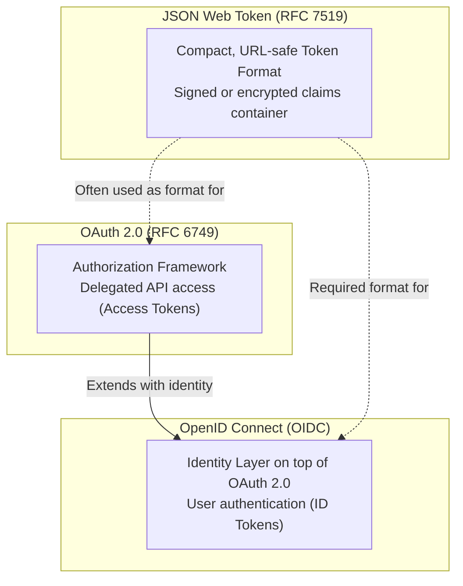
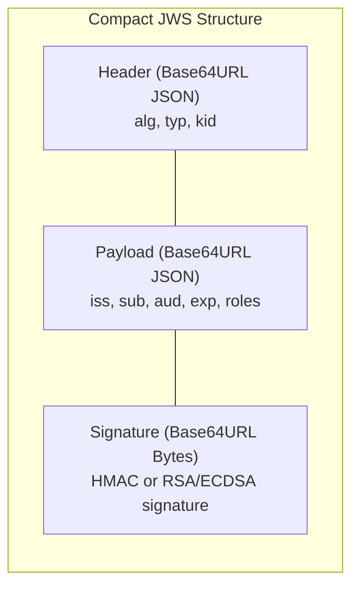
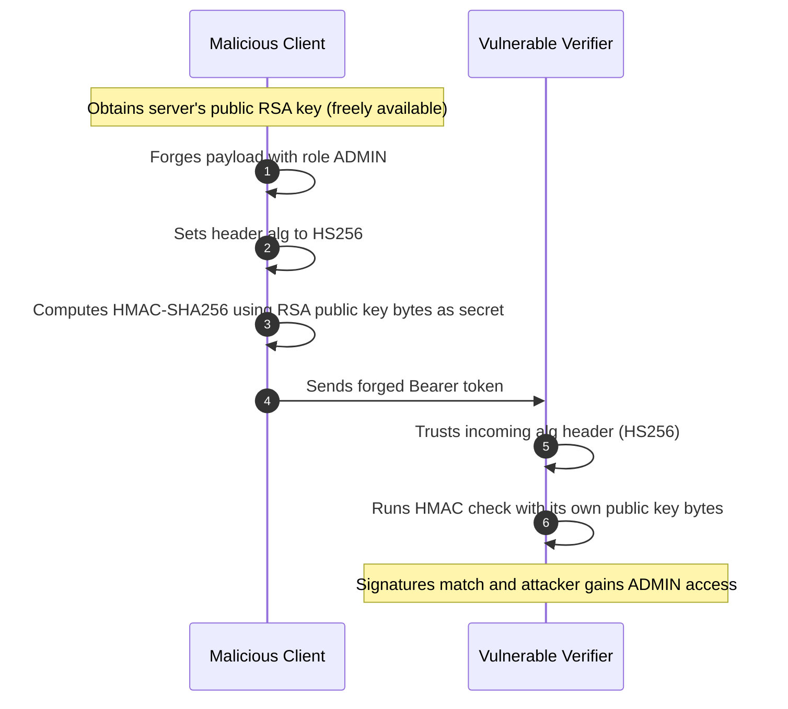
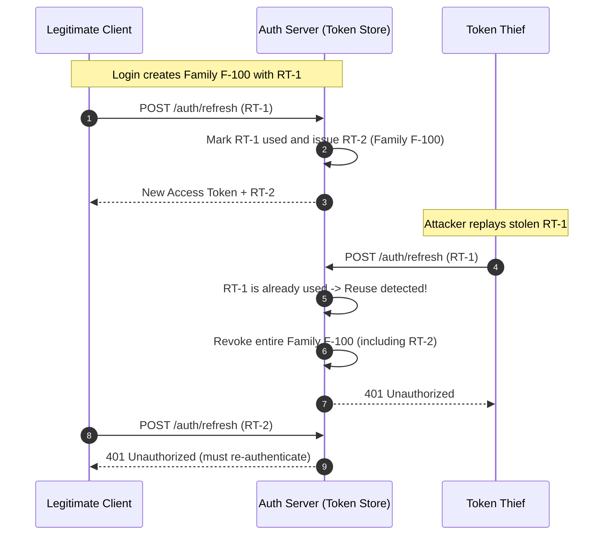

Stateless authentication with JSON Web Tokens looks deceptively easy on the surface: sign a JSON payload on login, send it back to the client, and verify the signature on subsequent requests without hitting a session store.

The problems show up after launch. A token stored in `localStorage` gets stolen through a third-party script, a terminated employee's 30-day token keeps working because nothing checks revocation, or a poorly configured verifier trusts the algorithm declared in an attacker's token header. Building stateless authentication safely means knowing exactly what JWTs do and do not guarantee, wiring Spring Security's filter chain cleanly, and designing a refresh strategy that limits the blast radius when a token leaks.

## OAuth 2.0 vs OpenID Connect vs JWT

These three terms get used interchangeably in meetings and tutorials, even though they operate at different layers:



| Standard | Primary Responsibility | Token Produced | Everyday Analogy |
|---|---|---|---|
| **OAuth 2.0** | **Authorization** (delegated access to APIs) | Access Token (can be a JWT or an opaque string) | Hotel keycard: opens Room 402, does not identify the guest. |
| **OpenID Connect (OIDC)** | **Authentication** (verifying who the user is) | ID Token (always a JWT) | Passport: proves who you are and who issued the identity. |
| **JWT** | **Data format** for representing claims | `header.payload.signature` | The physical card holding the printed fields and tamper-evident seal. |

> [!IMPORTANT]
> Never send an OIDC **ID Token** to a backend REST API to authorize requests. An ID Token is meant solely for the client application that initiated login so it can inspect the user's identity. Backend APIs should only accept **Access Tokens** whose audience (`aud`) and scopes match that API.

## Structure of a JSON Web Token

A signed JWT (technically a JWS, defined in RFC 7515 and RFC 7519) consists of three Base64URL-encoded segments separated by dots:

```text
header.payload.signature
```



### Header

The header describes how the token was signed and which key was used:

```json
{
  "alg": "RS256",
  "typ": "JWT",
  "kid": "auth-key-2026-q1"
}
```

### Payload (Claims)

The payload is a JSON object containing registered claims defined by RFC 7519 along with any application-specific claims:

- **`iss` (Issuer)**: Identifier of the service or IdP that created the token.
- **`sub` (Subject)**: Immutable identifier of the user or service account (usually a UUID, not a mutable email address).
- **`aud` (Audience)**: Intended recipient API or list of APIs.
- **`exp` (Expiration Time)** and **`nbf` (Not Before)**: Unix timestamps bounding when the token is valid.
- **`iat` (Issued At)**: Timestamp when the token was minted.
- **`jti` (JWT ID)**: Unique identifier for this specific token, useful for replay prevention or revocation lists.
- **Custom claims**: Application data such as `roles` or `tenant_id`. Keep payloads small because the token rides in HTTP headers on every single request.

> [!WARNING]
> **Signed does not mean encrypted.** Base64URL is an encoding scheme, not encryption. Anyone who captures a JWT can decode the header and payload in one second with `base64 -d`. Never put passwords, PII that should remain confidential, payment card numbers, or internal secrets in a signed JWT. (If you actually need payload confidentiality, use JWE — JSON Web Encryption — rather than a plain JWS.)

### Signature

The signature guarantees integrity and authenticity, not secrecy. To compute it, the issuer signs the exact ASCII string `base64UrlEncode(header) + "." + base64UrlEncode(payload)` with a secret key (for symmetric `HS256`) or a private key (for asymmetric `RS256` / `ES256`):

```text
RSASHA256(
  base64UrlEncode(header) + "." + base64UrlEncode(payload),
  privateKey
)
```

If anyone alters a single byte in the header or payload (for instance, changing `"roles": ["ROLE_USER"]` to `"roles": ["ROLE_ADMIN"]`), the recomputed signature will not match and the server rejects the token.

## Defending Against `alg: none` and Algorithm Confusion Attacks

Two historical JWT vulnerabilities still show up whenever teams write hand-rolled parsers or misconfigure verification libraries.

### The `alg: none` Bypass

RFC 7519 defines an `"alg": "none"` option for unsecured JWTs with an empty signature segment (`header.payload.`). Early JWT libraries accepted `"alg": "none"` by default during verification. An attacker could take a legitimate token, modify the payload, change the header to `"alg": "none"`, strip the signature, and walk right past authentication.

Always use a maintained library configured to require a cryptographic signature and explicitly reject unsecured tokens.

### The RS256-to-HS256 Algorithm Confusion Attack

A subtler flaw (CVE-2015-9235) occurs when a verification API takes a single `key` byte array and lets the incoming token's `alg` header choose the verification algorithm.

Suppose your backend verifies tokens signed with asymmetric `RS256` using a public RSA key. That public key is not a secret; it is often published openly at a JWKS URL. An attacker downloads the RSA public key, creates a forged payload with `"roles": ["ROLE_ADMIN"]`, sets the header to `"alg": "HS256"`, and signs the token with HMAC-SHA256 using the **public key bytes as the symmetric secret**. If the server blindly follows `"alg": "HS256"` and feeds its public key bytes into an HMAC verifier, the signature check passes.



The defense is straightforward: **never let the token header pick the verification algorithm or key type**. Pin the allowed algorithm server-side on your verifier. With Spring Security's `NimbusJwtDecoder`, specifying the `RSAPublicKey` and `SignatureAlgorithm.RS256` enforces this automatically:

```java
package com.example.ecommerce.security.jwt;

import org.springframework.context.annotation.Bean;
import org.springframework.context.annotation.Configuration;
import org.springframework.security.oauth2.core.DelegatingOAuth2TokenValidator;
import org.springframework.security.oauth2.core.OAuth2TokenValidator;
import org.springframework.security.oauth2.jose.jws.SignatureAlgorithm;
import org.springframework.security.oauth2.jwt.Jwt;
import org.springframework.security.oauth2.jwt.JwtClaimValidator;
import org.springframework.security.oauth2.jwt.JwtDecoder;
import org.springframework.security.oauth2.jwt.JwtValidators;
import org.springframework.security.oauth2.jwt.NimbusJwtDecoder;

import java.security.interfaces.RSAPublicKey;
import java.util.List;

@Configuration
public class JwtDecoderConfig {

    @Bean
    public JwtDecoder jwtDecoder(RSAPublicKey publicKey) {
        // Pins verification strictly to RS256; rejects HS256 and alg=none tokens
        NimbusJwtDecoder decoder = NimbusJwtDecoder.withPublicKey(publicKey)
                .signatureAlgorithm(SignatureAlgorithm.RS256)
                .build();

        OAuth2TokenValidator<Jwt> defaultWithIssuer =
                JwtValidators.createDefaultWithIssuer("https://auth.example.com");

        OAuth2TokenValidator<Jwt> audienceValidator = new JwtClaimValidator<List<String>>(
                "aud",
                aud -> aud != null && aud.contains("https://api.example.com/orders")
        );

        decoder.setJwtValidator(new DelegatingOAuth2TokenValidator<>(defaultWithIssuer, audienceValidator));
        return decoder;
    }
}
```

## Implementing a Custom JWT Authentication Filter

When your service integrates with an OAuth2/OIDC provider like Keycloak or Auth0, Spring Security's built-in `oauth2ResourceServer().jwt()` handles almost everything for you. When your application mints and validates its own JWTs (or reads tokens from a custom cookie or header), you will typically implement a custom filter extending `OncePerRequestFilter`.

Extending `OncePerRequestFilter` guarantees that token extraction and validation run at most once per HTTP request, even if the Servlet container performs internal forwards or error dispatches.

### Writing the `OncePerRequestFilter`

```java
package com.example.ecommerce.security.jwt;

import jakarta.servlet.FilterChain;
import jakarta.servlet.ServletException;
import jakarta.servlet.http.HttpServletRequest;
import jakarta.servlet.http.HttpServletResponse;
import org.springframework.http.HttpHeaders;
import org.springframework.security.authentication.UsernamePasswordAuthenticationToken;
import org.springframework.security.core.authority.SimpleGrantedAuthority;
import org.springframework.security.core.context.SecurityContext;
import org.springframework.security.core.context.SecurityContextHolder;
import org.springframework.security.oauth2.jwt.Jwt;
import org.springframework.security.oauth2.jwt.JwtDecoder;
import org.springframework.security.oauth2.jwt.JwtException;
import org.springframework.security.web.authentication.WebAuthenticationDetailsSource;
import org.springframework.util.StringUtils;
import org.springframework.web.filter.OncePerRequestFilter;

import java.io.IOException;
import java.util.Collections;
import java.util.List;

public class JwtAuthenticationFilter extends OncePerRequestFilter {

    private final JwtDecoder jwtDecoder;

    public JwtAuthenticationFilter(JwtDecoder jwtDecoder) {
        this.jwtDecoder = jwtDecoder;
    }

    @Override
    protected void doFilterInternal(
            HttpServletRequest request,
            HttpServletResponse response,
            FilterChain filterChain
    ) throws ServletException, IOException {

        String authHeader = request.getHeader(HttpHeaders.AUTHORIZATION);
        if (!StringUtils.hasText(authHeader) || !authHeader.startsWith("Bearer ")) {
            filterChain.doFilter(request, response);
            return;
        }

        // Skip if an earlier filter already authenticated the request
        if (SecurityContextHolder.getContext().getAuthentication() != null) {
            filterChain.doFilter(request, response);
            return;
        }

        String token = authHeader.substring(7).trim();

        try {
            // Verifies RS256 signature, exp, nbf, iss, and aud in one pass
            Jwt jwt = jwtDecoder.decode(token);

            List<String> roles = jwt.getClaimAsStringList("roles");
            List<SimpleGrantedAuthority> authorities = (roles == null ? Collections.<String>emptyList() : roles)
                    .stream()
                    .map(SimpleGrantedAuthority::new)
                    .toList();

            UsernamePasswordAuthenticationToken authentication =
                    new UsernamePasswordAuthenticationToken(jwt.getSubject(), null, authorities);
            authentication.setDetails(new WebAuthenticationDetailsSource().buildDetails(request));

            // Create a fresh SecurityContext rather than mutating an existing one
            SecurityContext context = SecurityContextHolder.createEmptyContext();
            context.setAuthentication(authentication);
            SecurityContextHolder.setContext(context);
        } catch (JwtException ex) {
            // Clear context and let downstream AuthorizationFilter / AuthenticationEntryPoint return 401
            SecurityContextHolder.clearContext();
        }

        filterChain.doFilter(request, response);
    }
}
```

### Registering the Filter Without Double-Execution

Notice that `JwtAuthenticationFilter` above is intentionally **not** annotated with `@Component`. In Spring Boot, any `Filter` bean registered in the application context is automatically added to the Servlet container's global filter chain *in addition* to wherever you place it in `SecurityFilterChain`. That causes the filter to execute twice per request (and run even on `permitAll()` or ignored paths).

Instantiating the filter directly inside your security configuration avoids that bug cleanly (or, if you prefer it as a Spring bean, declare a `FilterRegistrationBean` with `registration.setEnabled(false)`):

```java
package com.example.ecommerce.security;

import com.example.ecommerce.security.jwt.JwtAuthenticationFilter;
import org.springframework.context.annotation.Bean;
import org.springframework.context.annotation.Configuration;
import org.springframework.security.config.annotation.web.builders.HttpSecurity;
import org.springframework.security.config.annotation.web.configuration.EnableWebSecurity;
import org.springframework.security.config.http.SessionCreationPolicy;
import org.springframework.security.oauth2.jwt.JwtDecoder;
import org.springframework.security.web.SecurityFilterChain;
import org.springframework.security.web.authentication.UsernamePasswordAuthenticationFilter;

@Configuration
@EnableWebSecurity
public class SecurityConfig {

    @Bean
    public SecurityFilterChain securityFilterChain(HttpSecurity http, JwtDecoder jwtDecoder) throws Exception {
        JwtAuthenticationFilter jwtFilter = new JwtAuthenticationFilter(jwtDecoder);

        return http
            .csrf(csrf -> csrf.disable())
            .sessionManagement(sm -> sm.sessionCreationPolicy(SessionCreationPolicy.STATELESS))
            .authorizeHttpRequests(auth -> auth
                .requestMatchers("/api/v1/auth/**", "/actuator/health").permitAll()
                .anyRequest().authenticated()
            )
            .addFilterBefore(jwtFilter, UsernamePasswordAuthenticationFilter.class)
            .build();
    }
}
```

## Token Storage Trade-Offs: `localStorage` vs `HttpOnly` Cookies

Where a browser frontend stores tokens determines which attack class it is exposed to:

| Storage Option | XSS Exposure | CSRF Exposure | Practical Assessment |
|---|---|---|---|
| **`localStorage` / `sessionStorage`** | **High**: Any JavaScript running on the page (including a compromised analytics script or XSS payload) can read and exfiltrate the token. | **None**: Browsers never send `localStorage` values automatically. | Simple to wire up, but risky for sensitive applications because a single XSS bug leaks long-lived tokens. |
| **`HttpOnly; Secure; SameSite=Strict` (or `Lax`) Cookie** | **Mitigated for token theft**: JavaScript cannot read `HttpOnly` cookies via `document.cookie` (though XSS can still make authenticated calls while the script runs). | **Requires defense**: Browsers attach cookies automatically, so you must pair cookies with CSRF tokens and `SameSite`. | Solid default for browser apps when CSRF protection is properly enabled. |
| **In-Memory Access Token + `HttpOnly` Refresh Cookie (or BFF)** | **Low**: Short-lived access token stays only in JS memory and disappears on tab close; refresh token stays in an `HttpOnly` cookie scoped to `/auth/refresh`. | **Narrow surface**: Protect `/auth/refresh` with `SameSite=Strict` (or `Lax`) and origin/CSRF checks. | Strong balance for modern SPAs; for high-security apps, a Backend-for-Frontend (BFF) keeps all tokens off the browser entirely. |

## Refresh Token Rotation and Reuse Detection

Because signed JWTs are validated locally without a database lookup, you cannot easily cancel a single access token before its `exp` time passes. Keeping access tokens short-lived (5 to 15 minutes) limits the window if one leaks, while a longer-lived **Refresh Token** (days or weeks, stored server-side) lets the user stay signed in without re-entering credentials.

A static long-lived refresh token creates a different problem: if an attacker steals it, they can quietly mint fresh access tokens for weeks. **Refresh Token Rotation with Reuse Detection** (described in OAuth 2.0 Security Best Current Practice / RFC 9700) turns theft into a detectable event:

1. Every time a refresh token is exchanged for a new access token, the server marks the old refresh token as **used** and issues a brand-new refresh token belonging to the same **token family** (`familyId`).
2. If an attacker and the legitimate user both hold the same refresh token, one of them will present it second.
3. The moment the server sees a refresh request carrying a token already marked `used`, it treats the entire session as compromised, **revokes every token in that `familyId`**, and forces a fresh login.



### Implementing Token Family Tracking in Java

Never store raw refresh tokens in your database. Generate a cryptographically random opaque string (at least 256 bits of entropy), return the raw value to the client once, and persist only its SHA-256 hash. That way a read-only SQL injection or leaked database backup cannot be used to mint sessions.

```java
package com.example.ecommerce.security.jwt;

import org.springframework.stereotype.Service;
import org.springframework.transaction.annotation.Transactional;

import java.nio.charset.StandardCharsets;
import java.security.MessageDigest;
import java.security.NoSuchAlgorithmException;
import java.security.SecureRandom;
import java.time.Instant;
import java.time.temporal.ChronoUnit;
import java.util.Base64;
import java.util.HexFormat;
import java.util.UUID;

@Service
public class RefreshTokenService {

    private static final SecureRandom SECURE_RANDOM = new SecureRandom();

    private final RefreshTokenRepository repository;
    private final AccessTokenIssuer accessTokenIssuer;

    public RefreshTokenService(RefreshTokenRepository repository, AccessTokenIssuer accessTokenIssuer) {
        this.repository = repository;
        this.accessTokenIssuer = accessTokenIssuer;
    }

    @Transactional
    public TokenPair rotate(String rawRefreshToken) {
        String tokenHash = sha256Hex(rawRefreshToken);
        RefreshTokenEntity stored = repository.findByTokenHashForUpdate(tokenHash)
                .orElseThrow(() -> new InvalidRefreshTokenException("Unknown refresh token"));

        if (stored.isRevoked() || stored.getExpiresAt().isBefore(Instant.now())) {
            throw new InvalidRefreshTokenException("Refresh token expired or revoked");
        }

        if (stored.isUsed()) {
            // Replay of an already-rotated token: revoke the entire family
            repository.revokeAllByFamilyId(stored.getFamilyId());
            throw new RefreshTokenReuseException("Refresh token reuse detected; session family revoked");
        }

        // Consume current token and mint its successor in the same family
        stored.markUsed(Instant.now());
        repository.save(stored);

        String nextRawToken = generateOpaqueToken();
        RefreshTokenEntity replacement = RefreshTokenEntity.create(
                UUID.randomUUID(),
                sha256Hex(nextRawToken),
                stored.getUserId(),
                stored.getFamilyId(),
                Instant.now().plus(14, ChronoUnit.DAYS)
        );
        repository.save(replacement);

        String newAccessToken = accessTokenIssuer.issueForUser(stored.getUserId());
        return new TokenPair(newAccessToken, nextRawToken);
    }

    private String generateOpaqueToken() {
        byte[] bytes = new byte[32];
        SECURE_RANDOM.nextBytes(bytes);
        return Base64.getUrlEncoder().withoutPadding().encodeToString(bytes);
    }

    private String sha256Hex(String input) {
        try {
            MessageDigest digest = MessageDigest.getInstance("SHA-256");
            return HexFormat.of().formatHex(digest.digest(input.getBytes(StandardCharsets.UTF_8)));
        } catch (NoSuchAlgorithmException e) {
            throw new IllegalStateException("SHA-256 unavailable", e);
        }
    }
}
```

One practical edge case to plan for in production: if a user has two browser tabs open and both trigger `/auth/refresh` at the exact same millisecond, or if a mobile network drops the response after the server rotates the token, strict zero-grace rotation will trigger a false-positive reuse revocation. On the frontend, serialize refresh requests across tabs (using the Web Locks API or `BroadcastChannel`), and on the backend consider either a short concurrency grace window (a few seconds returning the same successor) or clean client retry handling, depending on your threat model.

## Common Production Pitfalls

### Long-Lived Access Tokens

Setting access token `exp` to 7 or 30 days to avoid building refresh flow turns offboarding and password resets into a security hole. If an employee leaves or a laptop is stolen, every downstream service keeps accepting that token until it expires because verification is purely local. Keep access tokens short (5–15 minutes) and revoke refresh tokens immediately on logout, password change, or account disablement.

### Hand-Rolled Token Parsing

Splitting JWTs manually with `String.split("\\.")`, decoding payloads with custom Base64 wrappers, or verifying signatures before checking `exp`/`iss`/`aud` introduces both bugs and unnecessary allocations under load. Delegate parsing and cryptographic verification to vetted libraries such as Nimbus JOSE+JWT (used internally by Spring Security's `NimbusJwtDecoder`).

## Interview Questions

### How can you revoke a stateless JWT immediately before its `exp` timestamp?

A purely stateless verifier cannot know a token was revoked without consulting shared state, so production systems rely on one of three trade-offs:
1. **Short-lived access tokens + revocable refresh tokens**: Accept a 5–10 minute window for access tokens and revoke the stateful refresh token immediately in PostgreSQL or Redis.
2. **User-level revocation timestamp**: Store a `tokens_valid_after` timestamp per user (cached in Redis). On logout-all, password reset, or termination, update that timestamp and reject any JWT whose `iat` is earlier.
3. **Redis `jti` deny-list**: Write each revoked token's `jti` claim into Redis with a TTL equal to its remaining lifetime so memory stays bounded.

### Why is validating the `aud` (Audience) claim important?

In organizations where one identity provider issues tokens for multiple APIs (for example, a public catalog API and an internal billing API), both tokens are signed by the same trusted issuer. If the billing API only checks the signature and `iss`, a caller holding a token minted for the catalog API can replay it against the billing API. Checking `aud` ensures the token was explicitly issued for this specific service.

### What security bug can happen if a verifier uses the JWT `kid` header carelessly?

`kid` (Key ID) tells the verifier which public key from a JWKS set signed the token, allowing smooth key rotation. If a custom verifier passes the untrusted `kid` value directly into a file path (such as loading `/keys/{kid}.pem`) or an unparameterized SQL query, an attacker can inject path traversal (`../../../dev/null`) or SQL injection to force verification against a known or empty key. Always treat `kid` as an opaque lookup key against an in-memory map of preloaded trusted keys.

### Why prefer asymmetric signing (`RS256` or `ES256`) over symmetric `HS256` in microservices?

With `HS256`, every service that verifies a token must hold the same shared secret that signs tokens. Compromising or leaking that secret from any single downstream service lets an attacker forge valid tokens for the entire platform. With `RS256` or `ES256`, only the authorization server holds the private signing key, while microservices only need the public verification key. Even if a downstream service is compromised, the attacker cannot mint new tokens.
